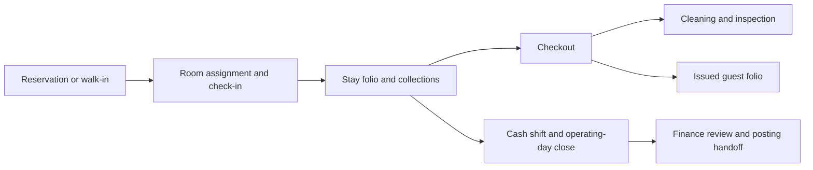

# Haven Hotel product audit

Follow-up implementation and acceptance status are in the [November 24 audit remediation](2026-11-24-haven-audit-remediation.md).

Audited on 23 November 2026 against the local working tree based on `e2514b8`. The tree includes the newer Front Office, predictive analytics, RBAC, subsystem scope and PDF work. The previous defense candidate and hosted database notes describe different release artifacts.

## 1. Executive summary

Haven is a working single-property hotel PMS. Its strongest workflows are booking holds, room eligibility, check-in and checkout, drawer and folio controls, housekeeping turnover, and guest self-service. PostgreSQL owns the important state changes. The main release risk is bringing the application, schema, security dependency baseline and operator assignments forward together. Finance, Workforce, Fleet, Restaurant, Supply Chain and Facilities have separate readiness gates. The Hotel can be rehearsed locally while partner acceptance continues.

The audit inventoried 36 page files, 212 HTTP handler files in 31 route families, 159 migration files and 29 named SQL test scripts. The count covers source files. The [module review and inventory](2026-11-23-haven-module-inventory.md) maps the routes, frontends, roles, data paths, state transitions and actionable gaps. The [RBAC route audit](../qa/rbac-audit-2026-11-23.md) contains the earlier detailed permission matrix. This audit cross-checked the subsequent application scope changes and direct-download routes.

## 2. Top critical and high-priority issues

| ID | Priority and type | Finding and staff impact | Evidence and action |
|---|---|---|---|
| A01 | P0 Security / Release | The initial production lockfile resolved Next.js 16.3.2. The registry flagged critical advisories in its version range. Public and authenticated app entry points use Next.js. | Patch and re-audit the production dependency graph. Verify image serving, authentication, SSR, PDF output and a matching Preview. [Next.js advisory](https://github.com/advisories/GHSA-2xp9-vwfh-vxw4) |
| A02 | P0 Payments / Integration if accepting real money | The current Xendit path labels its links and UI as sandbox. A successful test settlement does not establish readiness for real collections or payouts. | Align the deployed environment and payment copy. Rehearse provider settlement, webhook replay, reconciliation and refunds with the intended live release policy. `lib/xendit.ts`, `app/api/webhooks/xendit/route.ts` |
| A03 | P1 Operations / RBAC | Hotel day activation and close, reconciliation and payout actions continue to depend on existing Accounting access. New Accounting grants are retired. Removing the last qualified operator would interrupt closing and exceptions. | Assign a designated Hotel close operator and backup. Keep Finance posting and payout handoff separate. Rehearse the close, reconciliation, outage and revocation workflows before retiring remaining access. `app/api/staff/operational-date/route.ts`, `app/api/accounting/night-audit/close/route.ts`, `lib/admin.ts`, `20261103150000_hotel_operating_day.sql` |
| A04 | P1 Data consistency / UX | The Manager reservation list treated a missing invoice or failed related read as a zero folio balance. Its table displays zero as *Settled*. A manager can infer a payment outcome the source never established. | Preserve an unknown balance and keep a real zero. Test financial join errors, a missing invoice and a settled invoice through `listForRole` and the list display. `lib/staff-data.ts`, `ReservationsTable` in `components/manager/manager-dashboard-client.tsx` |
| A05 | P1 Performance / Availability | Staff Overview reads seven full histories before role filtering. Front Desk bookings also load all reservations, invoice balances and guest phones. Accounting downloads an entire property ledger for several sections. Large histories or one unrelated source failure can slow or break a shift's primary workspace. | Bound operational queries by status/date, move totals to role-specific aggregates, and paginate history server-side. Rehearse open work, previous bookings and archived financial access independently. `lib/data.ts`, `lib/staff-data.ts`, `lib/accounting.ts` |
| A06 | P1 Integration / Data integrity | Finance's current file is a review batch of totals. Partner posting acceptance, payout acknowledgement and correction reconciliation are pending. HR/Fleet/Restaurant have separate adapters and acceptance criteria. SCM/Facilities still need record mapping and acknowledgement. | Obtain partner contracts and run one reconciled transaction per boundary. Do not decommission a current writer on the strength of a downloaded file. [Readiness plan](../plans/2026-11-23-hotel-integration-readiness.md) |
| A07 | P1 Release / Database | The current working tree includes local schema and app changes beyond the hosted and defense evidence. CI builds the app. It does not execute disposable SQL suites or signed-in browser journeys in the workflow reviewed. | Freeze one exact candidate, compare the hosted migration ledger read-only, replay the migrations, and smoke test the candidate in a like-for-like environment. Add separate automated database and signed-in release checks. `.github/workflows/ci.yml`, [previous candidate](../qa/defense-release-2026-11-22.md) |
| A08 | P1 Security / Validation | The baseline registry also reported production advisories in `sharp`, `source-map-js`, `nodemailer` through the mail/session dependency graph, and `zod`. Risk varies by code path. A major mail/auth or validator jump can break typed requests and OTP delivery. | Apply supported dependency updates with tests. Track remaining advisories by actual call path. Rehearse mail delivery, validation parity and upload decoding. [Sharp advisory](https://github.com/advisories/GHSA-wq5f-xc86-pv6w), [Source-map advisory](https://github.com/advisories/GHSA-68fv-2mgg-jv7q), [Zod advisory](https://github.com/advisories/GHSA-mrhx-c7xc-m3w5) |
| A09 | P1 Workflow / Test coverage | The Room Rack style regression is red on the baseline. The assertion targets a source expression in a changed board implementation. Its failure establishes test drift or a theming regression, pending comparison against the rendered board contract. | Check a room card with a real governed color in both themes and keep a behavioral assertion for that contract. `components/front-desk/fused-room-rack-panel-style.test.ts:51` |
| A10 | P1 Frontend / Availability | The signed-out route audit found that a malformed location provider response can crash the entire homepage during rendering. `getPublishedLocation` accepted a truthy non-object value and the guide assumed `routes`, `places` and `categories` existed. | Validate the public location response where it enters the app. Preserve the guest find-room path and the guide's existing unavailable state. `lib/location-content-server.ts`, `components/landing/location-sections.tsx` |

Additional cross-cutting findings are ranked below. A package advisory identifies an affected version range. The audit did not test exploitation or conclude that a hosted instance was compromised.

## 3. Module-by-module audit

See the [module inventory and individual reviews](2026-11-23-haven-module-inventory.md#module-audits) for the master table and complete breakdown. The audit separates property operations, guest documents, administrative governance, and partner ownership. A legacy endpoint returning 410 represents intentional retirement of a writer.

## 4. UI/UX audit

The guest-facing design uses the existing Haven logo, warm ivory, navy ink, brass accents, Playfair Display and Inter. Staff uses the shared theme, table, modal, select, badge and action styles. Maintain those systems. The biggest UX work is selecting the right record and communicating its state during a shift. An explicit next action and a truthful unavailable state take priority over decoration. [Design system](../../DESIGN.md)

| Area | Priority | What to preserve | Exact improvement |
|---|---|---|---|
| Front Desk table | P1 UX / Data | Guest, assigned room, dates, status, balance and actionable exceptions already appear in the booking queue. | Make saved booking queues query the server. Open the selected stay with the queue and filters intact. Show unknown and unavailable reads distinctly from zero balance or empty results. |
| Forms and dialogs | P2 Accessibility / Validation | Shared dialogs, field errors, required controls and separate confirmations protect many sensitive actions. | Keep headings focused between steps. Test mobile keyboards and focus return for walk-in, payment and guest-profile actions. Provide phase-specific retry after network uncertainty and restore only the same draft. |
| Reports and forecasts | P2 UX / Content | Date filter, aggregate summary, CSV and saved PDF serve different jobs. Forecast evidence shows coverage and baseline. | Keep period, timezone, coverage and actual/forecast distinction above charts and in exports. Prefer one navigation entry with explicit Operational and Analytical choices. |
| Control consistency | P2 Accessibility / Theming | Shared `HavenSelect`, download controls, `StatusBadge`, tables and `Modal`. | Replace isolated icon-only controls or placeholder-only labels through shared components. Keyboard-test opened lists and modals. Sample light/dark contrast with non-empty data before claiming accessibility conformance. |
| Copy and surface scope | P3 Polish | The newest Hotel Supplies and Operational Handover labels match their responsibilities. | Apply the terms below in nav, headings, form actions, PDF titles and response copy. Review the narrow currency/date layout separately from larger desktop charts. |
| Initial navigation | P2 Performance / Accessibility | The branded loader gives feedback while work is pending. | `components/providers.tsx` deliberately hides and marks the entire non-home page `aria-hidden` until a 1,220 ms timer fires, even if its HTML is ready. Keep ready controls available. Use a wait tied to actual loading and preserve reduced-motion behavior. The first browser pass captured the loader instead of several staff dashboards. |

**Terminology.** Use *Bookings* for the shared queue, *reservation* for one record, and *walk-in* for its source. Use *check in* and *check out* as actions and *check-in* and *checkout* for the workflow objects. Use *folio* for stay charges, *receipt* for one settled payment, and *checkout folio* for the issued stay statement. Distinguish booking total, deposit, settled collections, and balance due. Use *Cash Shift Close* for the drawer, *Operating Day Close* for the hotel business day, and *Finance Period Close* for Finance. Reserve *out of service* for an operational restriction and explain how it relates to room sale eligibility.

**Front Desk action count.** The source-reviewed new reservation entry uses the New Reservation menu plus a booking-mode choice, then three stage actions in the dialog: Continue, Review reservation and Create reservation. That is five advances from the already-open workspace, excluding data entry and choosing a saved guest or available room. The existing Book Again shortcut can reuse a guest record. The booking queue still makes a desk operator open the stay to verify an unknown balance. Remove duplicate navigation and repeated data entry before removing an explicit pricing or identity check. End-to-end shift timing with an operator, a populated workload and a simulated network interruption is still needed. `components/manager/walk-in-dialog.tsx`, `components/manager/manager-dashboard-client.tsx`.

**UI health score.** The sampled review scores 13/20: accessibility 2/4, performance 2/4, theming 3/4, responsiveness 3/4, implementation integrity 3/4. This is a working product score, with a blanket loading delay, a room badge contract drift and incomplete assistive-technology/physical device coverage. The design detector returned ten style signals such as bounce easing and side accents. A style signal is a review cue and receives priority only with user impact.

## 5. Backend audit

The resolved stack uses the Next.js App Router, React 18, TypeScript, CSS modules and application theme styles, NextAuth Credentials, Supabase/PostgREST and PostgreSQL, Zod forms/requests, Recharts, cron entry points and a Vercel deployment configuration. Vitest, Testing Library, Playwright and separate PostgreSQL scripts cover different layers. The patched build reports React 18 deprecation for a future Next major. Schedule the React upgrade with a framework compatibility pass instead of pairing it with the critical patch.

- Retain typed Next.js route handlers and transactional SQL commands. The generic resources route is read-only and coordination now uses named commands. Supabase clients and partner keys stay server-side. `lib/supabase.ts`, `app/api/resources/[resource]/route.ts`, `lib/financial-route.ts`, `lib/hotel-operations-route.ts`.
- Consolidate inline session checks behind existing guard functions as endpoints change. The OTP-pending token is disabled, has an empty identifier and carries guest as a fallback role. A static scan found legacy paths with direct `getServerSession`, which requires auditing their delegated checks before any claim of a bypass. `lib/auth.ts`, `lib/authorization.ts`, `lib/customer-auth.ts`.
- Apply result-aware read models. Some role-specific list branches consume empty related data or a bounded default PostgREST page without reporting partial data. Return stable IDs, cursors, explicit source errors, and totals with a stated scope. Separate queue reads from audit and document history. `lib/staff-data.ts`, `lib/read-all-rows.ts`.
- Use different budgets for dashboard aggregates, audit history, analytical windows, documents and uploads. Benchmark p95 and query plans against a disposable seeded property, including 90 days and a large stay history. Fixture first paint and a full test pass do not establish a throughput target. `lib/command-center.ts`, `lib/analytics/analytical-report.ts`, `lib/hotel-document-pdf.ts`.

| Configuration group | Variables reviewed by name | Release check |
|---|---|---|
| Application, session and database | `NEXTAUTH_URL`, `NEXTAUTH_SECRET`, `NEXT_PUBLIC_SUPABASE_URL`, `SUPABASE_SERVICE_ROLE_KEY` | Verify the intended deployment and backend project are paired, and keep the service-role credential server-only. |
| OTP, mail and scheduler | `OTP_HASH_SECRET`, `SMTP_*`, `RESEND_*`, `CRON_SECRET`, `APP_BASE_URL` | Exercise each required delivery path and confirm a disabled or unconfigured provider produces the expected operational state. |
| Payments and optional partners | `XENDIT_SECRET_KEY`, `XENDIT_WEBHOOK_TOKEN`, `HAVEN_FLEET_*`, `HAVEN_WORKFORCE_*`, `HAVEN_RESTAURANT_BREAKFAST_*`, `GEMINI_*` | Check each credential audience, mode and feature flag independently before enabling traffic. `.env.example` lists placeholders. |

## 6. Business logic audit

| Workflow | Current state model | Remaining check |
|---|---|---|
| Reservation | Hold with expiry → confirmed stay → checked in → checked out. Pending or confirmed can close through allowed cancellation/no-show transitions. Amendments, room moves and approved exceptions have dedicated commands. | Rehearse concurrent public and staff allocation with the actual candidate, lost acknowledgement recovery, and the balance join found in A04. |
| Room | Availability is date-based. Room blocks and readiness are influenced by technical safety, guest assignment, housekeeping and inspection. | Protect the shared readiness vocabulary across Room Rack, Room Management, arrival gate and cleaning/inspection queues. |
| Money | Payment pending → settled or failed. Refund has a separate pending, attempted and processed lifecycle. An issued folio or closed day freezes the relevant record. | Decide who issues a checkout statement after the normal checkout and approved exception. Verify staff and guest copies refer to the same issued record. |
| Operating day | Inactive → activated date → assessed → closed → next date. Reconciliation, arrivals, departures and locks govern eligibility. | Resolve A03 without handing out unrelated Accounting capabilities or bypassing blockers. |
| Guest service | Guest request → routing/approval where required → assigned work → completion or closure. Hotel retains immediate safety actions. | Test request-to-job deduplication, escalation ownership, and withdrawal after work is already assigned. |

## 7. Database audit

Migrations are the schema authority. `supabase/schema.sql` remains a historical snapshot. The reviewed SQL uses row locking, unique replay keys, append-only or immutable financial/audit records and linked room/work-order state. The isolated acceptance suites exercise booking overlap, room assignment, reclean, shortage movement and receipt replay, breakfast redemption, partner status and operating close integrity. Validate indexes against actual query predicates before adding them. Prioritize history access on reservations, payments, report activity and departmental work. Reconcile ownership and balances when backfilling older reservations with missing links. Never infer missing historical money or capacity from current configuration. [SQL acceptance helper](../../scripts/hotel-db-test-helpers.mjs)

## 8. Security audit

- **Roles.** Eight account roles remain. Owner governs, Administrator manages system/accounts, Manager coordinates and reviews, Front Desk handles the stay and drawer, Housekeeping and Maintenance execute department work, existing Accounting reconciles and settles authorized money actions, Guest uses their own records. Protected role changes and versioned session revocation are in the SQL acceptance coverage. Account role decommissioning remains A03.
- **Data.** Private payment evidence, government ID, recovery selfie and Fleet pickup images need purpose-specific access, short-lived reads and agreed retention. Generic financial and property-wide history stays outside Front Desk. Survey wildcard policy reads and read models for unintended new field exposure. `app/api/admin/data/route.ts`, `app/api/owner/data/route.ts`, `lib/staff-data.ts`.
- **Requests.** The proxy checks browser origins and MIME where applicable. Webhooks and partner handlers use their own trust boundary. Keep validation schemas and SQL checks on commands, set request size limits before heavy parsing where supported, and test filename, MIME, image signature and safe normalization for private uploads. `proxy.ts`, `lib/input-validation.ts`, `app/api/integrations/`, `app/api/webhooks/`.
- **Assurance.** Record approved security package versions, verify delivered CSP/security headers for the chosen runtime, and add complete successful-login and operator export evidence to the audit programme. A read-only registry and source review cannot establish hosted attack exposure, secrets hygiene or incident status.

## 9. Missing features

| Category | Scope |
|---|---|
| Required for release | Supported framework/dependency baseline, a matching release/schema, named day-close coverage, signed-in rehearsal, and provider settlement/refund verification before live payment acceptance. |
| Recommended | Server-side operational queue search and pagination, known financial data states, closed-day and statement handoff, auditable provider exceptions, and measurable role-based regression coverage. |
| Optional | Saved queue filters for teams with repetitive work, printable shift handover when needed, and extra forecast horizons only after prospective evidence accumulates. |
| Out of scope | General ledger/AP/AR, payroll and official HR schedules, enterprise purchasing/vendor master, equipment register and preventive scheduling, enterprise fleet dispatch and fuel tracking, and Restaurant POS/menu/order management. Hotel operational receiving, guest transport requests, breakfast entitlements and room safety controls remain Hotel work. |

## 10. Redesign recommendations

Preserve the current guest booking visual direction. Apply minor polish to labels, loading and touch targets after evidence checks. Give the Front Office queues a moderate redesign around one selected stay and retained filters. Give the mixed operations/finance day-close workflow a role and responsibility redesign after A03 is agreed. Split the oversized Manager workspace by route, domain or lazy sub-workspace incrementally. Carry the shared shell and controls forward so daily staff do not have to relearn navigation.

## 11. Technical debt

The shared Manager client still coordinates many unrelated modules, and several backend routes repeat inline session and error mapping. The change strategy is vertical. Move a functional area with its policy and tests, restrict its reads, then retire the displaced code. Document which APIs are canonical and which return retired compatibility responses. Avoid adding another status table or new role until the permissions or workflow genuinely differ. Use typed SQL/RPC shapes and state-specific domain contracts at high-risk boundaries first.

## 12. Priority roadmap

| Phase | Work in order | Acceptance gate |
|---|---|---|
| 0 Release and dependency | A01/A08, lockfile and build identity, current hosted ledger comparison, matching production Preview. | Same commit, migration list and identity policy used in the signed-in smoke test. |
| 1 Hotel shift continuity | A03/A04/A09, cashier close and reconciliation, official checkout folio issuance, Front Desk board and booking confidence. | Manager sees unknown balances honestly. Front Desk consumes its own drawer and stay only. Designated operator can finish a real test day with an audit trail. |
| 2 Performance and mobile | A05, targeted queries, queue persistence, keyboard and dialog testing, operational speed budget. | Bounded payloads, correct totals and no hidden primary actions at the supported viewports. |
| 3 Partner pilot | A06, Finance acknowledgement first, then Workforce, Fleet and Restaurant per readiness, then SCM/Facilities cutovers. | Each partner proves ownership, a duplicate/replay test, outage behavior, correction and a reconciled sample. |
| 4 Reporting and polish | Coverage-aware analytics, release monitoring, terminology, shared-state polish and prospective accuracy scoring. | Actuals are distinct from projections. Unsupported conclusions and hidden empty/error states are absent from the audited workflows. |

Risk controls for the next code batches:

- **High.** Day-close authority touches operating dates, cash reconciliation and posted history. Implement an action-specific permission in HTTP and PostgreSQL after owners confirm primary and fallback operators. Use versioned, already-closed and failed-close tests before changing access.
- **High.** Partner activation changes who owns a write. Reconcile opening records and accepted events first. Keep a rollback boundary that prevents two writers or duplicate postings.
- **Medium.** Server-side queue pagination changes what staff see in searches. Preserve complete authorized history search, sorting, existing default queues, contextual selection and stable cursors.
- **Medium.** Dependency majors and provider policy changes touch session/OTP, uploads, payment and form parsing. Use separate changes with working credentials restricted to their test environments and rehearse failure and retry.
- **Low.** Label, formatting and accessibility refinements use shared tokens and controls. Exercise keyboard order, two themes and saved previews before replacing an established component.

## 13. Quick wins

- Preserve a missing Manager balance as unknown and align the existing *Open folio for balance* state. Low implementation risk and high operational value.
- Add one role-specific release checklist for active cashiers and manager day-close coverage. It can use existing records and permissions while ownership is decided.
- Replace the Room Rack literal assertion with a rendered palette assertion after comparing a seeded card. The goal is a useful release gate rather than a string check.

## 14. Implementation changes

| Finding | Implemented locally | Why and affected behavior | Risk |
|---|---|---|---|
| A01 and part of A08 | `package.json` and `package-lock.json` resolve Next.js and its ESLint configuration to 16.4.6, Sharp to 0.35.5, and the existing `source-map-js` dependency to 1.2.4. | Removes the initial framework/image/source-map advisory entries and preserves the existing package majors. Affects all Next routes, static output and native image processing. The post-update scan reports zero critical entries and three high package entries. | Medium. Requires the matching build and signed-in release smoke test. |
| A04 | `lib/staff-data.ts` preserves missing balances as `null`, joins balances and guest phone rows using keyed lookups, and keeps real zero intact. Added `lib/staff-booking-balances.test.ts`. | The Manager booking queue now shows its existing *Open folio for balance* state when evidence is absent, without changing bookings, invoice values or permissions. | Low. Output-only correction for the list read. |
| A10 | `lib/location-content-server.ts` validates the public guide response, with `lib/location-content-server.test.ts` covering a missing shape, invalid rows and a valid empty guide. | The landing and Stay Guide can render when the location service returns an unusable successful response. The location API uses its existing 503 error state. No location data is invented. | Low. The normal SQL shape remains accepted. |
| Local lint reliability | `eslint.config.mjs` ignores the generated `.next-guest-preview/` directory already listed in `.gitignore`. | Root lint initially found 6,193 errors in generated Next.js output and zero source errors. Exclude the generated output without weakening source lint rules. | Low. Scoped to one generated path. |

The remaining npm entries are Zod and Nodemailer plus NextAuth's transitive mail dependency finding. Do not use the suggested NextAuth downgrade as a remediation for the current v4 login/session flow. Qualify a compatible mail/auth dependency path and a separate Zod 4 migration with OTP, reset, receipt email, form and API validation checks. [Nodemailer advisory](https://github.com/advisories/GHSA-2x7j-588g-ccc2), [Zod advisory](https://github.com/advisories/GHSA-mrhx-c7xc-m3w5)

## 15. Test results

The audit uses an isolated production build and synthetic accounts. Test host and provider credentials are separate from hosted environments. All browser screenshots and diagnostics feed the evidence summary below. Browser and database outcomes do not substitute for hosted rollout acceptance.

| Check | Result | Evidence |
|---|---|---|
| Typecheck and production build | PASS | Next.js 16.4.6 compiled and generated pages with the patched lockfile and final app source. The separate TypeScript check passed. React 18 deprecation warning remains. |
| Source lint | PASS | 974 files, 0 errors and 74 warnings after excluding the generated preview directory. |
| Full Vitest suite | FAIL | 2,741 tests passed across 275 files. The only failure is the pre-existing Room Rack `colorKey` style assertion in `components/front-desk/fused-room-rack-panel-style.test.ts:51`. Both new regression files passed all seven tests. |
| Disposable PostgreSQL | PASS | Ten suites covering RBAC, Front Office booking, enterprise boundaries, Hotel operations, receiving, Workforce, breakfast, Fleet, business-rule audit and occupant/guest controls. Each suite used a disposable clone of the local schema. |
| Edge viewport and roles | PASS for sampled paths | Seven staff dashboards plus the guest portal across 390, 768, 1280 and 1440 CSS px, with light/dark staff samples. A broader pass recorded 96 route visits and 61 successfully opened staff module views. Three nav selections in that harness were unverified. The final smoke confirmed the corrected homepage fallback at all four widths, known versus unknown Manager balances, rejected broad ledger/drawer access and owned guest PDF access. |
| Registry security scan | NEEDS REVIEW | Zero critical entries after patching, with three high-rated package entries remaining. No live exploitation checks. |
| Hosted/provider readiness | NEEDS REVIEW | Latest hosted migration history and signed-in Preview, physical camera and touch, load/scan performance, provider mail/payment and partner acceptance still require their own checks. The previous defense evidence is for its frozen commit. |

The file inventory includes worksheet-like list, form, table and route entry points. It does not imply browser interaction with every control or transaction. Local dark theme sampling does not constitute WCAG conformance. Screenshots and automated diagnostics were captured with synthetic records only.
