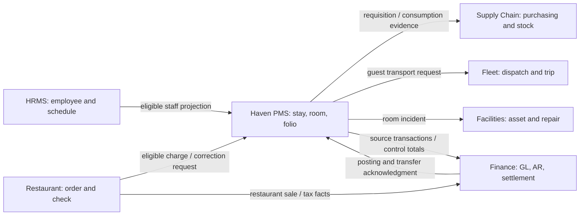

# Hotel and Restaurant Enterprise Management System — module and subsystem audit

Date: 4 November 2026 (Asia/Singapore). Repository baseline: `a3f2438`; working tree was clean at audit start.

**Recommendation:** retain seven business domains, clarify one authoritative owner for each business fact, and keep Haven as a focused single-property PMS. The largest architectural weakness is overlapping authority, especially in inventory, employees, accounting and maintenance. The largest delivery risk is treating source coverage, local acceptance, hosted release and activated property policy as the same milestone.

This is an advisory audit, not approval to remove existing functionality, change property policy, deploy migrations, or build the other teams' systems. Proposed endpoints, events and module moves below are designs, not implemented integrations. The user's complete pasted brief is the requirements checklist for this report.

## Scope, evidence and assumptions

- Haven serves one approximately 48-room boutique property. A modular Next.js/Postgres application is appropriate. Seven business systems do not require seven microservices, separate databases for every module, or a message broker at launch.
- HRMS, Finance, Supply Chain, Fleet, Facilities and Restaurant are independently assigned enterprise domains. Their production implementations were not supplied for inspection. Their assessment below evaluates the proposed module design, not the quality of unseen code.
- `SYSTEM.md` governs current Haven behavior. Reviewed supporting evidence includes `docs/ENTERPRISE_BOUNDARIES.md`, `docs/HMS-SCOPE-COMPARISON-2026-11-03.md`, the live memory handoff, relevant decisions/issues, `docs/HMS-WORKFLOW-IMPLEMENTATION-2026-11-03.md`, `docs/qa/hotel-scope-integration-and-manual-acceptance-2026-11-04.md`, and `docs/integrations/RESTAURANT_CHARGE_TO_ROOM.md`.
- Source spot checks included guest/occupant and night-audit contracts, stock-movement authorization, accounting calculations, authentication, payment webhook handling and current migration filenames. This is not a line-by-line security or accounting certification.
- Existing operating-day, night-audit, room-assignment history, cashier, receipt and stock-integrity workflows must be credited. Occupant controls, guest flags/merge and recent settlement changes have separate local/release statuses. The latest handoff reports a merge after earlier checks; earlier test totals are historical evidence until rerun.
- The last recorded linked ledger had 112 migrations, with eight later files pending. This audit does not query the live ledger or assert that those counts still describe the hosted database. Historical statements in older notes about missing night audit or unreleased cash fixes are superseded where `SYSTEM.md` documents their later release.
- A runnable Playwright configuration and scripts exist, despite older guidance describing no headless runner. Their presence does not establish usable authenticated fixtures or completed browser coverage. No browser or live payment action is claimed in this audit.
- Philippine jurisdiction is inferred from Haven Makati, PHP and GCash. Confirm the operating entity, tax registration, actual hotel services, staffing model and restaurant accounting arrangement before configuring legal or tax behavior. No mandatory tax rate, age, retention period or service-charge percentage is invented here.
- “Required for MVP” means necessary to demonstrate the scoped hotel lifecycle. “Required before production” means a controlled real-hotel operation needs it before relying on that flow. A feature classified as required may already exist: the action is then verification or release, not rebuilding it.
- All ownership assignments below are recommendations. Existing local procurement, transportation and maintenance continue to own their current records until an agreed cutover transfers authority. A proposed future owner does not invalidate current history.

## Commercial and open-source comparison: what actually applies

The product facts in this table were checked against official documentation on 4 November 2026. The application to Haven is this audit's judgment; vendor breadth is not a requirement list.

| Reference | Verified design signal | Appropriate conclusion for Haven |
|---|---|---|
| Oracle OPERA Cloud | End of Day controls business-date advancement and operational/financial closure. [End of Day documentation](https://docs.oracle.com/en/industries/hospitality/opera-cloud/26.2/ocsuh/c_endofday_procedures.htm) | Keep Haven's explicit operating date and immutable close. Do not copy OPERA's automatic no-show or automatic charge behavior over Haven's approved rules. |
| Oracle room management | Inventory deduction, assignment eligibility and housekeeping status need explicit semantics; OPERA's Out of Service can remain assignable. [Room Management controls](https://docs.oracle.com/en/industries/hospitality/opera-cloud/26.2/ocsuh/c_opera_controls_room_management.htm) | Specify Haven's own sellability and release rules. A matching status label does not establish matching behavior. |
| Cloudbeds | Night-audit reporting includes arrivals, departures, in-house guests, room rates and unavailable rooms. [Night-audit reports](https://myfrontdesk.cloudbeds.com/hc/en-us/articles/219104088-Use-Cloudbeds-Reports-for-Night-Audit) | Prioritize a reconciled daily operation over predictive dashboards. |
| Cloudbeds distribution | Channel mapping connects PMS, channel manager and OTA inventory/rates/reservations. [Room mapping](https://myfrontdesk.cloudbeds.com/hc/en-us/articles/210935118-Room-mapping-guidelines) | Buy or integrate a supported distribution adapter when channels are needed. OTA metadata alone is not synchronization. |
| Mews | POS integration distinguishes guest-bill posting from outlet reporting and supports linked reservation references and corrective postings. [POS integration](https://docs.mews.com/connector-api/use-cases/point-of-sale) | Integrate Restaurant sale references with PMS folios; preserve reversals and avoid duplicate revenue. Do not copy Mews' profile-centric billing data model into Haven. |
| Mews accounting | Accounting integration maps operational transactions and accounting categories, and explicitly addresses where debtor tracking resides. [Accounting integration](https://docs.mews.com/connector-api/use-cases/accounting) | Agree one corporate AR owner and versioned mappings. PMS balances and enterprise books answer different questions. |
| Hotelogix | Its official platform separates reservations, front desk, housekeeping, POS and external interfaces. [Product overview](https://www.hotelogix.com/) | The proposed hotel core is recognizable. Multi-property, payroll connectors and revenue optimization do not become MVP requirements. |
| ERPNext | Purchase orders, actual goods receipt, supplier invoices and payment have distinct effects. [Buying workflow](https://docs.frappe.io/erpnext/buying), [purchase receipt](https://docs.frappe.io/erpnext/purchase-receipt) | Put procurement and stock authority in Supply Chain; Finance owns supplier liabilities. A hotel's delivery acknowledgment must not independently duplicate receipt stock. |
| Frappe HR | Employee master and payroll settings are distinct from hotel task assignment. [Employee](https://docs.frappe.io/hr/employee), [payroll settings](https://docs.frappe.io/hr/payroll-settings) | Sync employment eligibility and minimal staff identity; do not infer paid attendance from completed cleaning tasks. |
| Odoo Restaurant POS | POS owns restaurant operation; preparation displays handle kitchen preparation states. [POS documentation](https://www.odoo.com/documentation/19.0/applications/sales/point_of_sale/overview/getting_started.html), [preparation display](https://www.odoo.com/documentation/19.0/applications/sales/point_of_sale/preparation.html) | Restaurant orders, kitchen tickets and payment checks remain outside Hotel PMS. |
| Odoo Fleet and Maintenance | Vehicle service histories and equipment preventive/corrective work are distinct operational capabilities. [Fleet services](https://www.odoo.com/documentation/19.0/applications/hr/fleet/service.html), [maintenance setup](https://www.odoo.com/documentation/19.0/applications/inventory_and_mrp/maintenance/maintenance_setup.html) | Give Fleet vehicle history and Facilities building equipment work; retain hotel room-readiness decisions in PMS. |

ERPNext/Frappe HR and Odoo provide the open-source ERP/HR/POS comparisons. No arbitrary open-source hotel repository was treated as a maturity benchmark without evidence of maintained operational controls.

## Part 1 — Validate every existing module

Necessity is judged for this property's enterprise operating model, not as an instruction that the Hotel team must implement every essential enterprise function. Outsourced payroll or an existing accounting package can satisfy a requirement. Grouping headings in HR are assessed as well as their listed submodules.

### HRMS / HCM

| System | Module | Purpose | Necessary? | Recommendation | Reason |
|---|---|---|---|---|---|
| HRMS | Recruitment & Onboarding | Hire and establish employment | RECOMMENDED | KEEP | Useful workflow group; not a prerequisite to opening the PMS. |
| HRMS | Applicant Management | Maintain candidate applications | SHOULD MERGE WITH ANOTHER MODULE | MERGE | Candidate pipeline belongs inside Recruitment Management. |
| HRMS | Recruitment Management | Requisitions, interviews, offers | OPTIONAL | MODIFY | Small hotel can use a basic approved hiring register. Avoid a full ATS initially. |
| HRMS | New Hire Onboarding | Employment checklist and provisioning trigger | RECOMMENDED | KEEP | Joiner event must request access, not automatically grant finance privileges. |
| HRMS | Core HR | Employment authority | ESSENTIAL | KEEP | One place for employee identity, department and active employment. |
| HRMS | Core Human Capital Management (HCM) | Employee lifecycle and organization | ESSENTIAL | MODIFY | Rename Core HR; HCM is an umbrella, not another employee database. |
| HRMS | Employee Self-Service (ESS) | Employee-facing requests and views | RECOMMENDED | MODIFY | A role-based surface over HR workflows, not a separate authority. |
| HRMS | Employee Records Management | Personnel records and documents | SHOULD MERGE WITH ANOTHER MODULE | MERGE | Merge into Core HR with restricted document access. |
| HRMS | Workforce Management | Planned and actual labor | ESSENTIAL | KEEP | A hotel has shift work even if software is purchased or outsourced. |
| HRMS | Time and Attendance System | Actual working time | ESSENTIAL | KEEP | HR owns approved attendance; payroll basis must be explicit. |
| HRMS | Shift and Schedule Management | Official planned shifts | ESSENTIAL | KEEP | Distinguish scheduled shifts from PMS room/task assignment. |
| HRMS | Timesheet Management | Allocate paid time to work/cost centers | OPTIONAL | MODIFY | Keep only for hourly/project costing; do not duplicate time punches. |
| HRMS | Leave Management | Entitlement, approval and absence | ESSENTIAL | KEEP | Leave affects staffing and payroll; PMS reads availability only. |
| HRMS | Workforce Analytics | Staffing and labor measures | SHOULD MERGE WITH ANOTHER MODULE | MERGE | Use HR reporting with controlled enterprise BI outputs. |
| HRMS | Performance & Development | Development and competency oversight | OPTIONAL | MODIFY | Start with simple reviews and required training records. |
| HRMS | Performance Management | Reviews and goals | OPTIONAL | KEEP | Valuable later; not a hotel transaction dependency. |
| HRMS | Competency Management | Skills and role qualifications | OPTIONAL | MODIFY | Track specific safety/service qualifications before building skill taxonomies. |
| HRMS | Learning Management | Course delivery and assessment | SHOULD MERGE WITH ANOTHER MODULE | MERGE | Combine with Training Management or integrate an LMS. |
| HRMS | Training Management | Training attendance and compliance | RECOMMENDED | MODIFY | Track completed safety, food-handling and service training where applicable. |
| HRMS | Succession Planning | Talent replacement pipelines | OPTIONAL | REMOVE | Remove from initial build; disproportionate for a single boutique hotel. |
| HRMS | Social Recognition | Peer awards and social feed | OPTIONAL | REMOVE | Little direct operational control value; use existing communication tools. |
| HRMS | Payroll & Benefits | Calculate employment obligations | ESSENTIAL | KEEP | Essential business capability, not a requirement to write a payroll engine. |
| HRMS | Payroll Management | Gross-to-net pay and payroll runs | ESSENTIAL | KEEP | HR/payroll owns calculations; Finance posts liabilities and disbursement. |
| HRMS | Compensation Planning | Salary and merit planning | OPTIONAL | MODIFY | Keep approved salary records; advanced modeling can wait. |
| HRMS | Claims and Reimbursement | Expense submission and repayment | RECOMMENDED | MOVE TO ANOTHER SYSTEM | Finance owns expense claim/payable/payment lifecycle; ESS can capture employee requests. |
| HRMS | HMO & Benefits Administration | Employee benefits enrollment | RECOMMENDED | MODIFY | Core HR benefits record/provider integration; no custom insurer platform. |
| HRMS | HR Analytics Dashboard | HR measures and reports | SHOULD MERGE WITH ANOTHER MODULE | MERGE | One HR reporting module incorporates Workforce Analytics. |

### Financial Management — transaction core

| System | Module | Purpose | Necessary? | Recommendation | Reason |
|---|---|---|---|---|---|
| Finance | General Ledger | Authoritative double-entry books | ESSENTIAL | KEEP | Own accounts, journals, periods and trial balance; use established accounting software. |
| Finance | Accounts Payable (AP) | Supplier obligations | ESSENTIAL | KEEP | Match approved procurement/receipt evidence to invoices before payment. |
| Finance | Accounts Receivable (AR) | Approved credit customer debt | RECOMMENDED | KEEP | Required when corporate credit is offered; avoid a second PMS aging ledger. |
| Finance | Disbursement Management | Approved outgoing payments | SHOULD MERGE WITH ANOTHER MODULE | MERGE | AP/treasury payment execution, with maker/checker controls. |
| Finance | Collection Management | Cash application and debtor collection | SHOULD MERGE WITH ANOTHER MODULE | MERGE | AR handles corporate collection; PMS/POS retain on-site operational receipts. |
| Finance | Budget Management | Department budgets and variance | RECOMMENDED | KEEP | Begin with annual cost-center budgets, not enterprise planning software. |
| Finance | Cash Management | Bank, cash, clearing and liquidity | ESSENTIAL | MODIFY | Treasury reconciles settlements; hotel drawers remain operational subledgers. |
| Finance | Financial Reporting & Analytics | Statements and financial performance | ESSENTIAL | KEEP | Finance signs off financial measures; operational dashboards do not replace books. |
| Finance | Tax Management | Tax treatment, filing and liability | ESSENTIAL | MODIFY | Finance owns approved tax rules and filings; PMS/POS snapshot applied rules. |

### Supply Chain & Inventory

| System | Module | Purpose | Necessary? | Recommendation | Reason |
|---|---|---|---|---|---|
| Supply Chain | Smart Warehousing System (SWS) | Stores and stock-location operations | SHOULD MERGE WITH ANOTHER MODULE | MERGE | Basic stores/locations belong in Inventory. Robotics, wave picking and “smart” branding add little here. |
| Supply Chain | Inventory Management System | Item, location, movement and stock authority | ESSENTIAL | KEEP | One authoritative quantity ledger per stock location. |
| Supply Chain | Procurement & Sourcing Management (PSM) | Requisition, approval and buying | ESSENTIAL | MODIFY | Simple requisition-to-order process first; strategic sourcing is optional. |
| Supply Chain | Supplier / Vendor Management | Approved suppliers and purchasing identity | ESSENTIAL | MODIFY | Own supplier master; Finance controls payment details and independently verified changes. |
| Supply Chain | Purchase Order Management | Approved supplier commitments | SHOULD MERGE WITH ANOTHER MODULE | MERGE | A procurement lifecycle stage, not an independent subsystem. |
| Supply Chain | Document Tracking & Logistics Records System (DTRS) | Purchasing/delivery evidence | SHOULD MERGE WITH ANOTHER MODULE | MERGE | Attach delivery notes to receipts and POs in shared storage; do not duplicate a document archive. |

### Fleet & Transportation

These modules are conditional on operating an actual fleet. If all transfers are outsourced, keep provider/trip coordination rather than building Fleet ERP.

| System | Module | Purpose | Necessary? | Recommendation | Reason |
|---|---|---|---|---|---|
| Fleet | Fleet & Vehicle Management (FVM) | Vehicles, availability, service and documents | RECOMMENDED | MODIFY | Essential if vehicles are owned/leased; otherwise use transport-provider records. |
| Fleet | Vehicle Reservation & Dispatch System (VRDS) | Allocate vehicles/drivers to trips | RECOMMENDED | MODIFY | Receive hotel service requests and confirm dispatch; avoid a second guest reservation system. |
| Fleet | Driver and Trip Performance Monitoring | Completed trips, incidents and service quality | RECOMMENDED | MODIFY | Begin with trip timestamps, mileage and incidents, not continuous employee surveillance. |
| Fleet | Fuel Management System | Fuel/charging usage and evidence | OPTIONAL | MERGE | A Fleet operating-cost register is sufficient for a few vehicles. |
| Fleet | Transport Cost Analysis & Optimization (TCAO) | Compare trip and vehicle cost | OPTIONAL | MERGE | Fleet reporting can show cost per trip/km; optimization engine is unjustified initially. |
| Fleet | Route Planning & Optimization | Multi-stop route scheduling | OPTIONAL | MODIFY | Maps/manual itinerary first. Optimize only with actual multi-stop volume. |
| Fleet | Mobile Fleet Command App — Optional | Driver updates from mobile devices | OPTIONAL | REMOVE | Responsive dispatch page or existing provider app first; a separate native app adds support burden. |

### Facilities & Administrative Management

| System | Module | Purpose | Necessary? | Recommendation | Reason |
|---|---|---|---|---|---|
| Facilities | Facilities Reservation System | Reserve shared non-bedroom resources | OPTIONAL | MODIFY | Internal meeting rooms/equipment only. Hotel guestrooms remain PMS; paid banquets need an agreed sales owner. |
| Facilities | Visitor Management System | Contractor/business visitor access | OPTIONAL | MODIFY | Separate visitors from staying guests; use a simple access register if needed. |
| Facilities | Document Management / Archiving System | Store and retrieve controlled records | RECOMMENDED | MOVE TO ANOTHER SYSTEM | Shared document infrastructure with domain-specific access; Facilities consumes it. |
| Facilities | Records Retention & Compliance | Retention, legal holds and disposal | RECOMMENDED | MOVE TO ANOTHER SYSTEM | Cross-enterprise governance; records remain owned by their originating domains. |
| Facilities | Legal Management System | Cases, legal advice and disputes | OUT OF SCOPE | REMOVE | Use counsel and controlled case records; a legal practice system is excessive for this scope. |
| Facilities | Contract Management | Agreements, renewal and obligations | RECOMMENDED | MODIFY | Shared contract register; Procurement owns supplier terms, Facilities service acceptance, Finance payment obligations. |

The Facilities proposal is administration-heavy but omits its most useful operational capability: building/equipment maintenance, work orders and asset service history.

### Hotel Management

| System | Module | Purpose | Necessary? | Recommendation | Reason |
|---|---|---|---|---|---|
| Hotel PMS | Guest & Customer Management | Hotel guest identity and stay relationship | ESSENTIAL | MODIFY | Separate account, guest profile, staying occupant and payer. |
| Hotel PMS | Reservation & Booking System | Sell room nights and manage booking commitments | ESSENTIAL | KEEP | Include availability, frozen rates, holds and lifecycle changes. |
| Hotel PMS | Front Office Operations | Execute arrival, stay and departure | ESSENTIAL | MODIFY | Include readiness, room moves, handover and operational day closure. |
| Hotel PMS | Room & Housekeeping Management | Physical rooms, cleaning and readiness | ESSENTIAL | MODIFY | PMS controls room sellability; Facilities repairs assets. |
| Hotel PMS | Billing & Payment System | Folio obligations and hotel settlement evidence | ESSENTIAL | MODIFY | Retain hotel subledger; integrate with Finance rather than create GL/AP. |
| Hotel PMS | Inventory & Staff Management | Supplies use and operational staffing | ESSENTIAL | SPLIT | Rename Hotel Supplies & Team Operations; separate local custody/tasks from SCM stock and HR employment authority. |
| Hotel PMS | Administration & Analytics | Hotel configuration, governance and reporting | ESSENTIAL | MODIFY | Separate configuration/permissions from operational metrics and integration support internally. |

### Restaurant Management

| System | Module | Purpose | Necessary? | Recommendation | Reason |
|---|---|---|---|---|---|
| Restaurant | Customer & Table Management | Dining party, seating and customer contact | ESSENTIAL | SPLIT | Table operation is core; CRM/loyalty can be lightweight and linked, not an automatic hotel guest copy. |
| Restaurant | Menu Management System | Sellable items, modifiers and prices | ESSENTIAL | MODIFY | Add availability, allergens and recipe/item mapping where food is prepared. |
| Restaurant | Order Management System | Order lines, amendments, fulfillment | ESSENTIAL | KEEP | Restaurant owns sale intent and line-level status. |
| Restaurant | Kitchen Order System (KOT) | Kitchen/bar preparation queue | ESSENTIAL | MERGE | A fulfillment module of Restaurant orders; printer/KDS is an implementation choice. |
| Restaurant | POS & Billing System | Checks, tender, voids, refunds and cashier close | ESSENTIAL | MODIFY | Own restaurant checks; PMS accepts eligible room charges; Finance owns enterprise books. |
| Restaurant | Inventory & Staff Management | Kitchen consumption and task/team coordination | ESSENTIAL | SPLIT | Restaurant owns recipes/yield/waste evidence and local assignments; SCM owns stock, HR owns employment. |
| Restaurant | Administration & Analytics | Outlet setup, controls and operational measures | ESSENTIAL | MODIFY | Menu/outlet metrics stay local; enterprise profit definitions belong to Finance/BI. |

## Part 2 — Overlaps and sources of truth

“Owner” means final write authority for the named fact. A cached view, reference or originating request is not a second master. This is the target state after agreed integration cutover.

| Business Data / Process | Owning System | Consuming System | Integration Method | Reason |
|---|---|---|---|---|
| Employee legal/master record | HRMS | PMS, Restaurant, Fleet, Facilities, Finance | Versioned employee API + employment events | One employment status and stable employee ID. |
| Login credentials and principal/session lifecycle | Shared identity platform | All systems | OIDC/SSO when integrated; revocation events | Employment identity does not equal login or permission. |
| Hotel role/access | Hotel PMS | Identity provisioning and audit | Local grants bound to principal/employee ID | HR cannot grant hotel refund privileges by changing a department. |
| Official shifts, attendance, leave, payroll | HRMS | PMS/Restaurant staffing view; Finance journals | Approved schedule/status API; payroll batch | Task completion is not proof of paid time. |
| Hotel tasks and operational workload | Hotel PMS | HR/BI aggregates if agreed | Assignment/read model API | Hotel knows cleaning and front-office demand. |
| Restaurant tasks and workload | Restaurant | HR/BI aggregates if agreed | Operational summaries | POS station work does not become HR master data. |
| Guest profile, stay history and preferences | Hotel PMS | Restaurant/Fleet minimal authorized data | Scoped lookup; consent/purpose controls | Hotel owns guest relationship; do not disseminate full CRM. |
| Restaurant-only customer profile | Restaurant | PMS only on explicit match/consent | External identity mapping | A walk-in diner need not become a hotel guest. |
| Reservation and occupant register | Hotel PMS | Restaurant, Fleet, emergency operations | Eligibility API; minimal stay events | Room numbers change; reservation/occupant IDs remain stable. |
| Physical room, room-night availability, rates | Hotel PMS | Distribution adapters, Facilities | Availability/rate APIs; block events | Hotel sells room nights; warehouses do not. |
| Housekeeping cleanliness/readiness | Hotel PMS | Front Desk, Facilities | Task/readiness events | Repair completion is not cleaning approval. |
| Building asset and repair work order | Facilities | Hotel PMS, SCM, Finance | Incident command + repair status events | Facilities owns diagnosis, servicing and work history. |
| PMS room sale block/release | Hotel PMS | Facilities, booking/distribution | Immediate local block; acknowledged serviceability events | PMS combines repair, cleanliness, occupancy and safety constraints. |
| Guest folio, hotel charges, hotel receipts/refund evidence | Hotel PMS | Finance, guest portal | Source transactions + reconciled posting batches | Operational guest balance must remain available at the desk. |
| GL, accounting periods, enterprise AR/AP | Finance | PMS/Restaurant summarized balances | Acknowledged posting/AR APIs; reconciliation | Accounting ownership is not transferred to POS/PMS. |
| Tax policy and approved posting mappings | Finance | PMS, Restaurant | Versioned/effective-dated configuration | Transaction systems snapshot their applied treatment; Finance owns filing policy. |
| Hotel drawer counts and variance | Hotel PMS | Finance | Close packet with source payment IDs | Treasury reconciles bank settlement; the desk counts its actual drawer. |
| Restaurant order/check and restaurant tender | Restaurant | PMS/Finance | Charge-to-room API; sales/settlement export | Restaurant charge is a sale obligation, not a second hotel payment. |
| Corporate credit limits and debtor aging | Finance | PMS | Credit authorization + AR balance API | PMS has routing references, not competing enterprise AR. |
| Supplier master and purchase orders | Supply Chain | PMS, Restaurant, Facilities, Fleet, Finance | Supplier/requisition/order APIs | Hotel/Restaurant may request purchases; buying approval has one authority. |
| Supplier bank instructions | Finance | SCM authorized payment status only | Restricted verified-change workflow | A vendor-name change must not silently redirect payments. |
| SKU, stock UOM, location and stock movement ledger | Supply Chain | PMS, Restaurant, Facilities | Idempotent movement commands; balance events | Hotel inventory vs SCM inventory is location custody vs enterprise ledger, not two quantities. |
| Hotel amenity/minibar consumption evidence | Hotel PMS | Supply Chain, Finance | Consumption reference → one stock movement; optional folio charge | Own the operational observation, not a second stock deduction. |
| Kitchen recipe, yield, waste and consumption evidence | Restaurant | Supply Chain, Finance | Recipe/SKU mapping and consumption/return commands | Restaurant understands food transformation; SCM values stock. |
| Goods receipt | Supply Chain | Hotel/Restaurant receiving staff, Finance | Receiving evidence submitted to one receipt API | Count accepted/rejected quantities once; AP still requires invoice matching. |
| Guest transport request | Hotel PMS | Fleet | Submit/cancel request and consume status | Hotel owns guest promise and stay linkage. |
| Vehicle, driver qualification, dispatch and trip | Fleet | PMS, HR eligibility, Finance | Dispatch/trip API + final-fare event | Hotel transportation requests must not become duplicate dispatch authority. |
| Hotel operational KPIs | Hotel PMS | BI/Management/Finance | Defined read-only datasets and snapshots | PMS knows occupancy and booked room-night basis. |
| Restaurant operational KPIs | Restaurant | BI/Management/Finance | Outlet sales/order dataset | Kitchen speed and covers are restaurant facts. |
| Financial/enterprise analytics | Finance for financial definitions; shared BI for presentation | Executives and domain dashboards | Read-only governed model | BI consumes facts; it must not update source transactions or invent a second GL. |
| Document bytes, retention enforcement | Shared document service | All owning domains | Private object reference + authorized access API | Storage is shared; record meaning/access remains domain-owned. |
| Approvals | The domain being approved | Shared identity/audit/notification | Local state machine; reusable utilities | Approval to refund, buy or hire has different authority and consequences. |

Transition rule: keep Haven's current atomic local stock ledger and procurement history until a reconciled cutover. Map items/UOMs/locations, count opening stock, freeze conflicting writes, migrate/map open documents and choose the exact ownership effective time. Thereafter PMS submissions carry unique movement IDs and SCM returns authoritative balances. During outages, use explicitly tracked provisional issues or a controlled manual queue with later one-time posting; do not pretend a stale cache is live stock. Do not delete current PO/transport/maintenance features merely because a target diagram moves them.

## Part 3 — Missing enterprise capabilities, without adding unnecessary subsystems

Priority describes business exposure if the capability is absent; it does not assert that every capability is absent from current Haven.

| Candidate capability | Priority | Placement | Minimum justified scope and current implication |
|---|---|---|---|
| Identity / SSO / centralized authentication | High | Shared infrastructure | One staff identity lifecycle across integrated applications. Current PMS auth exists; enterprise SSO is conditional on real partner applications. Keep guest identity separate from staff federation. |
| Enterprise Integration Layer | High | Thin shared conventions + domain adapters | Partner identity, mappings, contracts, delivery state and reconciliation. Build the first adapter with a real partner, not an empty ESB. |
| API Gateway | Low | Managed ingress/infrastructure | Existing HTTPS edge + route authorization is adequate initially. Dedicated gateway only with multiple published APIs, quotas and operational ownership. |
| Notification Service | High | Shared delivery infrastructure; domain-owned intent | Durable hotel notifications already exist. Retry critical email/SMS independently; sending failure must not undo a paid booking. |
| Audit Management | Critical | Domain audit records + shared protected retention/search | Capture actor, operation, reason, source, result, before/after references and posting date. Existing audit must cover integrations and privileged access. No separate audit ERP needed. |
| Master Data Management | Medium | Ownership register and ID mappings | Agree employee, supplier, room, SKU, UOM, currency and accounting-code owners. A standalone golden-record platform is Not Necessary now. |
| Business Intelligence | Medium | Read-only shared reporting later | Reconcile operational and financial definitions before cross-system dashboards. No data warehouse required for initial hotel deployment. |
| Security / Access Management | Critical | Shared identity + domain authorization | Staff lifecycle revocation, privileged MFA, restricted guest-ID access, partner scopes and server/DB authorization. Verify current controls; do not replace working auth solely to obtain SSO. |
| Backup / Disaster Recovery | Critical | Operations/infrastructure | Back up database, private objects, configuration and recovery prerequisites; isolate credentials, rehearse restoration and reconcile money after outage. Previous restore rehearsal is evidence, not a recurring recovery program. |
| Centralized Document Storage | High | Shared infrastructure | Private buckets, domain ownership, malware/type/size checks, short-lived links and retention/hold rules. Existing guest-ID/payment-proof storage must retain least privilege. |
| Workflow / Approval Engine | Low | Domain workflows with shared primitives | Reuse actual approver/reason/version/audit patterns. A generic BPM engine is Not Necessary without demonstrably varied long-running workflows. |
| Integration Event Bus | Low | Optional future infrastructure | Transactional outbox + worker + receiver deduplication is sufficient for a few partners. Broker only when fan-out/volume/replay needs justify it. |
| Central configuration | High | Small shared standards + domain config | Timezone, property identity, currency and external mappings; domain versioning for rates/policies. Secrets stay in managed secret storage, never ordinary config rows or events. |
| Monitoring / Observability | Critical | Operations/infrastructure + domain health views | Alert on failed booking/payment actions, lagging business date, failed critical jobs, unsettled gateway payments, integration backlog and storage access failures. Assign an on-call/support owner. |
| Finance posting and settlement reconciliation | Critical | Finance + PMS/POS adapters | Source-to-journal control totals, rejected posting queue and clearing/bank matching. A hotel can start with controlled export/import rather than live Finance APIs. |
| Facilities maintenance and equipment register | High | Facilities business module | Corrective work orders and preventive service due dates were missing from the proposed Facilities list. PMS retains room outage/readiness. |
| Procurement receiving/returns/valuation | High | Supply Chain + Finance accounting | Purchase order alone is insufficient: accepted/rejected receipt, return, stock count and AP matching are required when inventory/procurement is live. |
| Restaurant food/recipe and waste controls | High | Restaurant evidence + SCM stock | Recipe ingredients, units, availability, allergens, wastage and void authorization; batch/expiry/food-safety records only where relevant to actual food handling. |
| Privacy and records governance | High | Shared governance implemented by each domain | Purpose/minimum fields, restricted ID evidence, access history, retention/holds and request handling. Avoid sending age, restricted flags or documents to Restaurant/Fleet. |
| Release, rollback and operator continuity | Critical | Engineering/operations | Compatible app/schema manifest, ledger comparison, backup/restore, supported Node, role acceptance, emergency occupancy and manual recovery runbook. |
| Fixed assets and depreciation | Medium | Facilities/Fleet asset facts; Finance book values | A simple asset register may suffice; never calculate depreciation independently in PMS. |
| Multi-property control plane | Not Necessary | Future PMS/enterprise architecture | Explicitly outside current single-property scope. Do not add tenant management, multi-currency settlement or chain CRS to this release. |

Only Facilities maintenance is a clearly missing business module in the seven-system proposal. Most platform gaps are shared operating capabilities, not an eighth business subsystem or additional student team application.

## Part 4 — Deep audit of the seven Hotel PMS modules

The official seven headings can remain for team assessment. Rename the sixth in the product architecture to make its operational scope explicit. Internally, domain functions and protected database transactions are sufficient boundaries; module names do not imply separate deployments.

### Guest & Customer Management

**Core Responsibility**

Maintain the hotel's guest relationship and authorized service context. Distinguish the authenticated account, reusable guest profile, staying occupant, booking contact and financial payer. A child or companion need not have a login or permanent CRM profile.

**Required Submodules**

Guest profile/contact; explicit account linkage; stay history and preferences; occupant/party registry; identity/age evidence under approved policy; guest requests with department routing; minimal duplicate detection/review; restricted operational flags and override history; privacy/access controls. Preserve unknown historical information rather than infer identity from names.

**Optional / Future Submodules**

Reviewed profile merge, loyalty, reviews, marketing consent/preferences and pre-arrival forms. A merge can remain a management process until duplicate volume warrants a UI. Retain already-built controlled functionality when useful.

**Should NOT be owned by Hotel PMS**

Enterprise employee master, restaurant-only customer CRM, global identity provider, cross-company marketing data lake, unrestricted background checks or automated face recognition. Do not give Fleet or POS guest IDs/documents/DOB when a stay reference is enough.

**Integration Dependencies**

Identity/authentication, private document storage, notifications; limited guest/stay verification for Restaurant and transport; Finance customer/payer mapping only for approved credit billing.

**Owned Data**

Guest ID, account-to-guest link, preferences/consent records, occupant ID and stay linkage, evidence-review status, guest requests, restricted flags, canonical-alias/merge decisions and hotel stay history.

**External Data**

Authenticated principal ID, notification delivery outcome, enterprise corporate debtor ID, partner service outcome. Guest data copied to a source invoice is a historical snapshot, not a second guest master.

**Events / APIs**

Current internal examples: `/api/staff/reservations/[id]/guests`, occupant verification/presence routes, `/api/staff/occupants/in-house`, guest duplicate/merge routes. Proposed external contracts: minimal stay lookup; `GuestProfileChanged`, `OccupantPresenceChanged`, `GuestRequestApproved/Completed`. Sensitive field changes should produce references/version metadata, not broadcast full profiles. Guest requests have one lifecycle here; Front Office is its operational interface.

### Reservation & Booking System

**Core Responsibility**

Commit sellable room nights at an agreed rate and policy, then control changes, cancellation and no-show. Availability results are advisory; the confirming transaction enforces capacity and conflicts.

**Required Submodules**

Date/type availability; booking/hold expiry; individual and walk-in/phone entry; existing direct website flow; rate plans and restrictions actually sold; frozen nightly prices and policy snapshots; deposit requirement/status; confirmed/pending/cancelled/no-show lifecycle; modification, extension and upgrade/downgrade quotes; source tracking and manager exceptions. Keep half-open stay intervals and room moves coherent with availability.

**Optional / Future Submodules**

Waitlist, consolidated multi-room/group bookings, corporate contracts/blocks/rooming lists, promo codes, channel manager and RMS integration. Group facilities are conditional on actual group business, not hotel software branding.

**Should NOT be owned by Hotel PMS**

Fleet vehicle reservations, restaurant table availability, company-wide resource booking, bank settlement or independent OTA scraping/connectors for every channel.

**Integration Dependencies**

Guest identity, physical room/serviceability, folio/deposit verification, notifications; later distribution provider and Finance corporate credit authority.

**Owned Data**

Reservation/confirmation ID, booked dates/type/occupancy, source/external booking reference, hold/token expiry, frozen nightly rate/policy, change versions and approval references. Billing owns the actual money transactions.

**External Data**

Payment confirmation, room outage/readiness, corporate credit decision and distribution acknowledgments. Channel references are mappings, not proof of an active channel connection.

**Events / APIs**

Current internal examples: `/api/booking/holds`, hold confirmation, front-desk availability/reservation and extension routes. Proposed distribution API: versioned availability/rates, external reservation import and amendment/cancel commands. Events: `ReservationConfirmed/Modified/Cancelled/NoShow`, `HoldExpired`, `AvailabilityChanged`. All imported changes carry partner reference/version and deduplicate business effects.

### Front Office Operations

**Core Responsibility**

Execute the guest stay against live identity, financial, timing and room-readiness guards. Coordinate operations across shifts and prepare the operational side of day closure.

**Required Submodules**

Arrivals/departures/in-house worklists; check-in/checkout; room assignment/transfer and assignment history; readiness assessment with final transactional recheck; early/late exceptions; shared guest-request queue; front-office logbook/handover with named owner and acknowledgment; no-show/departure resolution; emergency in-house register access; night-audit operational checklist and daily report.

**Optional / Future Submodules**

Wake-up call register or telephony integration, queue management, pre-registration, express check-in/kiosk and digital keys when hardware/support exists.

**Should NOT be owned by Hotel PMS**

HR attendance/payroll, fleet dispatch, restaurant kitchen work or enterprise treasury. Front Desk must not grant itself finance-only refund/day-close powers. A daily narrative report does not replace ledger closure.

**Integration Dependencies**

Guest/occupant controls, Reservation, Rooms/Housekeeping, Billing and operational handover; external service statuses from Fleet/Facilities/Restaurant.

**Owned Data**

Arrival/departure execution, room assignment segments, actual stay presence, desk handover/logbook records, front-office report submissions and operational readiness decisions. The business-date/close authority is a shared hotel financial control executed by Accounting, not a free-form desk date picker.

**External Data**

Approved guest financial balance, identity review/override, available rooms, task outcomes, approved shift eligibility and external service acknowledgments.

**Events / APIs**

Current internal examples: `/api/front-desk/check-in`, reservation checkout/assign/change-room routes, `/api/staff/operational-date`, `/api/staff/night-audit`, handover APIs. Proposed events: `GuestCheckedIn/CheckedOut`, `RoomAssignmentChanged`, `HandoverAssigned/Resolved`. Checkout marks the old room dirty and creates turnover work atomically; events must reflect committed state.

### Room & Housekeeping Management

**Core Responsibility**

Maintain physical room configuration and safe, clean arrival readiness. Occupancy, cleanliness, service condition, maintenance block and sellable inventory are separate dimensions even if a compact UI displays one summary.

**Required Submodules**

Room/type catalog and capacity; room rack/diary; dirty/clean and inspection/reclean; departure/stayover tasks; assignment/prioritization; DND/declined/deferred service; room-discrepancy report/investigation; amenity consumption evidence; maintenance incident and sale-block coordination. The inspection role policy must reflect actual staffing; a separate inspector is not universally required.

**Optional / Future Submodules**

Lost & Found with custody/release policy, linen/laundry circulation, minibar stocktaking, turndown, public-area tasks and productivity summaries.

**Should NOT be owned by Hotel PMS**

Enterprise warehouse valuation, purchase orders/sourcing, whole-building preventive asset schedules, repair contractor contracts or equipment depreciation.

**Integration Dependencies**

Reservations/Front Office for occupancy; local team eligibility; Supply Chain for supplies; Facilities for repair and asset references. With no external Facilities system, keep the existing room-maintenance workflow as the documented local authority.

**Owned Data**

Room ID/type/capacity, housekeeping task and inspection, DND/service outcome, discrepancy record, PMS sale block with effective dates/reason and final readiness/release. Existing room-maintenance history remains intact during transition.

**External Data**

Facilities work order/repair outcome, available supply balances/accepted movements, HR active staff/schedule projection. Repair completion removes only that repair's block; other blocks and cleaning requirements persist.

**Events / APIs**

Current internal examples: housekeeping task start/complete/inspect/service-outcome, room discrepancy and maintenance routes. Proposed events: `RoomServiceabilityChanged`, `HousekeepingCompleted`, `RoomInspected`, `MaintenanceRequested`, `SuppliesConsumed`. Prohibit an external “set room ready” write that bypasses hotel checks.

### Billing & Payment System

**Core Responsibility**

Maintain the operational guest subledger: what the guest owes, collected money, remaining balance/credit, approved refunds and immutable issued evidence. Finance separately owns recognition policy, books, enterprise debt collection and bank/processor reconciliation.

**Required Submodules**

Guest folio; room/extra charges with frozen source detail; deposits/payment allocation; verified cash/transfer/wallet/terminal receipt records; linked adjustments/reversals; refunds with authorization/execution distinction; invoices/receipts under approved issuance rules; cashier shift/count/variance; method reconciliation; operating business date, close preview/immutable close; accounting export with control totals. Use integer minor units at interfaces and preserve currency.

**Optional / Future Submodules**

Split folios, charge routing, corporate direct billing/Finance transfer, tokenized card preauthorization, more payment methods and live Finance interface. Multiple tender records against one folio are simpler than full split-folio routing.

**Should NOT be owned by Hotel PMS**

General ledger, supplier AP, bank treasury, payroll, independent corporate AR aging, tax returns or storage of card secrets. Finance must not recalculate frozen guest prices by overwriting PMS history.

**Integration Dependencies**

Reservation policy/rate snapshots, payment processor/bank evidence, Finance account/tax mappings and acknowledgments, Restaurant charge references and Fleet finalized fares.

**Owned Data**

Folio/charge IDs, operational invoice/receipt snapshots/numbers, payment/refund/attempt IDs, allocations, source-document references, cashier session/count/variance and hotel posting day/close snapshot. Legal invoice authority must be assigned per operating entity; do not let PMS and Finance issue two fiscal invoices for one sale.

**External Data**

Provider payment/refund/settlement IDs, approved tax/account codes, enterprise debtor ID, Finance posting acknowledgment, restaurant check and finalized fare evidence.

**Events / APIs**

Current examples: front-desk charge/payment, `/api/accounting/ledger`, refund/reversal/reconciliation routes and `/api/accounting/night-audit/close`. Proposed events: `FolioChargePosted/Reversed`, `PaymentConfirmed`, `RefundExecuted`, `BusinessDayClosed`, `FinancePostingAccepted/Rejected`. An approval is not a payment or refund execution event.

### Inventory & Staff Management → Hotel Supplies & Team Operations

**Core Responsibility**

Capture local supplies use/custody and assign hotel service work to eligible people. This module is an operational workspace over distinct supplies and task domains; combining their screens must not combine master-data authority.

**Required Submodules**

Hotel supply catalog projection; local issue/count and adjustment evidence; task-linked consumption; shortages/replenishment requests; active hotel staff directory projection; task assignment/workload and operational handover. Current atomic `hms_stock_movement` issue/count is useful and should not be replaced by a generic quantity PATCH.

**Optional / Future Submodules**

Minibar consumption-to-charge link, linen custody, explicit location transfers/returns, HR schedule display, mobile picking and approved local purchasing fallback. Each needs an actual workflow and correction policy.

**Should NOT be owned by Hotel PMS**

Employee legal/personnel master, official attendance/leave/payroll, supplier master, strategic sourcing, enterprise PO approval or a second authoritative enterprise stock valuation ledger.

**Integration Dependencies**

HRMS eligibility/schedule, PMS authorization, Housekeeping/Maintenance requests, Supply Chain items/locations/accepted movements/requisitions. Existing local PO states remain until external procurement is genuinely ready.

**Owned Data**

Operational consumption/count evidence, hotel requisition intent, custody/task link, local work assignment and workload. Before SCM cutover, Haven also owns its current local stock records; after cutover these become reconciled projections/references.

**External Data**

Employee ID/status/name/department, approved shift availability, SKU/UOM/location, SCM movement acknowledgment and balance, procurement/receipt status and minimal supplier reference.

**Events / APIs**

Current examples: `/api/inventory/movements`, local PO lifecycle routes, operational handover and staff-duty routes. Proposed events: `HotelSupplyIssueRequested`, `PhysicalCountSubmitted`, `ReplenishmentRequested`, `HotelTaskAssigned`. An idempotent task fulfillment and stock request share one source reference; do not deduct again when SCM acknowledges.

### Administration & Analytics

**Core Responsibility**

Govern hotel configuration, authorize hotel roles, preserve audit evidence and present defined operational measures and integration health. Hotel Admin is not an enterprise superuser by implication.

**Required Submodules**

Property timezone/currency/settings; room/rate/policy configuration with effective dates and versions; hotel user-role grants/revocation; restricted audit search; occupancy/room revenue/collection reports; cash/day-close exceptions; backup/release visibility; actual integration delivery/reconciliation status when connected.

**Optional / Future Submodules**

Booking pace/pickup, forecasting, predictive maintenance/stock advice, advisory AI, scoped QR workflows and read-only BI outputs. Keep existing useful advisory tools; do not expand them ahead of source integrity.

**Should NOT be owned by Hotel PMS**

Enterprise financial statements, global IAM administration, a public API-management product, company-wide data warehouse or a generic low-code workflow platform.

**Integration Dependencies**

All PMS domains, shared identity/audit/storage/monitoring, Finance-approved tax and KPI definitions, partner delivery outcomes and platform backups.

**Owned Data**

Hotel settings and local role grants, configuration versions, operational report definitions/snapshots, exception decisions and hotel adapter mappings/delivery state. Domain transaction records remain owned by their originating module.

**External Data**

Principal/employee status, approved tax/account mappings, hosted deployment/backup health, integration acknowledgments, financial period/settlement results and BI dimensions.

**Events / APIs**

Current examples: policy/security/catalog administration, audit/system-health views, analytics routes. Proposed events: `HotelPolicyChanged`, `HotelAccessRevoked`, `IntegrationDeliveryFailed`, `ReconciliationExceptionRaised`. Log config changes and impact/effective time; do not publish secrets or unrestricted audit/guest records.

## Part 5 — Classification of every named Hotel feature

Each row uses one of the requested classifications. “Another system” applies to authoritative ownership; a hotel-facing request, view or evidence capture can still exist. Conditional requirements state their trigger. The two Guest Requests entries deliberately point to one shared lifecycle.

### Guest Management

| Feature | Classification | Practical ownership and decision |
|---|---|---|
| Guest Profile | REQUIRED FOR MVP | PMS Guest owns canonical hotel profile and explicit account link. |
| Guest History | REQUIRED FOR MVP | PMS derives prior bookings/stays without rewriting source history. |
| Guest Preferences | OPTIONAL / PHASE 2 | PMS keeps simple service preferences; avoid sensitive unrestricted notes. |
| VIP Classification | OPTIONAL / PHASE 2 | PMS management flag with reason and restricted edits; not automatic privileged access. |
| Do-Not-Rent / Blacklist | OPTIONAL / PHASE 2 | Controlled PMS DNR review/override when property adopts it; avoid unverified public blacklists. |
| Duplicate Guest Detection | REQUIRED BEFORE PRODUCTION | Basic exact-link/contact review; names alone never prove identity. |
| Guest Profile Merge | OPTIONAL / PHASE 2 | Reviewed PMS operation with alias/history retention; current local controlled workflow may be retained. |
| Accompanying Guest / Occupant Registry | REQUIRED BEFORE PRODUCTION | PMS stay-specific roster; named companions do not require CRM/login creation. |
| Identification Verification | REQUIRED BEFORE PRODUCTION | Human review/evidence and property-approved ID rules; OCR/biometrics unnecessary. |
| Date of Birth / Age Validation | REQUIRED BEFORE PRODUCTION | Validate eligibility where policy/law requires it; collect verified age instead of DOB when sufficient. No invented minimum age. |
| Nationality | OPTIONAL / PHASE 2 | PMS field becomes pre-production-required only for confirmed registration/reporting obligations. |
| Emergency Guest Register | REQUIRED BEFORE PRODUCTION | Restricted, printable current occupants/presence with timestamp and controlled outage copy. |
| Guest Requests | REQUIRED FOR MVP | One PMS request lifecycle with approval, assignment, progress, withdrawal and history. |
| Guest Feedback / Reviews | OPTIONAL / PHASE 2 | Retain genuine stay-linked feedback; external reputation aggregation can wait. |
| Loyalty Program | OPTIONAL / PHASE 2 | Existing simple loyalty may stay; chain-wide tiers/currency are future scope. |

### Reservation & Booking

| Feature | Classification | Practical ownership and decision |
|---|---|---|
| Availability Search | REQUIRED FOR MVP | PMS authoritative date/type capacity and blocked-room rules. |
| Reservation | REQUIRED FOR MVP | PMS booking lifecycle, stable ID, frozen commercial terms. |
| Walk-in Booking | REQUIRED FOR MVP | Front Desk enters the same reservation model and checks. |
| Phone Booking | REQUIRED FOR MVP | Staff-assisted booking with source=phone; no separate telephony subsystem. |
| Website Booking | REQUIRED FOR MVP | Included in Haven's existing direct-booking scope; not universally required of all PMS products. |
| Deposit | REQUIRED FOR MVP | Reservation requirement + Billing money record; pending evidence is not received cash. |
| Reservation Hold | REQUIRED FOR MVP | Expiring capacity hold for the existing website payment flow. |
| Cancellation | REQUIRED FOR MVP | Policy snapshot, inventory release and explicit folio/refund effects. |
| No-show | REQUIRED FOR MVP | Authorized decision/cutoff, inventory and settlement; never infer from browser inactivity. |
| Modification | REQUIRED FOR MVP | Recheck availability/rates with version and approved policy. |
| Stay Extension | REQUIRED FOR MVP | Remaining-room-night capacity, frozen extra rates and controlled charge. |
| Room Upgrade / Downgrade | REQUIRED FOR MVP | PMS room/type change with payer/reprice/approval evidence. |
| Waitlist | OPTIONAL / PHASE 2 | Simple queue only if turned-away demand justifies it. |
| Group Booking | OPTIONAL / PHASE 2 | Consolidated reservation/terms; implement when hotel actually sells groups. |
| Corporate Booking | OPTIONAL / PHASE 2 | PMS contract/rate reference; Finance approves credit customer. |
| Room Blocks | OPTIONAL / PHASE 2 | Group allotment/release dates; distinct from maintenance blocks. |
| Rooming List | OPTIONAL / PHASE 2 | Group room/occupant assignment; no extra guest-master duplication. |
| Rate Plans | REQUIRED FOR MVP | PMS owns approved sell prices and frozen nightly application. |
| Rate Restrictions | REQUIRED BEFORE PRODUCTION | Enforce restrictions the hotel advertises; configure only supported ones. |
| Promo Codes | OPTIONAL / PHASE 2 | Scoped/date-limited discount and approval rules. |
| Seasonal Pricing | OPTIONAL / PHASE 2 | Date-based rates inside Rate Plans; retain existing capabilities. |
| Dynamic Pricing | ENTERPRISE / FUTURE | Human-approved rate proposals first; no autonomous price engine needed. |
| Channel Manager | OPTIONAL / PHASE 2 | Required before unattended multi-channel sales; use supported provider and reconciliation. |
| Agoda integration | OPTIONAL / PHASE 2 | Distribution adapter/provider scope; requires commercial access and mappings. |
| Booking.com integration | OPTIONAL / PHASE 2 | Distribution adapter/provider scope; not a direct API promise. |
| Airbnb integration | OPTIONAL / PHASE 2 | Confirm connectivity type; calendar sync does not establish rates/restrictions sync. |

Cloudbeds documents that calendar-based channels can have narrower synchronization than full channels. Treat connectivity capability as an explicit contract. [Channel Distribution FAQ](https://myfrontdesk.cloudbeds.com/hc/en-us/articles/22066119732507-Channel-Distribution-FAQ)

### Front Office

| Feature | Classification | Practical ownership and decision |
|---|---|---|
| Arrivals | REQUIRED FOR MVP | PMS worklist tied to reservation readiness. |
| Departures | REQUIRED FOR MVP | Due-out worklist with balance and room turnover implications. |
| In-house Guests | REQUIRED FOR MVP | PMS current stays and restricted occupant view. |
| Check-in | REQUIRED FOR MVP | Atomic identity, room, time and money recheck. |
| Checkout | REQUIRED FOR MVP | Settle or use approved transfer policy; end assignment and start turnover. |
| Room Assignment | REQUIRED FOR MVP | Conflict-free serviceable room/type within stay dates. |
| Room Transfer | REQUIRED FOR MVP | Preserve stay and assignment segments; dirty the vacated room. |
| Early Check-in | REQUIRED BEFORE PRODUCTION | Explicit allow/refuse/approval and charge policy; advanced automation optional. |
| Late Checkout | REQUIRED BEFORE PRODUCTION | Explicit departure exception and next-arrival conflict handling. |
| Guest Requests | REQUIRED FOR MVP | Front Office consumes the same Guest module request lifecycle. |
| Shift Handover | REQUIRED BEFORE PRODUCTION | Owned follow-up, acknowledgment and unresolved work carryover. |
| Front Office Logbook | REQUIRED BEFORE PRODUCTION | Combine structured desk notes with handover; no duplicate task registry. |
| Wake-up Calls | OPTIONAL / PHASE 2 | Manual scheduled-call register is sufficient if the service is sold. |
| Night Audit | REQUIRED BEFORE PRODUCTION | Operational/financial exception assessment and immutable daily evidence; exists in current source. |
| End-of-Day Processing | REQUIRED BEFORE PRODUCTION | Controlled close/advance once, with concurrency/retry handling. |
| Hotel Business Date | REQUIRED BEFORE PRODUCTION | Server-owned posting day separate from actual timestamps and stay dates. |

### Room & Housekeeping

| Feature | Classification | Practical ownership and decision |
|---|---|---|
| Room Status | REQUIRED FOR MVP | PMS separates occupancy, cleanliness, service and sale-block meaning. |
| Physical Room Inventory | REQUIRED FOR MVP | PMS room/type/capacity and effective active inventory; not SCM stock. |
| Housekeeping Tasks | REQUIRED FOR MVP | PMS assignment, execution and turnover linkage. |
| Dirty/Clean status | REQUIRED FOR MVP | Cleaning state never silently changed by repair or financial close. |
| Inspection | REQUIRED BEFORE PRODUCTION | Property-approved readiness control; supervisor role may be combined at small scale. |
| Reclean | REQUIRED BEFORE PRODUCTION | Failed inspection reopens cleaning work with reason. |
| Stayover Cleaning | REQUIRED FOR MVP | Continue guest service without changing occupancy. |
| Do-Not-Disturb | REQUIRED BEFORE PRODUCTION | Stay-scoped service condition follows guest room moves. |
| Service Declined | REQUIRED BEFORE PRODUCTION | Record outcome/defer; never falsely mark a dirty room clean. |
| Room Discrepancy | REQUIRED BEFORE PRODUCTION | Housekeeping reports; Front Desk investigates without automatic checkout. |
| Linen Management | OPTIONAL / PHASE 2 | PMS custody/laundry needs; SCM owns stock quantity/valuation after integration. |
| Amenities Consumption | REQUIRED FOR MVP | PMS evidence, atomic local issue now; one SCM posting after cutover. |
| Lost & Found | OPTIONAL / PHASE 2 | Adopt only with custody, claim verification, release and retention policy. |
| Maintenance Request | REQUIRED FOR MVP | PMS incident/block locally; Facilities work-order reference when integrated. |
| Out of Order | REQUIRED FOR MVP | PMS dated, reasoned sale/assignment block for unserviceable room. |
| Out of Inventory | REQUIRED BEFORE PRODUCTION | Explicit inventory withdrawal/reactivation and reporting effect; not a required extra status if existing blocks express it. |
| Preventive Maintenance | SHOULD BE PROVIDED BY ANOTHER SYSTEM | Facilities owns asset schedules/work; PMS receives dated serviceability restrictions. |

Maintenance boundary: PMS reports defects, applies urgent local blocks and decides final hotel readiness. Facilities diagnoses, assigns technicians, manages parts/service history and completes repairs. A safety incident can involve an occupied room and a relocation/escalation workflow; do not copy a vendor restriction that prevents recording it. Define each block's effect on assignment, sale and KPI denominator; never assume all vendors use OOO/OOS identically.

### Billing & Payments

| Feature | Classification | Practical ownership and decision |
|---|---|---|
| Guest Folio | REQUIRED FOR MVP | PMS operational charges, credits, money and balance. |
| Room Charges | REQUIRED FOR MVP | PMS frozen room-night obligation; night close must not charge it twice. |
| Extra Charges | REQUIRED FOR MVP | PMS approved source/category/price/quantity and reason. |
| Deposits | REQUIRED FOR MVP | PMS records money against booking; Finance determines liability/recognition treatment. |
| Payments | REQUIRED FOR MVP | PMS records verified receipt; provider/bank supplies settlement evidence. |
| Refunds | REQUIRED BEFORE PRODUCTION | Approved credit, execution evidence, retries and cap against received money. |
| Invoices | REQUIRED BEFORE PRODUCTION | One fiscal issuing authority per sale/entity; validated template and numbering. |
| Receipts | REQUIRED FOR MVP | Immutable collection evidence; receipt is not automatically a statutory invoice. |
| Cashier Shift | REQUIRED BEFORE PRODUCTION | Attribute cash to drawer/session and responsible operator. |
| Cash Reconciliation | REQUIRED BEFORE PRODUCTION | Count/variance at PMS, accounting review and Finance settlement matching. |
| Split Payments / Split Tender | REQUIRED BEFORE PRODUCTION | Multiple payment records against one balance; advanced bill splitting can wait. |
| Card Payments | OPTIONAL / PHASE 2 | External terminal/hosted gateway first; pre-production-required if hotel accepts cards. |
| GCash | REQUIRED BEFORE PRODUCTION | For Haven's advertised methods, verify manual/provider reference and actual status; screenshot alone is not settlement. |
| Bank Transfer | REQUIRED BEFORE PRODUCTION | Accounting verifies bank evidence/reference; prevent duplicate allocation. |
| Refund Approval | REQUIRED BEFORE PRODUCTION | Separate request/approval from authorized execution and provider result. |
| Service Charge | REQUIRED BEFORE PRODUCTION | Apply only an approved property/legal policy; zero/disabled must be explicit. |
| VAT / Taxes | REQUIRED BEFORE PRODUCTION | Finance-approved treatment and snapshot; no hard-coded universal rate or exemption assumption. |
| Cancellation Fee | REQUIRED FOR MVP | Explicit PMS policy fee, released unused obligation and resulting credit/refund. |
| No-show Fee | REQUIRED FOR MVP | Explicit PMS fee/forfeiture with approved policy and evidence. |
| Corporate Billing | OPTIONAL / PHASE 2 | PMS routes an approved debtor balance; Finance owns credit and collection. |
| Charge Routing | OPTIONAL / PHASE 2 | PMS guest/company allocation with transaction references and limits. |
| City Ledger | SHOULD BE PROVIDED BY ANOTHER SYSTEM | Target owner Finance AR; PMS tracks transfer/acknowledgment and related source folio. |
| Accounts Receivable | SHOULD BE PROVIDED BY ANOTHER SYSTEM | Enterprise debtor balances/aging in Finance; PMS outstanding guest balance remains local. |

**Exact end of Hotel Billing:** PMS remains authoritative for hotel source obligations, payment/refund evidence, guest settlement, drawer counts and issued source documents. Finance begins at account mapping, recognition/period policy, accepted journals, enterprise AR/AP, bank/processor clearing, tax filing and statements. A transfer to AR is not cash received. Until Finance acknowledges a corporate transfer, retain a visible pending transfer; never mark a guest folio paid merely because an outbound message was queued.

For Philippine operation, invoice and receipt roles must be explicitly validated. BIR's published invoicing rules distinguish invoices from supplementary collection documents; a branded PDF does not itself establish compliant issuance. The accountant must confirm currently applicable registration and document requirements for this entity before reliance. [BIR invoicing clarification](https://bir-cdn.bir.gov.ph/BIR/pdf/RMC%20No.%2077-2024%20Digest.pdf)

Card collection should use a hosted provider or approved terminal and retain transaction references/tokens only. PCI SSC prohibits retaining card verification codes after authorization, including encrypted copies. [PCI SSC guidance](https://www.pcisecuritystandards.org/faqs/are-merchants-allowed-to-request-card-verification-codes-values-from-cardholders/)

### Inventory & Staff

| Feature | Classification | Practical ownership and decision |
|---|---|---|
| Hotel Consumables | REQUIRED FOR MVP | PMS hotel usage/custody; SCM item/stock authority after cutover. |
| Amenities Inventory | REQUIRED FOR MVP | PMS local stock now; target SCM hotel-store location and reconciled projection. |
| Minibar Inventory | OPTIONAL / PHASE 2 | Only if minibar exists; PMS guest consumption/charge, SCM quantities. |
| Linen Inventory | OPTIONAL / PHASE 2 | Local custody/condition in PMS; SCM counts/valuation; distinguish linen from disposable use. |
| Stock Movement | SHOULD BE PROVIDED BY ANOTHER SYSTEM | SCM target ledger; PMS retains current atomic local authority until handoff. |
| Stock Adjustment | SHOULD BE PROVIDED BY ANOTHER SYSTEM | SCM accepts approved count variance; PMS captures recount/reason. |
| Stock Count | REQUIRED BEFORE PRODUCTION | PMS staff physically count assigned stores; one authoritative ledger accepts results. |
| Stock Transfer | SHOULD BE PROVIDED BY ANOTHER SYSTEM | SCM two-location movement with one transfer ID, not two independent adjustments. |
| Stock Issue | REQUIRED FOR MVP | PMS operational issue request/evidence; SCM executes authoritative movement after cutover. |
| Stock Return | SHOULD BE PROVIDED BY ANOTHER SYSTEM | SCM linked return movement; PMS reports returned/usable quantity. |
| Reorder Levels | SHOULD BE PROVIDED BY ANOTHER SYSTEM | SCM item/location thresholds; PMS displays shortages and requests replenishment. |
| Replenishment Request | REQUIRED FOR MVP | PMS hotel demand reference consumed by SCM. |
| Purchase Request | REQUIRED BEFORE PRODUCTION | PMS can originate need; SCM approves procurement. Manual approved route acceptable before integration. |
| Purchase Order | SHOULD BE PROVIDED BY ANOTHER SYSTEM | SCM target; preserve existing PMS draft/approval/receipt history through transition. |
| Supplier Management | SHOULD BE PROVIDED BY ANOTHER SYSTEM | SCM supplier master; PMS consumes minimal approved reference. |
| Employee Directory | REQUIRED FOR MVP | PMS minimal active-staff projection with HR employee ID; not personnel files. |
| Hotel Roles | REQUIRED FOR MVP | PMS local role grants to eligible authenticated principals. |
| Hotel Permissions | REQUIRED BEFORE PRODUCTION | PMS server/DB enforced actions; HR status never grants financial authority. |
| Operational Workload | REQUIRED FOR MVP | PMS room/task assignments, queue and carryover. |
| Shift Schedule | SHOULD BE PROVIDED BY ANOTHER SYSTEM | HRMS official roster; PMS can display it and keep operational duty assignments. |
| Attendance | SHOULD BE PROVIDED BY ANOTHER SYSTEM | HRMS actual/approved time records. |
| Leave | SHOULD BE PROVIDED BY ANOTHER SYSTEM | HRMS entitlement/approval and availability. |
| Payroll | SHOULD BE PROVIDED BY ANOTHER SYSTEM | HR/payroll calculation, Finance journal/payment. |

### Administration & Analytics

| Feature | Classification | Practical ownership and decision |
|---|---|---|
| Hotel Configuration | REQUIRED FOR MVP | PMS property identity/timezone/currency and operational defaults. |
| Room Configuration | REQUIRED FOR MVP | PMS physical rooms, types/capacity and effective activation. |
| Rate Configuration | REQUIRED FOR MVP | PMS price approval/versioning and frozen transaction rates. |
| Cancellation Policies | REQUIRED FOR MVP | PMS policy snapshots, previews, fees and approved exceptions. |
| Payment Policies | REQUIRED FOR MVP | PMS deposit/method/due/verification rules. |
| Taxes | REQUIRED BEFORE PRODUCTION | PMS applies approved versioned codes; Finance owns policy/filing. |
| Service Charges | REQUIRED BEFORE PRODUCTION | Explicit rate/basis/rounding or disabled setting; Finance approves treatment. |
| User Role Management | REQUIRED BEFORE PRODUCTION | PMS role grant/revoke and audit; shared identity supplies principal. |
| Audit Logs | REQUIRED BEFORE PRODUCTION | Domain audit with restricted access, immutable correction trail and retention. |
| Revenue Dashboard | REQUIRED BEFORE PRODUCTION | Reconcile room revenue/charges separately from collections, deposits and refunds. |
| Occupancy | REQUIRED FOR MVP | PMS defined sold/occupied room-night and eligible-capacity basis. |
| ADR | REQUIRED BEFORE PRODUCTION | Eligible room revenue / sold room nights; define exclusions and zero denominator. |
| RevPAR | REQUIRED BEFORE PRODUCTION | Eligible room revenue / available room nights using the same period/basis. |
| Average Length of Stay | OPTIONAL / PHASE 2 | Define actual completed stays vs forward booked stays before showing it. |
| Booking Pace | OPTIONAL / PHASE 2 | Compare future on-books occupancy at equivalent lead time; requires retained snapshots. |
| Pickup | OPTIONAL / PHASE 2 | Net booking change between snapshots for fixed stay dates, including cancellations. |
| Cancellation Rate | OPTIONAL / PHASE 2 | Publish cohort/date basis; do not divide unrelated daily totals. |
| No-show Rate | OPTIONAL / PHASE 2 | Define eligible expected-arrival cohort and explicit no-show decisions. |
| Source / Channel Mix | OPTIONAL / PHASE 2 | PMS booking-source evidence; manual source does not imply OTA connectivity. |
| Forecasting | OPTIONAL / PHASE 2 | Transparent baseline with confidence/insufficient-history behavior. |
| Predictive Analytics | OPTIONAL / PHASE 2 | Existing advisory insights can stay; trustworthy inputs and limits come first. |
| AI Recommendations | ENTERPRISE / FUTURE | Expand only after stable operations; advisory, permission-limited and human-reviewed. |
| QR Features | OPTIONAL / PHASE 2 | Opaque scoped token, expiry/revocation and normal authorization; no raw guest IDs/PII. |
| Integration Monitoring | REQUIRED BEFORE PRODUCTION | Required for each enabled integration/job; no empty enterprise dashboard needed. |
| API Management | SHOULD BE PROVIDED BY ANOTHER SYSTEM | Platform ingress/auth/quotas; PMS owns its API contracts and partner permissions. |
| Webhook Monitoring | REQUIRED BEFORE PRODUCTION | For enabled payment/partner webhooks, show received/processed/rejected/retry/unknown outcomes. |

KPI control: room revenue, total folio charges, net collections, deposits, recognized accounting revenue and profit must have separate labels. Preserve Haven's approved booked-night vs physical-rack distinction; never silently change an existing denominator. Reconcile report totals to source rows and show unavailable/zero-denominator values honestly. If historical effective capacity is not reconstructable, label the limitation rather than invent past room counts.

## Part 6 — Important PMS capabilities absent or underspecified in the proposal

“Absent from proposal” does not mean absent from Haven source. The status column prevents recommendations from becoming duplicate development.

| Category | Capability beyond the named feature list | Business flow / minimum scope | Haven evidence and appropriate action |
|---|---|---|---|
| Must Have | Transactional room-night conflict protection | Last room is booked by two users: one transaction succeeds; the other receives fresh alternatives without a paid unfulfillable promise. | Booking/availability RPCs exist. Recheck race cases and pending-payment capacity behavior, not another availability engine. |
| Must Have | Frozen nightly rate and policy evidence | Later catalog changes do not reprice confirmed stays or change refund terms. | Existing frozen rates/policy snapshots; preserve their one pricing resolver. |
| Must Have | Financial corrections and source linkage | Wrong extra charge is reversed with reason and original reference; old document remains inspectable. | Folio adjustments/reversals and local cancellation settlement exist. Verify through latest release. |
| Must Have | Distinct booking contact, occupant and payer | Assistant books for a traveler; company pays; companions have presence without portal ownership. | Guest/account and occupant distinctions exist; local extensions need compatible release/policy activation. |
| Production Readiness | Paid-but-unconfirmed exception recovery | Payment arrives after hold expiry or last-room loss: durable exception, verified provider status and authorized alternative/refund; never silently discard money. | Gateway/hold guards exist, but provider end-to-end evidence is incomplete. Verify recovery and owned exception queue. |
| Production Readiness | No-post permission and room-charge eligibility | Restaurant confirms an eligible in-house payer with no-post/credit restrictions before posting; recheck atomically at post. | Required with Restaurant integration; not a reason to invent POS inside PMS. |
| Production Readiness | Processor payout/chargeback reconciliation | Collected gross, refunds, fees and bank payout are different facts; disputes become Finance cases linked to PMS payment. | Existing manual reconciliation helps; actual processor sandbox/payout/dispute behavior remains to be accepted. |
| Production Readiness | Fiscal document lifecycle and opening balances | Number/control invoices, corrections and fiscal issuer; load outstanding reservations/deposits/folios without counting them as new collections. | Immutable documents exist. Entity-specific issuance and cutover reconciliation need explicit acceptance. |
| Production Readiness | Recovery beyond database backup | Restore private ID/proof objects, document metadata, secrets access and job state; reconcile transactions created around outage. | Earlier isolated restore is recorded; verify full recovery inventory and recurring runbook. |
| Production Readiness | Human operating continuity | Print restricted emergency list, record manual emergency actions under unique references, reconcile when restored. | Occupancy/handover source exists; a tested outage procedure is still an operating requirement. |
| Production Readiness | Effective configuration and privileged change controls | Rate/tax/payment destination changes record version, approver, time and impact; past documents stay frozen. | Existing approvals/security controls should be assessed against actual role journeys and partner access. |
| Production Readiness | Accessible failure and recovery states | Staff can distinguish saving, saved, rejected and unknown outcome; stable retry key survives until result is resolved. | Important controls already exist in cash/stock workflows. Verify critical flows on production-intended devices. |
| Phase 2 | Package/inclusion entitlements | Track breakfast/meal entitlement and redemption separately from raw rate and restaurant tender. | Needed only if packages are sold; avoid double charge and double revenue. |
| Phase 2 | Third-party payer/OTA remittance reconciliation | Track prepaid-at-channel vs pay-at-property, commission and virtual-card settlement under approved contract. | Required before adding those channel payment models; channel metadata alone is insufficient. |
| Phase 2 | Guest messaging and service escalation | Delivery state and named follow-up for unacknowledged urgent requests; consent/quiet-hour rules where applicable. | Durable guest notifications already exist. Expand channels only on demonstrated need. |
| Phase 2 | Door-lock/telephony integration | Issue/revoke keys from checked-in stay, cancel on move/checkout and support manual fallback. | Hardware/provider project, not a software-only MVP blocker. |
| Phase 2 | Accessibility/service accommodations | Minimum guest preference and suitable room attributes, visible only to serving roles. | Practical property need; no sensitive medical dossier or AI inference. |
| Enterprise Feature | Chain CRS, shared loyalty and multi-property profiles | Cross-property availability, guest consent, corporate agreements and settlement. | Outside Haven single-property target. |
| Enterprise Feature | Revenue-management optimization | Reliable historical demand, constraints, accountable human override and channel push. | Existing advisory pricing is not evidence that autonomous RMS is needed. |
| Enterprise Feature | Banquet/conference/spa inventory | Event contracts and non-room resources with deposits and outlet charging. | Add only if the property's business model includes these products. |
| Unnecessary for Our Scope | Airline-style seat yield, vehicle route solver, general legal-case ERP, social HR network | No established boutique-hotel workflow justifies custom engines. | Exclude from Hotel PMS and initial enterprise delivery. |
| Unnecessary for Our Scope | Custom payroll, GL, restaurant POS or warehouse robotics inside PMS | Duplicates other teams' responsibilities and increases control risk. | Integrate established domain systems and preserve hotel operational references. |

Night audit implementation caveat: Haven already records the contracted room obligation. The documented hotel close assesses frozen rates and locks an immutable snapshot; it is not authorization to add OPERA-style nightly room charges on top of that obligation. If recognition later needs nightly accrual, export allocation/revenue facts without duplicating the guest's debt.

## Part 7 — Integration architecture

### Minimum deployment shape



Arrows show principal commands/data flow, not every response. Responses/status events flow back as specified below. Shared identity, private storage, notification delivery, audit retention and monitoring support all domains; they do not own hotel reservations.

### Common contract and delivery rules — apply to all six integrations

1. **Authentication/authorization:** TLS; one revocable machine identity per partner/outlet/property. Prefer supported OAuth client credentials or an equivalent scoped, rotated signed-request scheme. Authorize capability and target property server-side. Never share Supabase service-role credentials or impersonate a Front Desk user. Human approval remains attributable to the actual authorized person.
2. **Identifiers:** stable `propertyId`, authenticated `sourceSystem`/`partnerId`, domain ID, immutable `externalTransactionId` and correlation ID. Use explicit mappings; room number, employee name and email are display/search fields, not foreign keys. No need to add speculative sync columns to all tables.
3. **Amounts/time:** integer `amountMinor`, currency, explicit tax/service-charge components and rounding basis where relevant. Keep source `occurredAt` (UTC/offset) distinct from server `receivedAt`, hotel `businessDate` and Finance `accountingDate`. A late event cannot backdate a closed day.
4. **Idempotency:** unique partner/property/operation/business reference, normalized payload hash, saved outcome and effect reference in the same transaction. Same key and same payload returns original outcome, even after checkout; same key and different payload is a conflict. Deduplicate the business transaction as well as webhook event IDs: one sale/payment can be described by several events. Retain financial references for the required record lifetime, not a short cache TTL.
5. **Atomic delivery:** save business fact and outgoing outbox row together. A worker claims rows safely, sends with correlation/idempotency key and records per-destination acknowledgment. Receiver validates and deduplicates in an inbox/effect transaction. This gives at-least-once delivery with one business effect, not exactly-once network delivery. Retain an actionable exception queue and a reconciliation query; a broker alone does not solve loss/duplicates.
6. **Retry:** bounded exponential backoff with jitter for timeouts/429/5xx; honor `Retry-After`. Query operation status by reference after unknown outcomes before creating a replacement. Invalid 400 input and 403 denial require correction; 401 pauses for credential repair; 409 requires state/payload review, not blind repetition. After bounded retries, alert the named owner and permit controlled replay with the same identity.
7. **Ordering/concurrency:** include aggregate version/sequence, ignore stale projections, detect missing versions and fetch current authoritative state. Lock the affected stay/folio/room/stock aggregate for critical commands and serialize with day close. Never accept a stale lookup as posting authority. No distributed cross-database transaction is required.
8. **Audit:** record partner + requesting human where applicable, request/correlation/event IDs, property, source/effect IDs, payload hash, decision/reason, versions, amount/currency, occurred/received/posted times, destination attempts and acknowledgment. Keep access history for sensitive lookups. Redact secrets, ID images, raw card data and unnecessary guest details.
9. **Reconciliation and cutover:** daily source/accepted/reversed counts and amounts, unmatched IDs, failed/stuck delivery ages and opening balances. Assign operational owner, technical support owner, alert threshold, fallback and resumption procedure before go-live. Manual entries use unique source references so resumed delivery cannot duplicate them.
10. **Response meaning:** 200/201 means a saved result; 202 means durable pending work with an operation reference, not fulfilled service. A validated signature alone is not business acceptance. Do not acknowledge a critical webhook as processed before durable receipt or completed transaction. Unknown outcomes remain visible as unknown.

Mews' official guidance supports request correlation, bounded backoff and degradation of only the affected feature. The exact contracts and transactional design above are recommendations for Haven, not claims of Mews-compatible endpoints. [API best practices](https://docs.mews.com/connector-api/guidelines/best-practices)

### HRMS integration

| Contract item | Definition |
|---|---|
| Data owner | HRMS: employee master, employment status, department, official shifts/leave. PMS: hotel role grants, tasks and local assignment. Identity platform: login principal/session. |
| API direction | PMS reads minimal HR projections; HR sends employment/schedule changes to PMS adapter. PMS never writes salary or employment status. |
| Important IDs | `employeeId`, `principalId`, `propertyId`, `departmentId`, `shiftAssignmentId`, source employee version. Explicit employee-principal mapping. |
| Required endpoints | Proposed HR: `GET /employees/{employeeId}`, paginated `GET /employees?changedSince=...&cursor=...`, `GET /shift-assignments?propertyId=...&from=...&to=...`. Proposed PMS: `POST /api/integrations/hr/events` and operation/status query. |
| Events/webhooks | `EmployeeActivated/Changed/Terminated`, `DepartmentChanged`, `ShiftAssignmentChanged`, restricted availability/leave status. Do not send pay or health details. |
| Failure handling | Keep hotel operations available from a bounded last-known eligible-staff projection; show staleness. Block new grants when eligibility is unknown. Immediate local disable and session revocation must work even if HR feed is down; emergency access has explicit owner/expiry. |
| Retry behavior | Common delivery policy; cursor catch-up/pagination and periodic authoritative reconciliation recover missed events. Termination delivery failures alert promptly; no indefinite cached access. |
| Idempotency | Employee event ID + aggregate version; replay does not create another staff record or restore revoked access. HR activation never automatically grants a sensitive hotel role. |
| Audit requirements | Employment change source/version, principal mapping, local provisioning/grant/revoke decision, sessions invalidated, actor and delivery lag. |

Practical flow: HR approves a hire → identity provisions a principal → PMS management grants a hotel role → tasks can be assigned. HR terminates the employee → hotel account/session is disabled and future assignment blocked → unfinished tasks are reassigned with history preserved.

### Financial Management integration

| Contract item | Definition |
|---|---|
| Data owner | PMS: hotel source charges/payments/refunds/drawer/close. Finance: GL, accounts, recognition, accounting periods, enterprise AR, taxes/filings, bank/processor clearing. |
| API direction | PMS submits source posting batches/credit-transfer requests; Finance returns acceptance/rejection/journal/AR references and approved mappings. PMS reads debtor eligibility and transfer status. |
| Important IDs | `propertyId`, `folioId`, `chargeId`, `paymentId`, `refundId`, `sourceDocumentId`, `businessDate`, `postingBatchId`, `financeJournalId`, `debtorId`, `arTransferId`, provider settlement ID. |
| Required endpoints | Proposed Finance: `GET /posting-mappings?version=...`, `POST /source-batches`, `GET /source-batches/{id}`, `GET /debtors/{id}/credit-status`, `POST /ar-transfers`, `GET /ar-transfers/{id}`. Proposed PMS: source export/reconciliation read and `POST /api/integrations/finance/events`. |
| Events/webhooks | PMS: `HotelChargePosted/Reversed`, `PaymentConfirmed`, `RefundExecuted`, `BusinessDayClosed`; Finance: `PostingAccepted/Rejected`, `ARTransferAccepted/Rejected`, `SettlementReconciled`. Approval-only events do not book cash. |
| Failure handling | Hotel can collect and close locally under approved fallback while Finance delivery is pending. Queue rejected mappings/missing debtor/closed Finance period visibly. Do not change PMS source dates or mark a corporate balance transferred until accepted. |
| Retry behavior | Retry transient deliveries with stable batch/reference; query unknown result before replacement. Permanent accounting-rule errors require Finance correction and controlled replay. |
| Idempotency | Finance uniquely records source system/property/transaction/effect; batch replay cannot repost source lines. Reversal is a new linked transaction, not deletion. Revenue allocation lines are not additional guest charges. |
| Audit requirements | Source line→accepted journal mapping; tax/config version; gross/net/refund/fee/clearing totals; posting dates, rejected reason, correction linkage and approver. |

**Illustrative restaurant clearing flow, same legal entity and Finance-approved mappings:** Restaurant sale of PHP 1,000 creates the food revenue/tax facts and a hotel-clearing receivable. PMS room-charge acceptance creates PHP 1,000 guest receivable and clears the corresponding restaurant-clearing balance. Hotel collection clears guest receivable into cash/processor clearing. It does not create food revenue a second time. Finance chooses either POS-origin revenue with PMS clearing-only export (recommended here), or a PMS-consolidated export with POS revenue excluded. Never enable both. Across different legal entities, intercompany/merchant settlement must be designed separately before connection. These examples express control logic, not a prescribed tax journal.

**Hotel deposits:** receipt before the stay is not automatically earned room revenue. Finance approves deposit liability and later recognition/allocation. PMS can retain its operational invoice/obligation model while Finance recognizes room revenue by service date without posting extra folio debt.

### Supply Chain integration

| Contract item | Definition |
|---|---|
| Data owner | SCM: supplier, SKU/UOM/location, quantity/valuation ledger, requisition approval, PO and goods receipt/return. PMS: usage/count/receiving evidence and hotel demand; local stock authority remains until cutover. Finance: supplier AP/payment. |
| API direction | PMS requests replenishment/purchase and submits consumption/count/receipt evidence. SCM acknowledges authoritative movement and emits inventory/procurement status. PMS reads approved catalog/balances/minimal suppliers. |
| Important IDs | `skuId`, `uomId`, `locationId`, `hotelRequestId`, `sourceTaskId`, `movementId`, `countSessionId`, `requisitionId`, `purchaseOrderId`, `receiptId`, supplier ID. |
| Required endpoints | Proposed SCM: `GET /items`, `GET /locations/{id}/balances`, `POST /requisitions`, `GET /requisitions/{id}`, `POST /stock-movements`, `POST /stock-counts`, `POST /goods-receipt-evidence`, `GET /suppliers/{id}`. Proposed PMS: `POST /api/integrations/supply-chain/events`. |
| Events/webhooks | `RequisitionAccepted/Rejected`, `PurchaseOrderApproved`, `GoodsReceived/Returned`, `StockMovementAccepted/Rejected`, `StockBalanceChanged`. Only SCM acceptance changes target authoritative stock. |
| Failure handling | Shortage/invalid unit is explicit rejection, not negative silent stock. Offline consumption is pending/provisional under policy and reconciled before further procurement decisions. Hotel delivery acknowledgment waits for actual counted quantities and SCM acceptance. |
| Retry behavior | Retry the same movement/evidence ID. Resolve missing mappings/insufficient stock by reviewed correction; never convert rejected movement into an untracked adjustment. |
| Idempotency | Unique source task/item/location/movement operation; receipt line quantity accepted once; count includes expected ledger version. A transfer is one linked debit/credit operation. |
| Audit requirements | Requested vs accepted quantities/UOMs, conversion, stock before/after reference, task/receipt/PO link, counter/approver, reason and exception/reversal. |

Two shampoo bottles used by a cleaning task are one operational fact and one authoritative stock effect. They are not deducted again by housekeeping completion, SCM confirmation and a nightly reconciliation batch. Linen sent to laundry is a custody/location movement, not automatically a consumed expense. Restaurant recipe consumption must use agreed yield/UOM mapping and waste adjustments, not menu-item name matching.

### Fleet & Transportation integration

| Contract item | Definition |
|---|---|
| Data owner | PMS: guest request/stay link and guest-facing acknowledgment. Fleet: vehicle, qualified driver assignment, dispatch/trip, actual fare/cost. HR owns driver employment; PMS Billing owns accepted guest fare charge. |
| API direction | PMS submits/cancels transport requests and reads operation status. Fleet returns acceptance, schedule/assignment, trip completion and final charge evidence. |
| Important IDs | `reservationId`, `hotelTransportRequestId`, `fleetRequestId`, `tripId`, `vehicleId`, `driverId`, `fareVersion`, `folioChargeId`, cancellation reference. |
| Required endpoints | Proposed Fleet: `POST /transport-requests`, `GET /transport-requests/{id}`, `POST /transport-requests/{id}/cancellations`, `GET /trips/{tripId}`. Proposed PMS: `POST /api/integrations/fleet/events` and accepted-fare status query. |
| Events/webhooks | `TransportRequestAccepted/Rejected`, `TripScheduled`, `VehicleDriverAssigned`, `TripStarted/Completed/Cancelled`, `FinalFareConfirmed/Corrected`. |
| Failure handling | Request remains pending; show no unacknowledged vehicle promise. Escalate near pickup time and use an approved manual/provider reference. Completed trip with late fare becomes a billing exception if folio/stay has closed. |
| Retry behavior | Retry same request ID; query status before replacement dispatch. Cancellation can race dispatch/start and must return accepted/refused/current state rather than pretending cancellation succeeded. |
| Idempotency | One trip request per source operation; finalized fare/version maps to one hotel charge. Fare correction appends delta/reversal; never adds the full fare repeatedly. |
| Audit requirements | Requested pickup/time/passenger need, acknowledged schedule, assignee/trip reference, guest confirmation, final fare/approval and linked hotel charge/correction. Minimize guest contact exposure. |

Haven currently can post transportation fare during its local assignment workflow. A future final-fare-on-completion contract must explicitly map existing estimated/posted charges and cancellation rules. Do not introduce a second fare or silently change the current promise during cutover.

### Facilities integration

| Contract item | Definition |
|---|---|
| Data owner | Facilities: assets, diagnosis, maintenance work, technician/contractor service records and preventive plans. PMS: room incident/request link, hotel sale blocks and final readiness. |
| API direction | PMS submits room incidents and reads repair state. Facilities emits work/asset serviceability changes; PMS applies its own block/release rules and sends acknowledgment. |
| Important IDs | `roomId`, `assetId`, `hotelIncidentId`, `facilitiesWorkOrderId`, `serviceabilityBlockId`, source version, inspection/task ID. Room→asset mapping is explicit. |
| Required endpoints | Proposed Facilities: `POST /incidents`, `GET /work-orders/{id}`, `GET /assets/{id}/serviceability`. Proposed PMS: `POST /api/integrations/facilities/events`, scoped room lookup/serviceability acknowledgment. No generic external room-ready endpoint. |
| Events/webhooks | `WorkOrderAccepted/Assigned/Started/Deferred/Completed`, `AssetUnsafe`, `RepairVerified`, `RepairReopened`, `PlannedOutageChanged`. |
| Failure handling | PMS applies immediate local safety block even when Facilities is down. Retain block pending repair verification; expose stale status. Completion never clears unrelated blocks, DND or cleanliness. |
| Retry behavior | Same incident ID on retries; catch up by work-order version. Reopen/unsafe events supersede older completion. Escalate unacknowledged safety incidents to local staff directly. |
| Idempotency | Incident/source version→one work order; independent block IDs prevent one completed repair clearing another issue. PMS release is a separate authorized transition. |
| Audit requirements | Reporter/evidence, local block time/reason, work-order link/status/version, technician verification, housekeeping readiness and final release actor/time. |

For example, a leaking air conditioner blocks a room locally → Facilities accepts and repairs it → repair completion is acknowledged → Housekeeping recleans/inspects if required → PMS releases only when no other blockers remain. A planned preventive service date alone must not unexpectedly remove sold room nights.

### Restaurant integration

| Contract item | Definition |
|---|---|
| Data owner | Restaurant: order, menu, check, outlet sale/tax evidence and POS tender/void. PMS: stay eligibility, accepted hotel folio charge and hotel settlement. Finance: enterprise revenue/clearing and accounting corrections. |
| API direction | POS queries minimal stay eligibility, then posts a charge request. PMS returns saved charge/status; POS requests correction; authorized hotel Accounting approves/posts linked reversal. PMS sends acknowledgment/reversal events if partner can receive them. |
| Important IDs | `partnerId`, `outletId`, `externalTransactionId`, `restaurantCheckId`, `reservationId`/stable stay reference, `folioId`, `hotelChargeId`, `reversalRequestId`, `sourceChargeId`. Never room number alone. |
| Required endpoints | Existing proposal, not runtime routes: `POST /api/integrations/restaurant/stays`, `POST /api/integrations/restaurant/folio-charges`. Add agreed `GET /api/integrations/restaurant/transactions/{externalTransactionId}` and `POST /api/integrations/restaurant/reversal-requests`; expose outcome/status without granting general refund access. |
| Events/webhooks | `RestaurantRoomChargeAccepted/Rejected`, `RestaurantReversalRequested/Approved/Rejected/Posted`. Internal stay/checkout events can invalidate an eligibility token; they do not expose the guest roster. |
| Failure handling | Do not mark a restaurant check room-settled until saved PMS acknowledgment. Unknown result queries stable transaction status. If PMS is unavailable, use approved alternative tender/manual controlled exception; a stale offline room lookup cannot authorize a new charge. |
| Retry behavior | Retry same sale ID/payload; preserve pending POS state. Checkout/room move/credit/no-post conflict needs fresh review. Reversal failures do not erase original charge or justify a cash refund at POS and hotel simultaneously. |
| Idempotency | Unique partner/outlet/external sale effect and payload hash; duplicate webhook IDs alone are insufficient. Reversal total cannot exceed unreversed accepted amount; concurrent post/checkout and reverse/refund operations serialize. |
| Audit requirements | Machine/outlet identity, staff verification/guest authorization evidence as agreed, stable stay/charge ID, amount/tax snapshot, acceptance/rejection reason, posting day and correction approval/reference. No ID document or restricted flags in response. |

The initial partner sandbox/authentication/schema is still missing. Agree and execute the existing contract proposal before adding runtime routes or claiming an active connection.

```mermaid
sequenceDiagram
  participant POS as Restaurant POS
  participant PMS as Hotel PMS
  participant DB as PMS transaction
  participant FIN as Finance
  POS->>PMS: Minimal stay lookup
  PMS-->>POS: Stable stay reference + eligibility
  POS->>PMS: Post sale ID + amount + stable stay
  PMS->>DB: Recheck current stay; dedupe; charge + audit + outbox
  DB-->>PMS: Committed charge or saved replay
  PMS-->>POS: Charge ID + accepted amount + posting day
  POS->>FIN: Sale/revenue facts under agreed export model
  PMS->>FIN: Guest receivable/clearing + later settlement facts
  FIN-->>PMS: Acknowledged posting references or actionable rejection
```

### Payment-provider boundary requiring specific attention

The current `lib/gateway-store.ts` reads the paid-event discriminator from top-level `event.type`. PayMongo's documented envelope places the business event at `data.attributes.type`; its outer resource type is not the paid-event name. `app/api/webhooks/payments/route.ts` passes parsed JSON directly to that function and returns a successful ignored response when the function ignores it. This source path can therefore acknowledge a standard paid event without confirming the hotel payment. This is a source/documentation finding, not a newly performed provider sandbox test. [PayMongo event examples](https://docs.paymongo.com/docs/developer-tools-webhooks-events)

Before enabling automatic gateway confirmation, require a signed provider-shaped paid event to produce one confirmed payment, duplicate and alternative paid events to preserve one effect, wrong amount/currency/mode/reference to fail safely, and provider-paid/expired-hold cases to enter recovery. Review `source.chargeable` semantics separately; availability to charge must not be assumed to equal final money collected. Prior records explicitly excluded the webhook-envelope repair from an earlier implementation scope; this audit flags the release condition and does not change that decision or code.

PayMongo documents finite retries and webhook disabling, so reconciliation must recover payment status from provider records as well as deliveries. A 2xx acknowledgment must not hide an unprocessed financial event. [Webhook delivery reference](https://docs.paymongo.com/reference/webhook-resource)

## Part 8 — Explicit system boundary matrix

This matrix describes target authority. Grouped rows cover related feature names classified individually in Part 5. Every row has one OWNER. CONSUMER includes a system that captures a request/evidence or displays the authoritative result. NOT INVOLVED means no direct integration is justified for the defined process, not that an employee can never view a report through BI. Shared IAM, storage, delivery and monitoring sit outside these seven domain columns.

| Feature | Hotel PMS | HRMS | Finance | Supply Chain | Fleet | Facilities | Restaurant |
|---|---|---|---|---|---|---|---|
| Applicant/recruitment/onboarding/personnel/benefits | CONSUMER | OWNER | CONSUMER | NOT INVOLVED | CONSUMER | CONSUMER | CONSUMER |
| Official shift schedule/attendance/leave/timesheets | CONSUMER | OWNER | CONSUMER | NOT INVOLVED | CONSUMER | CONSUMER | CONSUMER |
| Payroll/compensation calculation | NOT INVOLVED | OWNER | CONSUMER | NOT INVOLVED | NOT INVOLVED | NOT INVOLVED | NOT INVOLVED |
| Training/competency/performance records | NOT INVOLVED | OWNER | NOT INVOLVED | NOT INVOLVED | CONSUMER | CONSUMER | CONSUMER |
| Employee expense claim/reimbursement payment | NOT INVOLVED | CONSUMER | OWNER | NOT INVOLVED | NOT INVOLVED | NOT INVOLVED | NOT INVOLVED |
| Hotel staff directory projection, task/workload/handover | OWNER | CONSUMER | NOT INVOLVED | NOT INVOLVED | NOT INVOLVED | NOT INVOLVED | NOT INVOLVED |
| Hotel roles/permissions/local user grant | OWNER | CONSUMER | NOT INVOLVED | NOT INVOLVED | NOT INVOLVED | NOT INVOLVED | NOT INVOLVED |
| Guest profile/history/preferences/VIP/DNR/duplicates/merge | OWNER | NOT INVOLVED | CONSUMER | NOT INVOLVED | NOT INVOLVED | NOT INVOLVED | CONSUMER |
| Occupants/ID-age/nationality/emergency register | OWNER | NOT INVOLVED | NOT INVOLVED | NOT INVOLVED | NOT INVOLVED | NOT INVOLVED | NOT INVOLVED |
| Hotel requests/feedback/loyalty | OWNER | NOT INVOLVED | NOT INVOLVED | NOT INVOLVED | CONSUMER | CONSUMER | CONSUMER |
| Availability/reservation/walk-in/phone/website/holds | OWNER | NOT INVOLVED | NOT INVOLVED | NOT INVOLVED | NOT INVOLVED | NOT INVOLVED | NOT INVOLVED |
| Booking modification/cancellation/no-show/extension | OWNER | NOT INVOLVED | CONSUMER | NOT INVOLVED | CONSUMER | NOT INVOLVED | NOT INVOLVED |
| Rates/plans/restrictions/promos/seasonal/dynamic proposals | OWNER | NOT INVOLVED | CONSUMER | NOT INVOLVED | NOT INVOLVED | NOT INVOLVED | NOT INVOLVED |
| Groups/corporate room booking/blocks/rooming lists | OWNER | NOT INVOLVED | CONSUMER | NOT INVOLVED | NOT INVOLVED | NOT INVOLVED | NOT INVOLVED |
| Channel manager/Agoda/Booking.com/Airbnb distribution | OWNER | NOT INVOLVED | CONSUMER | NOT INVOLVED | NOT INVOLVED | NOT INVOLVED | NOT INVOLVED |
| Arrivals/departures/in-house/check-in/checkout | OWNER | NOT INVOLVED | NOT INVOLVED | NOT INVOLVED | NOT INVOLVED | NOT INVOLVED | CONSUMER |
| Room assignment/transfer/upgrade/downgrade/early-late stay | OWNER | NOT INVOLVED | NOT INVOLVED | NOT INVOLVED | NOT INVOLVED | NOT INVOLVED | CONSUMER |
| Front-office logbook/wake-up call/handover | OWNER | NOT INVOLVED | NOT INVOLVED | NOT INVOLVED | NOT INVOLVED | NOT INVOLVED | NOT INVOLVED |
| Hotel night audit/end-of-day/business date | OWNER | NOT INVOLVED | CONSUMER | NOT INVOLVED | NOT INVOLVED | NOT INVOLVED | NOT INVOLVED |
| Physical room catalog/status/OOO/inventory withdrawal | OWNER | NOT INVOLVED | CONSUMER | NOT INVOLVED | NOT INVOLVED | CONSUMER | NOT INVOLVED |
| Cleaning/inspection/reclean/stayover/DND/service decline | OWNER | NOT INVOLVED | NOT INVOLVED | NOT INVOLVED | NOT INVOLVED | NOT INVOLVED | NOT INVOLVED |
| Room discrepancy and readiness release | OWNER | NOT INVOLVED | NOT INVOLVED | NOT INVOLVED | NOT INVOLVED | CONSUMER | NOT INVOLVED |
| Hotel Lost & Found custody/claims | OWNER | NOT INVOLVED | NOT INVOLVED | NOT INVOLVED | NOT INVOLVED | NOT INVOLVED | NOT INVOLVED |
| Hotel linen/laundry custody and amenities/minibar use evidence | OWNER | NOT INVOLVED | CONSUMER | CONSUMER | NOT INVOLVED | NOT INVOLVED | NOT INVOLVED |
| Hotel folio/room-extra charges/fees/deposits/payments/refunds | OWNER | NOT INVOLVED | CONSUMER | NOT INVOLVED | NOT INVOLVED | NOT INVOLVED | CONSUMER |
| Hotel invoices/receipts/charge routing/split tender | OWNER | NOT INVOLVED | CONSUMER | NOT INVOLVED | NOT INVOLVED | NOT INVOLVED | CONSUMER |
| Hotel cashier count/refund approval/cash variance | OWNER | NOT INVOLVED | CONSUMER | NOT INVOLVED | NOT INVOLVED | NOT INVOLVED | NOT INVOLVED |
| GL/accounting periods/tax filing/financial statements | CONSUMER | CONSUMER | OWNER | CONSUMER | CONSUMER | CONSUMER | CONSUMER |
| Tax policy and service-charge accounting treatment | CONSUMER | CONSUMER | OWNER | CONSUMER | NOT INVOLVED | NOT INVOLVED | CONSUMER |
| Corporate credit/enterprise AR/city ledger/debtor collection | CONSUMER | NOT INVOLVED | OWNER | NOT INVOLVED | NOT INVOLVED | NOT INVOLVED | CONSUMER |
| Supplier AP/disbursement/bank details/payment | NOT INVOLVED | NOT INVOLVED | OWNER | CONSUMER | CONSUMER | CONSUMER | NOT INVOLVED |
| Treasury/bank/processor payout settlement and budget | CONSUMER | CONSUMER | OWNER | CONSUMER | CONSUMER | CONSUMER | CONSUMER |
| Supplier sourcing/qualification/purchasing master | CONSUMER | NOT INVOLVED | CONSUMER | OWNER | CONSUMER | CONSUMER | CONSUMER |
| Replenishment/procurement requisition approval/PO | CONSUMER | NOT INVOLVED | CONSUMER | OWNER | CONSUMER | CONSUMER | CONSUMER |
| SKU/UOM/store locations/stock quantity/valuation/reorder levels | CONSUMER | NOT INVOLVED | CONSUMER | OWNER | NOT INVOLVED | CONSUMER | CONSUMER |
| Stock issue/return/transfer/adjustment/count acceptance | CONSUMER | NOT INVOLVED | CONSUMER | OWNER | NOT INVOLVED | CONSUMER | CONSUMER |
| Goods receipt/returns/PO delivery evidence | CONSUMER | NOT INVOLVED | CONSUMER | OWNER | CONSUMER | CONSUMER | CONSUMER |
| Hotel guest transport request and service confirmation | OWNER | NOT INVOLVED | NOT INVOLVED | NOT INVOLVED | CONSUMER | NOT INVOLVED | NOT INVOLVED |
| Vehicle/qualified driver/dispatch/trip/route/fuel/fare evidence | CONSUMER | CONSUMER | CONSUMER | NOT INVOLVED | OWNER | NOT INVOLVED | NOT INVOLVED |
| Vehicle maintenance/service/insurance/operating cost | NOT INVOLVED | NOT INVOLVED | CONSUMER | CONSUMER | OWNER | NOT INVOLVED | NOT INVOLVED |
| Room incident request and immediate PMS block | OWNER | NOT INVOLVED | NOT INVOLVED | NOT INVOLVED | NOT INVOLVED | CONSUMER | NOT INVOLVED |
| Building equipment/repair/preventive maintenance/work order | CONSUMER | CONSUMER | CONSUMER | CONSUMER | NOT INVOLVED | OWNER | CONSUMER |
| Internal shared-resource reservations/contractor visitors | NOT INVOLVED | NOT INVOLVED | NOT INVOLVED | CONSUMER | NOT INVOLVED | OWNER | CONSUMER |
| Building service contract register/renewal performance | NOT INVOLVED | NOT INVOLVED | CONSUMER | CONSUMER | NOT INVOLVED | OWNER | NOT INVOLVED |
| Fixed-asset capitalization/depreciation/book values | NOT INVOLVED | NOT INVOLVED | OWNER | CONSUMER | CONSUMER | CONSUMER | NOT INVOLVED |
| Restaurant customer/table/reservation/dining party | CONSUMER | NOT INVOLVED | NOT INVOLVED | NOT INVOLVED | NOT INVOLVED | NOT INVOLVED | OWNER |
| Menu/modifiers/allergens/recipes/yield | NOT INVOLVED | NOT INVOLVED | CONSUMER | CONSUMER | NOT INVOLVED | NOT INVOLVED | OWNER |
| Restaurant order/KOT/kitchen/bar/food waste evidence | CONSUMER | NOT INVOLVED | CONSUMER | CONSUMER | NOT INVOLVED | NOT INVOLVED | OWNER |
| Restaurant POS check/tender/void/refund/cashier close | CONSUMER | NOT INVOLVED | CONSUMER | NOT INVOLVED | NOT INVOLVED | NOT INVOLVED | OWNER |
| Acceptance/reversal of restaurant charge on hotel folio | OWNER | NOT INVOLVED | CONSUMER | NOT INVOLVED | NOT INVOLVED | NOT INVOLVED | CONSUMER |
| Restaurant staff permissions/station workload | NOT INVOLVED | CONSUMER | NOT INVOLVED | NOT INVOLVED | NOT INVOLVED | NOT INVOLVED | OWNER |
| Hotel configuration/policies/audit/operational KPIs/QR/adapter health | OWNER | NOT INVOLVED | CONSUMER | NOT INVOLVED | NOT INVOLVED | NOT INVOLVED | NOT INVOLVED |
| Restaurant configuration/audit/operational analytics | NOT INVOLVED | NOT INVOLVED | CONSUMER | NOT INVOLVED | NOT INVOLVED | NOT INVOLVED | OWNER |
| Finance financial measures feeding enterprise BI | CONSUMER | CONSUMER | OWNER | CONSUMER | CONSUMER | CONSUMER | CONSUMER |

PMS invoice ownership in this matrix means hotel operational source documents; Finance controls fiscal policy and may instead be the issuing service by an agreed design. That decision must be singular. Shared document archive, retention/holds, centralized authentication, API gateway and event delivery are infrastructure, so none should be falsely assigned a business OWNER in these seven columns.

## Part 9 — Final revised structure for the entire enterprise

The structure below defines responsibility, not a mandate to custom-build all domains now. Optional lines are deliberate deferrals. Existing mature ERP/HR/POS tools can implement several domains within one suite while retaining these boundaries.

### HOTEL MANAGEMENT SYSTEM — seven official modules, clarified

```text
HOTEL PMS
→ Guest & Customer Management
  → Guest profiles, account links, history and preferences
  → Stay occupants, identity/age evidence and emergency occupancy
  → Guest requests, service outcomes and controlled flags
  → Duplicate review/merge; feedback and loyalty (optional expansion)
→ Reservation & Booking
  → Availability, holds and individual/walk-in/phone/direct-web reservations
  → Rate plans, restrictions and frozen commercial terms
  → Change, extension, upgrade/downgrade, cancellation and no-show
  → Groups/corporate blocks/rooming lists (Phase 2)
  → Channel-manager adapter and reconciliation (when channels adopted)
→ Front Office Operations
  → Arrivals, departures, in-house and readiness
  → Check-in/out, room assignment/moves and assignment history
  → Desk logbook, operational handover and guest-service coordination
  → Night-audit operational assessment and daily reports
→ Rooms & Housekeeping
  → Physical room/type/capacity and room rack/diary
  → Cleaning, inspection/reclean, stayover and service conditions
  → Discrepancy investigation, maintenance incident and readiness blocks
  → Linen custody/laundry and Lost & Found (policy-dependent)
→ Guest Folios, Billing & Payments
  → Frozen room/extra charges, deposits and payment allocation
  → Adjustments, reversals, refunds and source documents
  → Cashier drawers, counts and reconciliation
  → Hotel business date and immutable financial day close
  → Restaurant/fare acceptance and Finance export/AR-transfer adapter
→ Hotel Supplies & Team Operations
  → Hotel supply use/count/custody evidence and replenishment requests
  → Local stock authority until reconciled SCM handoff
  → Active staff projection, operational task assignment and workload
  → HR/SCM status views; no HR/payroll or enterprise procurement master
→ Administration & Operational Reporting
  → Property/policy/catalog configuration and effective versions
  → Hotel role grants, audit and exception governance
  → Defined occupancy, room-revenue and collection reports
  → Integration/reconciliation health and recovery visibility
  → Advisory forecast/AI/QR tools (optional; controlled expansion)
```

### HUMAN RESOURCES & WORKFORCE

```text
HRMS
→ Core HR & Employee Lifecycle
  → Employee/organization/department master and employment status
  → Personnel documents, benefits/HMO and joiner/mover/leaver events
  → Employee self-service views and requests
→ Workforce & Time
  → Official schedules/shifts, attendance and approved overtime
  → Leave/holidays and timesheets where actually needed
→ Payroll & Benefits
  → Approved earnings/deductions, payroll runs and benefits administration
  → Finance payroll journal/payment handoff and reconciliation
→ Recruitment & Onboarding (lightweight; optional initial automation)
  → Requisitions, applicants/interviews/offers and onboarding checklist
→ Training & Performance (phased)
  → Required qualifications/training records and simple reviews
  → LMS integration when course delivery needs justify it
→ HR Reporting & Governance
  → Staffing/attendance/leave/payroll reports and restricted audit
```

ESS is a surface across HR modules. Workforce Analytics and HR Analytics are one reporting capability. Succession/social recognition do not belong in the initial program.

### FINANCIAL MANAGEMENT

```text
FINANCE
→ General Ledger & Close
  → Chart of accounts, journals, cost centers and accounting periods
  → Controlled posting, adjustments, trial balance and financial statements
→ Payables & Expenses
  → Supplier invoice/PO/receipt matching and approval
  → Employee expense claims and reimbursement obligations
  → Approved payment/disbursement instructions and status
→ Receivables & Credit
  → Corporate debtor master/credit terms and limits
  → PMS AR transfer acceptance, aging, collection and allocation
→ Cash, Treasury & Settlement
  → Bank/processor clearing, refunds, fees and payouts
  → Cash/settlement reconciliation and liquidity
→ Tax & Fiscal Documents
  → Approved tax treatment/mappings and fiscal issuance policy
  → Tax liability/returns and source invoice/correction traceability
→ Planning, Assets & Reporting
  → Simple cost-center budgets and variance
  → Asset capitalization/depreciation linked to Facilities/Fleet records
  → Financial reporting and governed BI outputs
→ Source Integration & Reconciliation
  → PMS/POS/payroll/SCM batches and source-to-journal references
  → Rejected postings, control totals and period/cutover reconciliation
```

### SUPPLY CHAIN & STORES

```text
SUPPLY CHAIN
→ Item & Supplier Master
  → SKU, stock/purchase UOM, conversions, location and approved supplier
  → Supplier terms/qualification; restricted Finance bank-detail handoff
→ Requisition & Procurement
  → Department demand, approval and purchasing requests
  → Quotations/sourcing only as needed; purchase order lifecycle
→ Receiving & Returns
  → Actual accepted/rejected/partial receipt and delivery evidence
  → Supplier returns and Finance invoice-matching references
→ Inventory & Stores
  → One location-based movement/quantity/valuation ledger
  → Issue, return, transfer, count, adjustment and replenishment
  → Batch/expiry controls for relevant food/chemical items
→ Procurement & Stock Reporting
  → Open orders, shortages, inventory variance and supplier performance
  → PMS/Restaurant/Facilities evidence interfaces and acknowledgments
```

SWS and DTRS disappear as independent systems. Warehousing functions and delivery records remain within Stores/Receiving and shared document storage.

### FLEET & TRANSPORT SERVICES — conditional on fleet size/model

```text
FLEET / TRANSPORT
→ Transport Requests & Dispatch
  → Hotel service request intake, acceptance and cancellation
  → Vehicle/driver availability, assignment and pickup itinerary
→ Trip Execution
  → Start/completion, mileage, incidents and actual fare evidence
  → Hotel billing acknowledgment and correction references
→ Vehicle & Driver Operations
  → Vehicle/service/insurance/inspection records
  → Driver qualification/availability linked to HR employment
→ Operating Costs & Reporting
  → Fuel/charging, service and cost per vehicle/trip
  → Exceptions and provider performance
→ Provider Coordination (alternative where transfers are outsourced)
  → Approved provider booking/status/fare references
  → No duplicate vehicle/fuel/driver management system
```

Route optimization and a standalone mobile command app remain deferred. Vehicle maintenance is Fleet's responsibility; Facilities does not create a competing vehicle service ledger.

### FACILITIES MAINTENANCE & SHARED SERVICES

```text
FACILITIES
→ Building & Equipment Register
  → Asset/location/room linkage, warranty and service references
  → Finance asset-number/book-value mapping
→ Maintenance Work Management
  → Corrective incidents, diagnosis, technician/contractor assignment
  → Progress, repair verification, reopen and service history
  → Preventive schedule/occurrences and planned outage coordination
→ Hotel Serviceability Interface
  → Acknowledge hotel incidents and publish repair/safety status
  → Track PMS block/release acknowledgment without bypassing readiness
→ Service Agreements & Contractors
  → Building-service contract register, renewal and performance
  → Procurement/Finance references and controlled documents
→ Shared Resources & Visitor Access (only where required)
  → Internal room/equipment reservations and contractor/business visitors
  → Staying guest registry remains Hotel PMS
```

General legal-case management is removed. Enterprise records policy and document storage are shared capabilities, not Facilities-owned copies of HR/guest/financial records.

### RESTAURANT MANAGEMENT

```text
RESTAURANT
→ Dining & Customer Operations
  → Tables/floors, dining parties, seating and table reservations
  → Minimal customer profiles and optional guest-stay reference
→ Menu & Recipe Control
  → Menu items, modifiers, prices, availability and allergens
  → Recipe/ingredient/yield mappings where prepared food requires them
→ Orders & Kitchen Fulfillment
  → Order lines/amendments/courses and kitchen/bar routing
  → KOT printer or KDS preparation/ready/served states
→ POS, Checks & Settlement
  → Checks, split bills/tender, discounts/void/refund approval and tips
  → Cashier/session close and Finance sale/tax/settlement export
  → PMS charge-to-room authorization, acceptance and correction adapter
→ Food & Outlet Stock Operations
  → Receipt/use/waste/return evidence linked to SCM item/location ledger
  → Food expiry/batch and hygiene controls proportionate to actual operation
→ Team Operations
  → HR eligibility/schedule projection and outlet station/task assignments
  → Restaurant role permissions; no payroll/leave master
→ Outlet Administration & Reporting
  → Outlet/menu/printer/configuration, role grants and audit
  → Sales, covers, food waste and kitchen service metrics
```

### SHARED ENTERPRISE PLATFORM — infrastructure, not another ERP

```text
SHARED PLATFORM
→ Identity & Access Foundation
  → Principal authentication/federation, session revocation and machine credentials
  → Each domain retains its permission and approval decisions
→ Integration Foundation
  → Versioned contracts/ID mappings, domain adapters and durable delivery
  → Outbox worker, receiver deduplication, reconciliation and exception support
→ Documents & Notification Delivery
  → Private object storage, domain ACLs, retention/holds and access logs
  → Email/SMS transport with delivery outcomes; domains own message intent
→ Operations & Governance
  → Monitoring/alerts, secret/config management, backups and recovery rehearsal
  → Release manifests, compatible schema rollout and support/runbooks
→ Read-only BI (when justified)
  → Reconciled domain facts, financial definitions and governed executive views
```

## Part 10 — Hotel PMS final recommendation

### A. Keep

Keep all seven official coverage areas, with the sixth's clarified operational meaning. Retain guest/account links and history, individual/walk-in/direct bookings, availability/holds/frozen rates, lifecycle changes, room rack/diary and moves, housekeeping/inspection, guest requests, operational handover, folios/collections/refunds/receipts, current atomic stock issue/count, role/policy governance and daily/night-audit controls. Preserve working local transport, room-maintenance and procurement history while integration ownership is negotiated.

### B. Modify

Split guest/account/occupant/payer concepts; make room occupancy/cleanliness/sale-block effects explicit; rename Inventory & Staff to Hotel Supplies & Team Operations; label collections separately from room revenue; separate operating date from wall-clock/security clocks; make Finance/export status a first-class acknowledgment; version tax/rate/policy mappings; define fiscal issuer; recheck live eligibility at Restaurant posting and serialize posting/checkout/day close. Resolve fresh test failures and validate provider-shaped gateway input before enabling the affected flow.

### C. Move / Integrate

HR owns employee legal records, official schedule/attendance/leave/payroll. SCM owns supplier/PO/enterprise stock authority after a measured handoff. Finance owns GL/AP/enterprise AR, treasury and filing. Fleet owns vehicle/driver dispatch/trips. Facilities owns building/equipment servicing and preventive work. Restaurant owns menus/orders/kitchen/POS. PMS retains guest-facing requests, hotel task/custody evidence, guest balance and acceptance of externally sourced charges.

### D. Remove

Remove duplicate master-data and ledger implementations from the target PMS scope; do not delete live historical records. Remove a second request tracker embedded in Front Office, a separate staff attendance/payroll engine, full sourcing/supplier buying, autonomous fleet route optimization, warehouse robotics, general legal-case management and a universal workflow/event platform built without partners. Eliminate duplicate dashboards only when they repeat the same measure without serving a different role.

### E. Missing — Critical

The broad proposed list fails to specify transactional capacity/financial invariants, operating-day control, emergency occupancy, source-to-Finance reconciliation, fiscal issuance ownership, recoverable provider payment handling and tested release/recovery. Several already exist in source; their next action is latest merged verification/acceptance/release, not a second implementation. Specifically address the gateway event-envelope finding before automated gateway dependence, the two reproducible test failures, and pending schema/application compatibility. Do not declare the current hosted property unsafe solely from an unverified local release difference.

### F. Missing — Recommended

Minimum exact-reference duplicate review, explicit no-post/charge eligibility with Restaurant, controlled Lost & Found if policy is supplied, linen custody where useful, packages/meal entitlements if sold, scheduled service follow-up, clear pickup/pace definitions and a partner contract/reconciliation support owner. Basic human/manual controls can satisfy early operation where a full automation is unnecessary.

### G. Future

Group/corporate allocations, multi-channel synchronization, full split-folio routing, digital locks/telephony/kiosks, live ERP/HR/SCM adapters, rich RMS, chain-wide guest/loyalty/CRS, multi-property and advanced AI. Prioritize actual sales channels and workload; a valuable existing optional feature can remain without forcing broader enterprise expansion.

## Part 11 — Priority roadmap

P0 gates the next release or activation of the affected flow. P1 completes property-approved core operations; a production-required P1 item must finish before the hotel depends on that workflow. P2 means integrate a ready partner, not wait for all enterprise teams before a standalone hotel pilot. P3/P4 are conditional scope, not automatic commitments.

### P0 — Critical before deployment

| Item | Why it matters / acceptance | Owning module | Integrates with | Block deployment? |
|---|---|---|---|---|
| Reconcile next app/schema release manifest | Verify actual live ledger, exactly pending files, compatible app and rollback/restore procedure. Preserve held/out-of-scope migrations. | PMS Administration + engineering | Hosting, Supabase, private storage | YES for the affected release. |
| Resolve fresh merged test failures | PO source-contract and room-rack history assertions reproduce; inspect intended behavior before changing tests. Re-run complete suite after repair. | Supplies / Front Office + engineering | None required | YES for release until resolved or explicitly reviewed as non-blocking with evidence. |
| Gateway provider-shaped acceptance | Paid event is parsed, verified, deduplicated and reconciled; expired-hold payment becomes visible recovery. | Billing & Payments | PayMongo/accepted payment provider | YES for automatic gateway collection/confirmation; verified manual methods can be separately released. |
| Cash/folio/refund/day-close acceptance | Exercise collect→receipt→count→Accounting reconcile→close, retry/race and refund failure. No duplicate charges on day close. | Billing + Front Office | Finance process/provider as enabled | YES for real-money operation. |
| Fiscal/tax/fee policy sign-off | Confirm entity, approved treatment and one invoice issuer; source amounts/documents match accepted policy. | Billing/Admin; Finance policy authority | Finance/accountant/fiscal service | YES before issuing relied-upon fiscal documents. |
| Recovery and outage rehearsal | Restore DB + objects/config; validate access; printable occupant list and manual-money reconciliation. Proposed starting target RPO ≤1 hour/RTO ≤4 hours requires property approval and provider capability. | Platform operations; PMS emergency view | Hosting/storage/support | YES for unattended real-hotel reliance; targets are proposals, not achieved guarantees. |
| Role/identity/document access acceptance | Disabled staff lose access; Front Desk cannot execute Finance-only actions; partner scopes and private IDs cannot leak. | Administration + domain guards | Identity/HR when connected | YES for affected roles/integrations. |

### P1 — Core Hotel PMS completion

| Item | Why it matters / acceptance | Owning module | Integrates with | Block deployment? |
|---|---|---|---|---|
| Occupant and emergency policy rollout | Named staying people, capacity, verified eligibility where required and restricted emergency access; historical unknowns preserved. | Guest + Front Office | Private storage; no HR dependency | YES when required by adopted operating policy; current local controls need explicit activation. |
| Complete room-readiness/discrepancy journey | Report mismatch→investigate→resolve; DND/decline→defer; repair completion→inspect→release. | Rooms/Housekeeping + Front Office | Local maintenance; Facilities later | YES for selling/assigning affected rooms. |
| Verify booking lifecycle exceptions | Last-room race, expired hold, no-show, cancellation/refund, extension conflict and guest acceptance of price changes. | Reservations + Billing | Payment evidence/notifications | YES for the respective advertised booking flows. |
| Resolve operational work across shifts | Handover has named owner/due/acknowledgment; guest request withdrawal and fulfillment remain race-safe. | Front Office / Guest / Team Operations | Notification delivery | YES for dependable multi-shift handover; manual controlled log can bridge rollout. |
| Reconcile hotel supply usage/count | Issue/count/consumption history agree; stale count/shortage/retry fails safely; unrecognized supply mapping is reviewed. | Hotel Supplies | Local stock now; SCM later | YES for relying on automated supply deductions; basic hotel pilot can use a reconciled manual process. |
| Publish verified operational report definitions | Occupancy, ADR, RevPAR, room charges, deposits and net collections tie to source rows/closed snapshots. | Administration & Reporting | Billing, room/reservation facts | YES for relied-upon financial/operational totals; advanced charts do not block. |

### P2 — Enterprise integrations

| Item | Why it matters / acceptance | Owning module | Integrates with | Block deployment? |
|---|---|---|---|---|
| Controlled Finance export first | Source totals and journal acknowledgment reconcile without duplicate restaurant revenue. Manual approved batch before live API is acceptable. | Billing adapter; Finance posting owner | Finance + Restaurant source model | NO to standalone PMS with controlled accounting handoff; YES before replacing that handoff. |
| Restaurant charge-to-room | Real partner sandbox covers lookup, checkout race, same-key retry, correction approval and reconciliation. | PMS Billing adapter; Restaurant POS | Restaurant + Finance | YES for enabling room charging; NO to pay-at-POS restaurant operation. |
| HR eligibility and staff lifecycle | Employee mapping, schedule projection, termination/revocation and degraded-mode policy. | Team Operations/Admin adapter | HRMS + identity | NO with controlled local provisioning; YES before relying on automated sync. |
| SCM stock/procurement handoff | Map items/UOM/locations and open POs; reconcile opening count; one effect per issue/receipt. | Hotel Supplies adapter; SCM | Supply Chain + Finance | YES for ownership cutover; NO for current reconciled local ledger. |
| Facilities work-order handoff | Preserve local blocks and outstanding incidents; late/stale completion cannot release unsafe room. | Rooms adapter; Facilities | Facilities | YES for replacing local maintenance control. |
| Fleet request/fare handoff | Preserve open transport promises and existing fare postings; final-fare changes cannot duplicate charge. | Guest service/Billing adapter; Fleet | Fleet | YES for automated dispatch/fare cutover, NO for controlled local/provider workflow. |
| Enterprise staff SSO | One principal lifecycle, revoked sessions and domain permission grants; guest login remains appropriate. | Shared identity + PMS Admin | HRMS/all connected apps | NO unless centrally mandated for actual enterprise go-live. |

### P3 — Advanced Hotel features

| Item | Why it matters / acceptance | Owning module | Integrates with | Block deployment? |
|---|---|---|---|---|
| Group/corporate workflows | Consolidated party, release dates, rooming lists and Finance-approved payer routing. | Reservation + Billing | Finance | NO, unless contracted group/credit business is in launch scope. |
| Supported channel manager | Real rate/room mappings, booking amendments/cancel, stale-feed/oversell exception reconciliation. | Reservation distribution adapter | Provider/selected OTAs | YES before unattended multi-channel selling; otherwise NO. |
| Linen/Lost & Found/package controls | Custody/release policy and meal entitlement prevent losses/double charging. | Rooms/Guest/Billing | SCM/Restaurant where applicable | NO unless service is adopted for launch. |
| Split folios and payment preauthorization | Support legitimate multi-payer/credit needs with explicit authorization/reversal. | Billing | Finance/provider | NO for basic single-folio operation. |
| Pace/pickup and simple forecasts | Useful planning only after retained snapshots/reliable movements; confidence and missing data visible. | Reporting | PMS facts/optional BI | NO. |

### P4 — Optional/future features

| Item | Why it matters / adoption trigger | Owning module | Integrates with | Block deployment? |
|---|---|---|---|---|
| Digital keys, PBX, kiosks, mobile-native apps | Adopt if hardware/service demand and support capacity justify it. | Front Office/integration adapter | Lock/PBX/device providers | NO. |
| Dynamic RMS, richer AI recommendations | Only after trustworthy demand history and an accountable human decision process. | Reservation/Reporting | Optional RMS/AI provider | NO. |
| Multi-property CRS/shared loyalty | Adopt only when another property creates real cross-property requirements. | Future PMS/enterprise design | Finance/identity/distribution | NO. |
| Route solver, enterprise LMS/succession, warehouse automation | Triggered by fleet/training/logistics scale, owned by those teams. | Fleet/HR/SCM | Their own providers | NO; outside Hotel delivery scope. |

## Fresh local verification and limits

Checks were run on the merged baseline using the repository's available Node 22.22.2 runtime. Only audit/memory documentation is changed by this work; application behavior was not repaired.

| Check | Result | Interpretation |
|---|---|---|
| `npm run typecheck` | PASS | Current TypeScript compiles without emitting. |
| `npm run lint` | PASS with 88 warnings, 0 errors | Warnings remain; lint success is not a security or behavior certification. |
| `npm test`, default sandbox temp | No tests executed; 212 file-loading failures | Sandbox temporary-file rename permission failure; not 212 business defects. |
| `npm test`, writable workspace TEMP/TMP | 209 files passed, 3 failed; 2,281 tests passed, 3 failed / 2,284 | This is the fresh full-suite result. It supersedes older green totals for this audit baseline. |
| Isolated rerun of the three failed files, one worker | 50 tests passed, 2 failed / 52; one file passed, two failed | Booking clipboard test passed; PO source-contract and room-rack history failures reproduced. Full suite remains non-green. |
| `npm run build` | PASS | Production bundle built locally; no deployment or hosted acceptance implied. |

Reproduced failures:

1. `lib/purchase-orders.test.ts`, “the PO workspace offers status filters and the submit/receive/cancel lifecycle”: expected source copy `Outstanding quantities stay open for the next delivery.` was absent from the scanned dashboard. Determine whether the test scans an outdated component or the intended UI information is missing; do not assume this proves lost receipts or inventory corruption.
2. `components/front-desk/fused-room-rack-panel.test.tsx`, “refreshes full reservation history after a folio mutation without losing the selected view”: the test could not find the `All Reservations` table. Review current default view/fixture and actual history refresh behavior before deciding whether implementation or test needs correction.

The full run's `components/booking/confirm-booking-form.test.tsx` clipboard feedback timeout did not reproduce in isolation. It remains part of the failed full run; an isolated pass is not proof the suite is reliable. Raw check logs are retained locally in ignored `.tmp/enterprise-audit/`.

No live database/ledger inspection, new SQL replay, backup restore, external sandbox, authenticated browser journey, tax certification, penetration test or deployment was performed in this audit. Prior QA evidence is credited with its date/environment limitations. The proposed readiness score is an evidence-based planning judgment, not an availability or compliance attestation.

# Required final summary

The scores below are architectural judgments with explicit rubrics, not percentages of table rows or vendor feature parity. Missing HR/payroll/GL inside PMS is correct separation and does not reduce the PMS score.

## 1. Overall Architecture Score /10

**6/10 for the proposed whole-enterprise architecture.**

| Dimension | Score /2 | Reason |
|---|---|---|
| Business-domain coverage | 1.5 | Seven useful domains; Facilities operations and receiving/control infrastructure are underspecified. |
| Clear authority/separation | 1.0 | Staff, stock, billing and administrative records overlap. |
| Fit to single-property scale | 1.0 | Legal ERP, social HR, “smart” warehousing and optimization engines overreach. |
| Integration/control model | 1.0 | Named systems lack accepted contracts, source IDs, retries and reconciled ownership transitions. |
| Delivery/operational foundation | 1.5 | Haven has strong operational transactions and prior rollout evidence; enterprise-wide release/support remains undefined. |

This is a repairable boundary/scope problem. A modular PMS plus thin partner adapters is a more appropriate next step than a microservice rewrite.

## 2. Hotel PMS Completeness Score /10

**7.5/10 for current local Haven functional coverage against the stated single-property scope.** This credits source implementation, not hosted release or every optional feature.

| Dimension | Score /2 | Reason |
|---|---|---|
| Reservations/rates/availability | 1.75 | Substantial individual/direct lifecycle and frozen terms; group/distribution rightly deferred. |
| Guest/front-office/room operations | 1.75 | Broad current controls; occupant/merge/service-condition changes have separate rollout status. |
| Folio/payment/day close | 1.50 | Real operational subledger and business-date controls; provider/corporate interfaces require validation. |
| Supplies/team/service handoffs | 1.25 | Atomic local movements and tasks exist; external SCM/HR/Fleet/Facilities handoffs are proposals. |
| Governance/reporting/operational acceptance | 1.25 | Existing audit/policy/reporting; release evidence, metric definitions and reproduced tests need attention. |

The seven module titles alone are not evidence of completeness. Haven's actual source is materially more capable than that list communicates.

## 3. Production Readiness Score /10

**5/10 for the next merged release, provisional and limited to evidence available here.** This does not regrade the uptime or safety of the separately deployed hotel application.

| Dimension | Score /2 | Reason |
|---|---|---|
| Fresh local engineering checks | 1.5 | Typecheck/build pass and lint has no errors; two isolated failures reproduce and full suite is not green. |
| Compatible release/cutover evidence | 1.0 | Prior coordinated cutover is documented; newer local changes need their own live-ledger manifest and rollout. |
| Real-money/provider acceptance | 0.5 | Cash/folio controls exist; provider-shaped webhook mismatch and incomplete external acceptance prevent reliance on automatic gateway confirmation. |
| Access/fiscal/governance acceptance | 1.0 | Role/document controls exist; property-specific fiscal/age/partner policy sign-off and intended-release acceptance remain necessary. |
| Recovery/observability/support | 1.0 | Restore and local QA evidence exists; full recurring recovery/support/partner reconciliation has not been verified here. |

Score improvement comes from closing these acceptance gates, not adding AI or more modules. Do not enable an unaccepted payment method or partner integration simply to increase coverage.

## 4. Modules That Should Stay

Stay: Guest; Reservations/Rates; Front Office; Rooms/Housekeeping; Hotel Folios/Payments; Hotel Supplies/Team Operations; Hotel Administration/Operational Reporting. At enterprise level retain Core HR/Workforce/Payroll, Finance GL/AP/conditional AR/Treasury, SCM Procurement/Stores/Receiving, conditional Fleet operations, operational Facilities maintenance and Restaurant Dining/Menu/Orders/Kitchen/POS. They solve distinct daily business problems.

## 5. Modules That Should Be Modified

- Rename HCM to Core HR; make ESS a surface and merge HR reporting/training duplicates.
- Rename Hotel Inventory & Staff to Hotel Supplies & Team Operations; official HR and enterprise stock authority remain external after handoff.
- Give Facilities building/equipment maintenance and service history instead of centering it on archives/legal software.
- Keep PMS/POS source billing and Finance books distinct; assign one fiscal issuer and corporate AR owner.
- Merge Restaurant KOT into order fulfillment; distinguish kitchen consumption evidence from SCM stock ledger.
- Replace impressive labels such as SWS/TCAO with measurable stores and transport operating processes.

## 6. Modules That Should Be Moved to Another System

Employee legal records, schedule, attendance, leave and payroll → HRMS. Employee expense payment → Finance with ESS capture. Supplier/PO/authoritative enterprise stock → SCM after reconciliation. GL/AP/city-ledger enterprise AR/treasury/tax filing → Finance. Vehicle/driver dispatch → Fleet. Asset preventive/corrective work → Facilities, with vehicle service retained in Fleet. Restaurant menus/orders/KOT/POS → Restaurant. Document bytes/retention enforcement and identity federation → shared platform. Hotel retains request, stay, room-readiness and folio facts.

## 7. Modules That Should Be Removed

Remove separate Applicant vs Recruitment databases, parallel Employee Records vs Core HR, parallel HR analytics, standalone PO management outside procurement, standalone DTRS/archive duplication and redundant stock/staff/accounting authorities. Exclude initial custom legal-case ERP, social recognition/succession suite, warehouse automation, route optimization engine and mobile command app. Removal means removing duplicate scope/authority, not erasing existing records or disabling useful workflows before handoff.

## 8. Missing Critical Modules

In the proposal: Facilities maintenance/work orders; SCM receiving/returns; explicit source-to-ledger/settlement reconciliation; compatible release/recovery operations; restricted emergency occupancy; effective-dated business/configuration controls and durable integration delivery when partners connect. Many are controls inside existing modules, not standalone applications. Current Haven already covers several; finish acceptance and release them rather than rebuild. Automated payment confirmation needs the specific provider-envelope issue resolved before use.

## 9. Missing Optional Modules

Conditional group/corporate blocks and rooming lists, package/meal entitlement, linen/laundry custody, policy-based Lost & Found, supported channel manager, richer split-folio routing, lock/PBX integrations and governed read-only enterprise BI. Loyalty/forecast/AI/QR expansion is optional; current useful capabilities can stay. Multi-property and advanced RMS remain future scope.

## 10. Recommended Integration Points

1. Finance controlled export/acknowledgment and settlement/AR reconciliation; manual batch can precede API.
2. Restaurant minimal stay eligibility, idempotent charge acceptance, approved linked reversal and one revenue-export model.
3. HR employee eligibility/department/schedule projection and prompt access revocation.
4. SCM requisition/receiving/consumption with one quantity authority and opening-stock cutover.
5. Facilities incident→repair status→independent PMS readiness release.
6. Fleet request→acknowledged dispatch/trip→one mapped fare/correction.

Implement with scoped machine identities, stable business IDs, atomic outbox/inbox effects, bounded retry/status lookup and source-total reconciliation. Partner readiness sets order; do not claim connections from documented endpoints alone.

## 11. Final Revised Hotel PMS Architecture

1. Guest & Customer → profiles/account links; stay occupants/identity; requests/flags/history.
2. Reservation & Booking → availability/holds; frozen rates/policies; individual lifecycle; optional groups/distribution.
3. Front Office → arrivals/departures; check-in/out; assignment/moves/readiness; desk handover and operational audit.
4. Rooms & Housekeeping → physical room inventory; cleaning/inspection/service conditions; discrepancies/incidents and readiness.
5. Guest Folios, Billing & Payments → charges/deposits/tender/refunds/documents; drawers; business-date close; external charge/Finance adapters.
6. Hotel Supplies & Team Operations → usage/count/custody evidence; replenishment; eligible staff/task workload; HR/SCM projections.
7. Administration & Operational Reporting → hotel configuration/permissions/audit; defined metrics; integration/recovery health; optional advisory tools.

Use one modular PMS deployment and its protected transactional domain layer. Preserve existing role-specific navigation; architecture modules need not be seven identical sidebar entries for every employee.

## 12. Final Revised Whole-System Architecture

Seven business domains remain: Hotel PMS; Restaurant; HRMS/Workforce; Finance; Supply Chain/Stores; conditional Fleet/Transport; Facilities Maintenance/Shared Services. HR supplies employment, SCM stock/purchasing, Finance books/credit/settlement, Fleet trips, Facilities repair/service history, Restaurant sale/kitchen facts and PMS stay/room/folio facts. Shared identity, private storage, delivery, audit retention, configuration/secrets, monitoring/recovery and later read-only BI support them. Part 9 specifies every module and its submodules; infrastructure is not an additional custom ERP.

## 13. Top 10 Things We Should Implement Next

1. **Engineering/Admin:** establish the exact next-release app/schema manifest from a fresh live-ledger read and preserve held migrations; no blind root migration push.
2. **Front Office/Supplies:** diagnose and resolve the two reproducible merged test failures, then obtain a green full suite without weakening valid behavior checks.
3. **Billing:** correct/accept provider-shaped webhook handling under separately authorized implementation, test duplicate/payment-ID effects and paid-after-expiry recovery before enabling automation.
4. **Billing/Front Office:** accept collection→receipt→count→reconcile→night close and cancellation/refund/reversal paths in the intended release environment.
5. **Finance + Hotel Billing:** approve fiscal issuer, invoice/tax/service-charge treatment and frozen-document rules; reconcile operational obligations, deposits and collections separately.
6. **Guest/Front Office/Rooms:** complete release and explicit policy activation for occupant/age/emergency, guest-control and DND/discrepancy flows where adopted.
7. **Operations:** rehearse database + private-object/config recovery, manual desk continuity and transaction reconciliation; assign support ownership and agreed recovery targets.
8. **PMS/Finance/Restaurant teams:** ratify ownership, IDs, one restaurant revenue-export model and controlled Finance export/control totals before partner code.
9. **PMS Billing/Restaurant:** implement the existing charge-to-room contract only with agreed auth/schema/sandbox, checkout-safe posting and Accounting-controlled reversal.
10. **Hotel Supplies/Team Operations:** define and rehearse HR/SCM cutover mappings/opening records; preserve current stock/procurement/tasks until acknowledgments and fallback are verified. Schedule Fleet/Facilities adapters by actual partner readiness.
