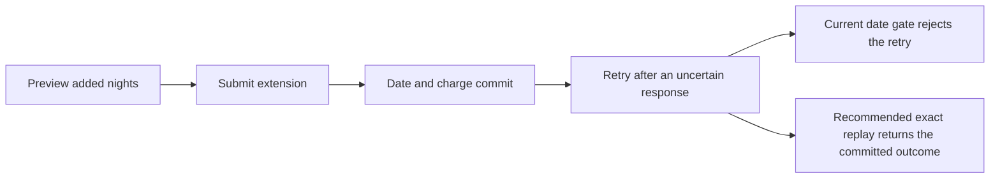
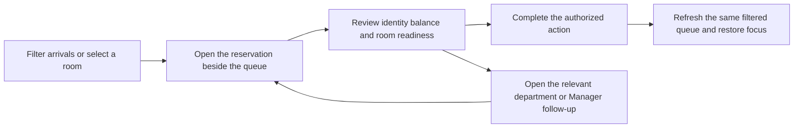

# Front Desk business logic and database audit

The audit traced actual Front Desk writes through the matching local route
and PostgreSQL function. SQL reads reconciled the affected records after
each transaction. The fixture had 30 rooms, 36 baseline reservations and
additional walk-in and phone bookings. The role was `front_desk` for
reception transactions. Department actions used their own credentials.

| Area | Flow and data authority | Local result and boundary |
| --- | --- | --- |
| Booking | Staff booking form → `/api/front-desk/reservations` → `hotel_staff_booking_create` → guest, reservation, invoice, attempt | Walk-in UI confirmed a stay and Phone API replay retained one reservation. Same-day checkout failed validation. Stale quoted price was rejected. Website-source records were seeded for the queue. Provider-backed creation belongs to the separate guest audit. |
| Queue history | Bookings → board route → `hotel_front_office_booking_page` | Verified the paged RPC is present in the clone. The list showed ten records at a time. The audit did not establish performance for a multi-property or peak portfolio. |
| Assignments | Eligibility queries and `front_desk_assign_room` → `reservation_room_assignments` | Dirty-room assignment denied. Two same-room attempts resulted in 200 and 409 with one active assignment. Database locks and the exclusion constraint carry integrity across sessions. |
| Arrival | Arrival dialog and readiness API → `front_desk_check_in` → reservation, assignment and room | An unverified guest, a remaining folio balance and an unsuitable room blocked progress. Identity and a settled invoice let the confirmed stay check in. Optional age and occupant gates require approved policy dates. |
| In-house service | Reservation detail → operational charge, route request, move, extension | Incidental replay retained one charge. Changed payload using the same charge key received a conflict. The same-type move preserved the folio and dirtied the released room. A different-type move without approval was blocked. |
| Extension | Preview → `front_desk_extend_stay` → updated checkout, assignment and one additional-night charge | The first extension applied. Exact replay returned HTTP 409 even though the new date and one charge persisted. [FD-LOGIC-001](FRONT-DESK-QA-FINDINGS.md#fd-logic-001--extension-replay). |
| Settlement | Front Desk payment endpoint → `hms_collect_payment` → payment and invoice | Synthetic electronic tender replay retained one record. Reusing the same reference on a distinct transaction was denied with generic copy. A closed cash shift blocked cash collection. A test opening float and duplicate drawer check verified the shared drawer boundary. |
| Checkout and turnover | Checkout → `front_desk_checkout` → checked-out stay, dirty room and Housekeeping task | An unsettled balance blocked departure. Settlement then produced zero balance and one turnover task. Housekeeping completion and inspection returned the room to clean. |
| Cancellation and no-show | Reservation PATCH → `cancel_reservation` or `mark_reservation_no_show` → terminal stay and settlement projections | Cancellation was persisted on a separate confirmed stay. A future no-show was refused. Real payout and financial reconciliation stayed outside this pass. |
| Guest service | `/api/front-desk/reservations/:id/requests` → `guest_requests` and audit event | Front Desk routed an approved towel request to Housekeeping. Specialist fulfillment remains departmental. |
| Maintenance | Report issue endpoint → `maintenance_create_work_order` | Front Desk filed the issue. Maintenance could see the resulting work order. The generic Maintenance orders list remained unavailable to Front Desk. |
| Transportation | Front Desk ride form → validation and consent → local record and Fleet outbox when enabled | Tested local request validation and the review path separately from Fleet delivery. Contact sharing, fare confirmation and external callbacks require integrated acceptance. |
| Approvals | Department request → Manager review → authorized execution | Front Desk created a reservation modification request. Front Desk was denied approval. Manager approval moved it to awaiting execution. Approval alone did not claim a completed modification. |
| Handover and property | Protected linked handover and lost-property functions | Front Desk could see its linked handover and Housekeeping's found item. The Housekeeping list omitted claimant notes. Release to claimant was outside the sampled actions. |
| Daily report | Preview snapshot → `submit_front_desk_daily_snapshot` → immutable submission → Manager acknowledgement | Front Desk submitted and Manager acknowledged. Front Desk was denied review. The snapshot flow is separate from official Close Day. |

## Database integrity

The assignment race exercised separate authenticated HTTP requests and found
one active assignment after the conflict. The charge and tender replay checks
verified record counts rather than treating a second HTTP success as proof.
The extension needs the same idempotency ordering, with a replay lookup tied
to its operation, reservation and canonical input. Returning a charge from
another reservation would be incorrect even if its key matched.

Operational writes remain backed by the reservation lifecycle, room
assignment history and folio ledger. Room occupancy, housekeeping condition
and maintenance serviceability are separate states. A completed cleaning
task can still leave the room in Inspection until authorized staff pass it.
Treat the frontend readiness display as advisory until the next guarded
write confirms the state.

## Current and recommended extension workflow

## Recommended reservation workspace

## Release checks still open

Confirm the deployed schema and migration ledger together with the matching
build before rollout. The audit cloned an existing disposable template and
applied no migrations. Test large-property overlap, repeated browser actions,
two-drawer shift handoff, approval execution and repricing, effective-date
age/occupant policies, live-provider callbacks and accounting reconciliation
before the applicable feature is accepted. The broader reservation and
database model is documented in [SYSTEM](../../../SYSTEM.md) and
[Front Desk operations](../../FRONT_DESK_OPERATIONS.md).
