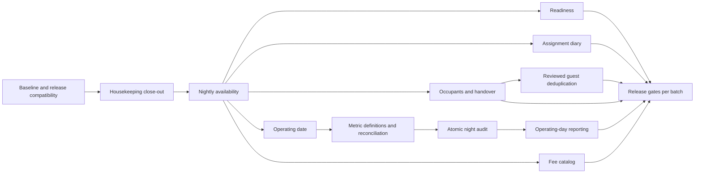

# Hotel Operations and Housekeeping Implementation Plan

> **For implementers:** Use the [Executing Plans skill](C:/Users/areva/.agents/skills/executing-plans/SKILL.md) task by task with **one agent**, preserving unrelated work. This document plans implementation; it does not execute migrations, deploy changes or authorize operational data changes.

**Goal:** Resolve the hotel findings, finish Housekeeping verification and introduce useful PMS workflows while preserving Haven's existing transactional and financial controls.

**Architecture:** Extend the existing Next.js routes, domain helpers, Supabase/PostgreSQL RPCs and role-based screens. Keep critical mutations atomic in PostgreSQL, use read-only previews for operator guidance, and retain current reservation states, frozen rates, inspection gates and separate charge/payment entities. Adapt hotel concepts from Open Hotel PMS without copying its application, auth model or unrelated modules.

**Tech Stack:** Next.js App Router, React, TypeScript, NextAuth, Zod, Supabase/PostgreSQL, Vitest/jsdom, existing CSS/components. No new dependency is planned.

**Date/status:** 3 November 2026. **First implementation batch verified locally.** P0 baseline checks, P1 automated close-out and P2 source/SQL correction are implemented; P1 controlled browser acceptance and P3 onward remain pending. Migration `20261103010000_hotel_nightly_availability.sql` was numbered after checking the live ledger. Neither pending migration has been applied. Evidence: [batch QA](../qa/hotel-operations-batch-1-2026-11-03.md).

---

## 1. Scope and current baseline

This plan covers all ten REA recommendation cards, all three Housekeeping findings, verification of existing hotel workflows, conditional improvements from the analysis, and the existing backend-remediation rollout dependency. It is not a request to rebuild features already working.

Primary evidence:

- [Hotel PMS analysis and I-01–I-10](C:/Projects/HOTEL-MANAGEMENT/docs/rea-open-hotel-pms-analysis.md:716).
- [Housekeeping audit and fixes](C:/Projects/HOTEL-MANAGEMENT/docs/qa/housekeeping-integration-2026-11-03.md:1).
- [Earlier backend remediation](C:/Projects/HOTEL-MANAGEMENT/docs/qa/backend-remediation-2026-11-02.md:1) and [its implementation plan](C:/Projects/HOTEL-MANAGEMENT/docs/plans/2026-11-02-backend-remediation.md:1).
- [Authoritative system contract](C:/Projects/HOTEL-MANAGEMENT/SYSTEM.md:744) and [occupancy decision D-033](<C:/Projects/HOTEL-MANAGEMENT/nano_bots/05 Memory/Decisions.md:8>).

| Item | Verified current status | Work remaining |
|---|---|---|
| Prior backend audit | 23 authorized source fixes implemented; B-005 excluded | Recheck current ledger/build and coordinate application/database rollout; do not redo completed fixes |
| Pending remediation migration | `20261102010000_backend_audit_remediation.sql` was the sole pending item at the last live dry-run | Refresh ledger/dry-run before any release; do not assume nothing changed remotely |
| Housekeeping fixes | Owner assignment API, disabled-session guard and misleading worker actions fixed locally | Preserve changes, finish role/browser/integration coverage, then include in reviewed release |
| Housekeeping lifecycle | Existing checkout → dirty → clean → inspect/reclean → ready demonstrated with actual isolated SQL | Extend coverage to guest-request stock, assignment-later and two-connection conflict cases |
| Hosted observations | Six completed tasks, two pending inspections, two active HK accounts, seven relevant RPCs advertised | These are dated observations, not fixtures to modify or promises about today's state |
| Latest checkpoint | 195 files / 2,120 tests; 62 targeted tests; 12 isolated SQL checks; typecheck/lint/build passed | Rerun relevant checks after new implementation, not merely quote this baseline |
| Browser QA | Partial earlier role QA; browser use unavailable afterward | Recheck tool availability; if unavailable, keep browser acceptance explicitly pending |
| Availability | False sold-out case reproduced; matching whole-window SQL counting found | Implement I-01 across every read/commit path |

The local app uses **hosted Supabase**. Disposable local PostgreSQL is for isolated tests only; do not reconnect the app to it or introduce a Docker requirement. Preserve dirty source/docs and do not stage or commit unrelated work.

Explicit exclusions remain: B-005 PayMongo event-envelope parsing and the unrelated domains excluded in the original investigation. Inventory corrections may touch the existing gateway booking-capacity RPCs, but must not change webhook parsing or signatures. No automatic guest merges, inspection bypass, fabricated historical records, tax-jurisdiction transplant or framework replacement.

## 2. Plain-language sequence

| Phase | Ano ang gagawin | Priority / dependency |
|---|---|---|
| P0 | Ihanda ang safe baseline at release dependencies | Required first |
| P1 | Tapusin ang Housekeeping checks at tiyaking tama ang roles/actions | High; existing fixes are already local |
| P2 | Ayusin ang maling “fully booked” result | High; first new correctness fix |
| P3 | Mas malinaw na check-in/checkout checklist | Medium; reuse existing wizard |
| P4 | Tamang history kapag lumipat ng room | Medium; depends on allocation dates being truthful |
| P5 | Listahan ng individual companions at shared shift handovers | High where occupant registration required; otherwise Medium |
| P6 | Magtakda ng operating day na hindi basta nagbabago sa midnight | High if daily close is adopted; policy decisions first |
| P7 | Guided night audit: review, reconcile, close once | High; depends on P6 and ledger reconciliation |
| P8 | Malinaw na booked/live occupancy at revenue/collection reports | Medium; definitions precede P7 snapshot freezing |
| P9 | Standard hotel fee catalog | Medium; preserve current money/approval flow |
| P10 | Review duplicate guests; merge only when justified | Medium; high identity risk |
| P11 | Optional room planning, shortened-stay, loan-item and cleaning-timer work | Conditional; no speculative build |
| P12 | Final regression, role walkthrough and controlled rollout | Required for each released batch |

P8's **metric definitions and reconciliation tests** must be completed before P7 can freeze financial snapshots. P8's dashboard presentation can follow P7. P4/P5/P9 do not need to wait for a business-date subsystem.



## 3. Finding coverage and status

| Finding / concept | Destination | Treatment |
|---|---|---|
| I-01 nightly availability | P2 | Confirmed bug; implement |
| I-02 business date | P6 | New workflow; define cutover/posting policy |
| I-03 atomic night audit | P7 | New workflow; locked transaction, no client-controlled force |
| I-04 accompanying guests | P5 Task 5A | Additive party relationship |
| I-05 room diary segments | P4 | Reuse assignment history; add effective boundaries if necessary |
| I-06 operational handover | P5 Task 5B | Simple linked queue, separate from immutable audit |
| I-07 duplicates/merge | P10 | Review first, protected transaction only if justified |
| I-08 readiness assessment | P3 | Consolidate actual gaps; do not duplicate existing wizard |
| I-09 hotel fee catalog | P9 | Optional catalog feeding existing charges |
| I-10 operating-day reconciliation | P8 | Preserve D-033 and ledger definitions |
| HK-01 Owner assignment rejection | P1 | Fixed locally; retain and verify |
| HK-02 disabled-session admission | P1 | Fixed locally in shared guard; verify all handlers |
| HK-03 other worker's cleaning buttons | P1 | Fixed locally; verify role/ownership matrix |
| Reference creation/edit/cancellation/confirmation | P2/P3/P12 | Preserve explicit states, frozen prices and idempotency; test regressions |
| Reference room conflicts/readiness/inspection | P1/P2/P4 | Preserve database constraints; improve dated allocation projection |
| Reference no-shows and unresolved arrivals | P6/P7 | Reuse policy-cutoff rules; decisions and money remain separate |
| Reference basic extension | P12 | Already implemented; regression only |
| Reference richer planned room changes/shortening | P11 | Conditional, simplified, atomic if implemented |
| Reference stock/linen/returnable items/timing | P1/P11 | Existing fulfillment consistency required; new lending/timing optional |
| Reference tax documents/security deposits/day-use | P11 decision register | Existing document snapshots preserved; add new workflows only on actual requirement |
| Earlier B-001–B-004, B-006–B-024 | P0/P12 | Source done; release/verification dependency |
| B-005 webhook envelopes | Excluded | Do not implement or silently reclassify |

Analysis catalog cross-check: BR-HOTEL-001–014 → P2/P4/P11; 015–020 → P1/P3; 021–023 → P1; 024–027 → P5/P10; 028–030 → P8/P9/P11; 031–035 → P6/P7; 036–037 → P5; 038 → P8. These reference rules are reviewed for applicability, not automatically imported.

## 4. Common execution and verification protocol

Each task is a small work unit. Repeat the following sequence before moving on:

1. Re-read the target file and current `git status`; record the exact failing scenario.
2. Add one meaningful regression test; run it and confirm the intended failure.
3. Implement the smallest shared-layer fix. For database invariants, use a real isolated PostgreSQL test, not SQL-text assertions or mocked locking.
4. Rerun the targeted tests. Inspect the diff for authorization, financial/history and unrelated changes.
5. Run the checkpoint gates below, update task evidence, and make a scoped commit only when implementation/commit work is authorized. Never stage the whole dirty checkout blindly.

Standard commands from `C:/Projects/HOTEL-MANAGEMENT`:

```powershell
npm run typecheck
npx eslint <explicit touched TypeScript/TSX files>
npx vitest run <explicit test files>
npm test
npm run build
git diff --check
```

Angle-bracket arguments above describe substitutions, not literal executable filenames. Each phase below supplies targeted test paths. Expected result is zero failures; test counts can grow from the baseline and must be recorded from actual output.

If Windows denies Vitest temp-file renames, set task-local `TEMP` and `TMP` to a workspace `.tmp` directory and retry. If a build fails with filesystem EPERM, distinguish it from a compilation failure and use the established authorized execution path. Do not weaken lint/type checking to make a gate pass.

Database work: prepare an **unnumbered** SQL draft in `supabase/pending/`, verify the current hosted ledger and relevant live function bodies/grants, then promote to a new additive migration. Do not edit old migrations or invent the next version now. Use `supabase db push --linked --dry-run --skip-vault` for review; actual application uses `supabase db push`, never `npm run migrate`. Database apply/deployment are separate release actions, not part of this planning turn.

Isolated SQL tests must have a fixed loopback-only connection and refuse hosted configuration. The existing [backend harness](C:/Projects/HOTEL-MANAGEMENT/scripts/backend-remediation-db-test.mjs:1) **drops/recreates its disposable test database**; run it alone, never against a shared fixture database while another test uses it. Keep security failures that require committed counters in separate committed test transactions; roll back ordinary scenario fixtures. Use two actual connections for concurrency tests.

## 5. P0 — Establish compatibility and release baseline

### Task 0A — Inventory source, deployed schema and release boundaries

**Existing files:** [SYSTEM.md](C:/Projects/HOTEL-MANAGEMENT/SYSTEM.md), [remediation migration](C:/Projects/HOTEL-MANAGEMENT/supabase/migrations/20261102010000_backend_audit_remediation.sql), [backend plan](C:/Projects/HOTEL-MANAGEMENT/docs/plans/2026-11-02-backend-remediation.md), [Housekeeping QA](C:/Projects/HOTEL-MANAGEMENT/docs/qa/housekeeping-integration-2026-11-03.md).

1. Record the branch/HEAD and dirty paths; preserve the three Housekeeping fixes and all unrelated notes.
2. Refresh the linked migration ledger and relevant function signatures/bodies/grants through read-only access.
3. Write a release manifest identifying source fixes already committed, Housekeeping changes still local, pending SQL and browser gaps.
4. Prove the stock-consumption contract on the candidate release: completion, direct request fulfillment and movement insertion must share the DB transaction and consume once.
5. Decide the coordinated deployment window and traffic gate before any production operation. Do not test intermediate incompatible app/DB versions with live requests.

**Acceptance:** no assumption that source equals deployment; no old-JavaScript/new-trigger double deduction, or new-JavaScript/old-DB missing deduction. Never overwrite the live Housekeeping-only completion role gate with an older broader body.

### Task 0B — Re-establish reproducible gates

**Tests:** `lib/housekeeping-assignment-route.test.ts`, `components/manager/housekeeping-queue-panel.test.tsx`, `scripts/backend-remediation-db-test.mjs`.

1. Run targeted Housekeeping tests and inspect baseline failures independently of infrastructure errors.
2. Reproduce the false sold-out fixture from the research artifact, then make it a permanent test in P2.
3. Run the isolated baseline migration replay and backend regression harness sequentially.
4. Run typecheck, touched-file lint, full tests and build; record actual output in a dated QA artifact.
5. Recheck browser tool/account availability. Never bypass disabled browser settings or mark manual scenarios passed without execution.

**Acceptance:** a trustworthy starting checkpoint. The previous 2,120 tests are historical evidence until rerun.

## 6. P1 — Finish Housekeeping integration and acceptance

### Task 1A — Preserve and extend the completed permission/UI fixes

**Existing source:** `app/api/housekeeping/tasks/[id]/assign/route.ts`, `lib/housekeeping-route.ts`, `components/manager/housekeeping-queue-panel.tsx`.

**Tests:** `lib/housekeeping-assignment-route.test.ts`, `components/manager/housekeeping-queue-panel.test.tsx`, `lib/housekeeping-workflow.test.ts`, `lib/housekeeping-suggestions.test.ts`.

1. Verify Owner assignment requires an explicit active Housekeeping worker; ordinary Housekeeping self-claim remains intact.
2. Extend disabled/anonymous-session tests across start, complete, inspect, defer and room-issue handlers using the actual shared guard.
3. Exercise queue controls for own, another worker's, unassigned, completed and pending-inspection tasks; retain independent inspection authority.
4. Test Manager prioritization and Front Desk read-only access. Keep Admin out of routine cleaning actions; do not infer execution authority from dashboard visibility.
5. Run `npx vitest run lib/housekeeping-assignment-route.test.ts lib/housekeeping-workflow.test.ts lib/housekeeping-suggestions.test.ts components/manager/housekeeping-queue-panel.test.tsx`.

**Acceptance:** the already-fixed Owner 403 does not recur; no disabled account reaches an RPC; unusable cleaning controls do not appear on other workers' tasks. This task is validation/extension, not reimplementation.

### Task 1B — Make the integrated SQL checks durable

**Create:** `scripts/housekeeping-workflow-db-test.mjs` and, if reuse warrants it, fixture utilities local to that script. **Read:** current Housekeeping RPC definitions in migrations and the earlier isolated test harness.

1. Move the proven 12-case scratch lifecycle into a checked-in, fixed-target isolated harness; keep hosted `.env` entirely out of it.
2. Add genuine two-connection checks: competing starts on one room, repeated completion, repeated inspection and retry after an uncertain client response. Require one business effect, or a clear already-completed response, rather than duplicate tasks/stock.
3. Add guest-request cases: assigned-room request → linked task; request without room → no invalid task; later room assignment → exactly one task; completion → linked request/stock/movement changes once.
4. Verify blocked room serviceability remains blocked after cleaning/inspection. Audit the existing cleanup handoff without changing unrelated repair workflows.
5. Run isolated tests, roll back fixtures and stop the server. If a new failure needs SQL changes, draft only the precise new function/trigger migration after live-ledger verification.

**Acceptance:** checkout/clean/inspect/reclean/readiness and request fulfillment are demonstrated together; database failure rolls back linked changes; no missing/double stock deduction. Avoid claiming that API mocks prove SQL behavior.

### Task 1C — Complete the browser/role walkthrough

**Update:** `docs/qa/housekeeping-integration-2026-11-03.md` with a new dated verification subsection, not rewritten history.

1. In a controlled test property/database, use Front Desk to check out a settled test stay; verify one linked turnover appears.
2. With a Housekeeping account, claim/start/complete it; confirm pending inspection still blocks room assignment/check-in and same-day sale.
3. Fail inspection, finish the new reclean task and pass; verify ready status in room detail, rack, availability and Front Desk picker.
4. Test Owner suggested assignment, Manager priority, other-worker denial, DND deferral and request fulfillment across the relevant roles.
5. Record evidence and actual errors. Treat the two observed hosted pending inspections as real operational work, not test fixtures to auto-approve.

**Acceptance:** a staff member can finish the whole flow through actual screens. If browser access is unavailable, mark this task pending while completing independent automated work; do not claim release acceptance.

## 7. P2 — Correct availability across every caller (I-01)

### Task 2A — Reproduce and fix nightly arithmetic

**Modify:** `lib/booking.ts`, `lib/availability.test.ts`. Read current types before extending them; reservation rows currently do not expose physical assignment IDs.

Add this regression inside the existing availability test suite using its current helpers:

```typescript
it("does not treat consecutive bookings as simultaneous demand", () => {
  const window: AvailabilityWindow = {
    checkIn: "2026-11-10", checkOut: "2026-11-12",
    now: "2026-11-01T00:00:00.000Z", today: "2026-11-01",
  };
  expect(count(window, {
    rooms: rooms(2),
    reservations: [
      reservation({ check_in: "2026-11-10", check_out: "2026-11-11" }),
      reservation({ check_in: "2026-11-11", check_out: "2026-11-12" }),
    ],
  })).toBe(1);
});
```

1. Run `npx vitest run lib/availability.test.ts`; expect the new assertion to fail with actual 0 versus expected 1 before the fix.
2. Replace whole-window demand subtraction with minimum nightly free capacity using existing half-open date helpers.
3. Preserve active pending expiry, blocking statuses, converted-hold exclusion, hold expiry and existing administrative/same-day housekeeping policy.
4. Add staggered holds, reservation+hold, empty demand, adjacency, mixed types, expired pending, converted hold and zero-capacity cases.
5. Rerun the tests and verify pricing/frozen nightly rates are unchanged.

**Acceptance:** type capacity is correct on every night. The test above proves type arithmetic; an isolated SQL fixture with both existing bookings assigned to the same room separately proves the continuously-free-room case.

### Task 2B — Align every locked database commit

**Draft SQL:** `supabase/pending/hotel-nightly-availability.sql`. **Create test:** `scripts/hotel-availability-db-test.mjs`. **Existing callers:** `app/api/booking/holds/route.ts`, `app/api/booking/holds/[token]/confirm/route.ts`, `app/api/front-desk/reservations/route.ts`, `app/api/front-desk/availability/route.ts`.

Relevant RPCs include `create_booking_hold`, `submit_reservation_deposit`, `submit_gateway_deposit`, `confirm_gateway_payment`, `front_desk_create_reservation`; search all current function replacements/callers and include any additional inventory writers before editing. Do not alter the payment-webhook envelope parser.

1. Write failing real-DB tests for the same staggered stays and holds, including a continuously free physical room.
2. Factor one small SQL nightly-capacity query/function if it avoids divergent copies; pass one captured evaluation timestamp where expiry must agree.
3. Replace the window-wide counts in all affected RPCs; keep current room-type advisory locks and physical assignment exclusion.
4. Test competing transactions for the final unit and a hold-to-reservation conversion; exactly one final-unit claim succeeds and conversion does not count twice.
5. Compare TypeScript and SQL results over the same scenario matrix; migration replay must pass before promotion from pending SQL.

**Acceptance:** search, hold, manual/gateway submission and staff booking agree; no overselling or false sold-out result introduced. A concrete room still needs continuous allocation feasibility, not just a positive type count.

### Task 2C — Keep availability errors distinct from zero rooms

**Modify:** `app/(booking)/booking/search/page.tsx`; extend the nearest existing booking-search behavior tests, creating `components/booking/availability-state.test.tsx` only if needed to exercise extracted presentation logic.

1. Reproduce the earlier observation: failed availability lookup shows an unavailable-service error and a contradictory “No rooms” chip.
2. Test three distinct outcomes: successful nonzero, successful zero and failed lookup.
3. Show sold-out only for successful zero; failed lookup gets a retry path and preserves search dates.
4. Verify existing filters do not convert unknown availability into empty inventory.
5. Run targeted search/availability tests and a browser scenario when available.

**Acceptance:** network/database failure cannot be presented as genuine zero availability. This is the additional browser finding, not a new inventory rule.

## 8. P3 — Consolidate arrival/departure readiness (I-08)

### Task 3A — Reuse existing readiness work before adding an endpoint

**Read/modify as necessary:** `components/manager/front-desk-arrival-dialog.tsx`, `components/manager/manager-dashboard-client.tsx`, `lib/staff-data.ts`, `app/api/front-desk/check-in/route.ts`, `app/api/front-desk/reservations/[id]/checkout/route.ts`.

**Proposed only if existing payloads cannot supply it:** `lib/reservation-readiness.ts`, `app/api/front-desk/reservations/[id]/readiness/route.ts`, `lib/reservation-readiness.test.ts`.

1. Map the existing arrival steps/folio detail against identity, deposit, balance, date/time/early approval, room/inspection and active-assignment gates.
2. Write failing tests only for information or actions actually missing from those screens; do not add a second wizard for equivalent behavior.
3. Return a role-scoped read assessment containing `assessedAt`, reservation version, applicable dates, blocker codes and valid next actions. Do not trust client-computed balances or return finance to roles lacking access.
4. Render blockers near the existing action with a direct route to resolution. Final check-in/checkout RPC rechecks under locks regardless of a prior green assessment.
5. Run `npx vitest run components/manager/front-desk-arrival-dialog.test.tsx lib/front-desk-operations.test.ts` plus any new readiness tests.

**Acceptance:** dirty or uninspected rooms, unpaid balance, incomplete required identity and invalid early-arrival approval remain blocked. Reusing existing behavior with clearer messages is a valid completion outcome.

## 9. P4 — Correct room-diary assignment segments (I-05)

### Task 4A — Establish truthful effective assignment periods

**Existing:** `lib/room-rack.ts`, `lib/room-rack.test.ts`, `app/api/rack/route.ts`, `app/api/front-desk/reservations/[id]/change-room/route.ts`, `app/api/front-desk/reservations/[id]/assign/route.ts`.

**Conditional draft:** `supabase/pending/hotel-assignment-effective-periods.sql`. **Proposed test:** `scripts/hotel-room-diary-db-test.mjs`.

1. Inspect real assignment history semantics: planned stay dates, assigned/released timestamps, room changes and cancelled assignments.
2. Write a failing scenario: Room A on night 1, Room B from night 2; current room must not occupy Room B across the full original stay.
3. Reuse trustworthy existing effective boundaries. Add effective-from/to recording atomically to assignment/change RPCs only when current history cannot represent them.
4. Preserve old rows and mark unknown historical boundaries rather than fabricating them. Keep planned allocation and physical occupancy distinct.
5. Verify back-to-back dates, early checkout, multiple moves and a move concurrent with another allocation in isolated SQL.

### Task 4B — Extend the current rack rather than replace it

**Modify:** `app/api/rack/route.ts`, `lib/room-rack.ts`, `components/front-desk/fused-room-rack-panel.tsx`, their existing tests and `hooks/use-front-office-rack.ts` only if the response contract changes.

1. Add segment identity/effective dates to the existing batched response; preserve current role/privacy checks.
2. Render separately clipped segments with the same reservation reference and useful room-change details.
3. Keep checkout-exclusive boundaries, existing polling and action navigation; no new realtime dependency or drag/drop scheduling.
4. Run `npx vitest run lib/room-rack.test.ts components/front-desk/fused-room-rack-panel.test.tsx` and new SQL cases.
5. Compare calendar segments to recorded assignment/audit history in a controlled move scenario.

**Acceptance:** diary answers which room was allocated when, without rewriting pricing or claiming unknown history.

## 10. P5 — Occupant identity and shift handover (I-04, I-06)

### Task 5A — Add capacity-aware reservation party membership

**Draft:** `supabase/pending/hotel-reservation-party.sql`. **Create:** `lib/reservation-party.ts`, `lib/reservation-party.test.ts`, `app/api/front-desk/reservations/[id]/guests/route.ts`, `components/manager/reservation-party-panel.tsx`, `components/manager/reservation-party-panel.test.tsx`, `scripts/hotel-party-db-test.mjs`.

**Reuse/modify:** `lib/staff-data.ts`, `app/api/staff/guests/[id]/route.ts`, existing arrival/reservation detail and guest profile surfaces.

1. Add tests for one primary, unique membership, companion capacity, unauthorized access and account-holder versus staying-guest distinctions.
2. Add `reservation_guests` using Haven's existing guest ID type, reservation FK, primary/accompanying role and uniqueness; do not copy the reference's four fixed slots.
3. Implement locked, authorized membership RPCs with stale-version handling and audit. Backfill primary only where the existing guest link is authoritative.
4. Add a compact occupant list to the current details/check-in flow; preserve current booking ownership, guest count and document visibility rules.
5. Include role-based party history in the existing CRM; verify remove/replace/retry and multi-room/group semantics before claiming support.

**Acceptance:** companion identities are stored without creating guest auth accounts, changing the primary booking account, exceeding occupancy or exposing documents to Housekeeping.

### Task 5B — Add a simple linked operational handover queue

**Draft:** `supabase/pending/hotel-handover.sql`. **Create:** `lib/operational-handover.ts`, `lib/operational-handover.test.ts`, `app/api/staff/handover/route.ts`, `app/api/staff/handover/[id]/route.ts`, `components/manager/handover-panel.tsx`, `components/manager/handover-panel.test.tsx`.

**Reuse:** `lib/permissions.ts`, `lib/notifications.ts`, `components/manager/front-desk-reports-panel.tsx`, existing staff shell/navigation.

1. Test role-scoped creation, responsibility, due time, shared edit conflicts, resolve/reopen and archive/restore distinctions.
2. Add note/link/history records with server-stamped actors and versioned atomic writes; keep immutable audits and submitted daily reports unchanged.
3. Support plain text/safely rendered content, reservation/room/guest links, `open/in_progress/resolved`, assigned role/user and separate archive flag.
4. Add a simple list/filter/detail surface in the existing staff shell. Link Housekeeping follow-up to the actual task; do not create a second cleaning-completion action.
5. Reuse durable notifications only for an explicitly implemented event; a due/reminder field alone must not promise delivered reminders.

**Acceptance:** the next shift can find who owns unresolved hotel work. No draggable canvas, new editor dependency or replacement audit subsystem.

## 11. P6 — Define and introduce an operational business date (I-02)

### Task 6A — Record property policy before freezing a new clock

**Read:** `lib/hotel-policy.ts`, `app/api/admin/policy/route.ts`, existing Front Desk reports, no-show/cancellation rules and financial RPCs. **Record agreed decisions:** `nano_bots/05 Memory/Decisions.md` only after actual agreement; proposals remain in this plan until then.

1. Define the first operating date/cutover; do not infer it by rewriting old payment timestamps.
2. List exactly which events use operating date: operational posting/close/reporting. Booking eligibility, auth/session expiry, OTP/recovery, audit timestamps and real-time room safety retain real time.
3. Set close responsibilities and warning/blocker policy. Proposed starting model: Front Desk prepares operations, Accounting executes financial close, Manager reviews exceptions. This role model is **not approved** and must be reconciled with current permissions before coding.
4. Define late postings, future-dated postings, corrections to a closed day, unresolved departures, no-show decisions and uncompleted check-in drafts.
5. Define lock acquisition order for date-close and posting RPCs before adding locks to avoid deadlocks with reservation/invoice/room locks.

**Acceptance:** a concise agreed policy matrix. Do not silently grant new financial authority or manufacture a `draft_checkin` reservation enum to mimic the reference.

### Task 6B — Add a scoped operational-date service and posting stamps

**Draft:** `supabase/pending/hotel-operational-date.sql`. **Create:** `lib/business-date.ts`, `lib/business-date.test.ts`, `app/api/staff/operational-date/route.ts`, `scripts/hotel-business-date-db-test.mjs`.

**Modify as justified by Task 6A:** `lib/hotel-policy.ts`, applicable posting/report RPCs and reporting readers. Do not globally replace `hotelToday` or `hotel_today`.

1. Add failing midnight/lagging-day tests while asserting that booking/auth real-clock behavior is unchanged.
2. Add a single versioned operational-date record using the existing property/policy context; avoid a second competing property-settings subsystem.
3. Stamp applicable new postings with server-selected operating date; preserve original timestamps and immutable historic identity. Explicitly tag pre-cutover records rather than silently relabeling history.
4. Require transactional posting/open-day checks using the locking protocol from Task 6A. A TypeScript precheck alone cannot prevent a posting-versus-close race.
5. Return business date, calendar date, timezone and version to authorized staff; display a concise banner when the operating day lags.

**Acceptance:** the operating day can intentionally remain open over midnight while public/security clocks remain correct.

## 12. P7 — Atomic guided night audit (I-03)

### Task 7A — Implement a useful read-only pre-check

**Create:** `lib/night-audit.ts`, `lib/night-audit.test.ts`, `app/api/accounting/night-audit/preview/route.ts` if the Task 6A role decision accepts Accounting ownership; otherwise rename before implementation. **Reuse:** existing no-show, reporting, readiness and ledger helpers.

1. Test unresolved arrivals/no-shows, pending inspections, unpaid/unclosed departures, active drafts and linked operational work separately.
2. Return explicit blockers/warnings and resolution links, with business date/version and an assessment timestamp.
3. Follow existing cutoff policy for no-show eligibility; preview never marks no-show or records money as received.
4. Require acknowledgement/reason only where policy calls for it; do not let a generic `force` flag bypass financial invariants.
5. Verify Front Desk/Manager/Accounting visibility separately and preserve least-privilege financial fields.

### Task 7B — Close exactly once in a database transaction

**Draft:** `supabase/pending/hotel-night-audit.sql`. **Create:** `app/api/accounting/night-audit/close/route.ts`, `scripts/hotel-night-audit-db-test.mjs`, `components/manager/night-audit-panel.tsx`, `components/manager/night-audit-panel.test.tsx` subject to the agreed role decision.

1. Complete P8 Task 8A's metric contracts before designing the immutable snapshot.
2. Test two concurrent closes, concurrent payment posting, stale preview, mid-close failure, repeated idempotency key and missing required resolutions.
3. Implement one authorized RPC that locks the operating-date row, rechecks blockers/ledger basis, freezes snapshot and audit, then advances exactly one day atomically.
4. Make same-key retry return the existing close; fail stale/conflicting date attempts explicitly. Historical corrections use controlled adjustment entries, not snapshot overwrites.
5. Wire review → resolve → reconcile → confirm → immutable summary in the current staff shell; test refresh after uncertain response without double close.

**Acceptance:** no completed snapshot with an unadvanced date, no advanced date without snapshot, no half-written close and no client-controlled bypass. Pre-check becoming stale is harmless because commit rechecks.

## 13. P8 — Metric definitions and operating-day reporting (I-10)

### Task 8A — Define and reconcile before daily snapshots

**Existing:** `lib/data.ts`, `lib/analytics/occupancy.ts`, `lib/accounting.ts`, `lib/front-desk-reports.ts`, `app/api/owner/data/route.ts`, `app/api/manager_dashboard/route.ts`.

**Tests:** `lib/analytics/occupancy.test.ts`, `lib/accounting.test.ts`, `lib/front-desk-reports.test.ts`; **create if needed:** `lib/hotel-daily-metrics.test.ts`, `scripts/hotel-daily-metrics-db-test.mjs`.

1. Write reconciliation fixtures separating booked nights, physically occupied rooms, nightly room accrual, received hotel payments, refunds and outstanding balance.
2. Use existing frozen nightly rate arrays for accrual. Define cancellation, early departure, extension, adjustment and prepayment treatment before any closed-day totals are frozen.
3. Preserve D-033 booked/live distinction and the correct Manila report-day window; financial visibility omission is not zero revenue.
4. Define dated capacity/OOO-OOS basis and whether an operating-day snapshot uses opening, closing or effective dated inventory. Do not copy reference configured-capacity assumptions blindly.
5. Test totals against the underlying ledger/nightly snapshots; failures must propagate rather than return healthy-looking zeros.

### Task 8B — Add clear operational-date presentation

**Modify:** `components/manager/performance-reports.tsx`, `components/manager/front-desk-reports-panel.tsx`, relevant Owner/staff KPI contracts and report exports.

1. Label each figure with date, basis and live/closed status.
2. Show a reconciled accrual-versus-receipts view without forcing physically occupied and booked occupancy to agree.
3. Keep formal submitted Front Desk reports separate from night-audit close records.
4. Test role-specific visibility, zero capacity and stale/failed data states.
5. Verify the P7 closed snapshot matches the agreed P8 query for the same business period.

**Acceptance:** staff can explain why occupancy bases or accrual/collections differ, and reports reconcile without changing frozen booking prices.

## 14. P9 — Optional server-priced hotel fees (I-09)

### Task 9A — Catalog and immutable charge snapshots

**Draft:** `supabase/pending/hotel-fee-catalog.sql`. **Create:** `lib/hotel-fees.ts`, `lib/hotel-fees.test.ts`, `app/api/front-desk/fees/route.ts`, `components/manager/hotel-fee-picker.tsx`, `components/manager/hotel-fee-picker.test.tsx`.

**Reuse/modify:** `app/api/front-desk/reservations/[id]/charge/route.ts`, current `post_folio_charge`, existing Accounting adjustment/reversal permissions and policy/catalog governance.

1. Confirm which recurring hotel fees need templates; keep generic authorized charge entry available for valid exceptions.
2. Test inactive fees, client price tampering, authorized override/waiver reasons, amount rounding and duplicate-submit idempotency.
3. Add minimal definitions and freeze code/name/unit amount/quantity/tax treatment into the existing folio-charge evidence at commit.
4. Quote on the server and recheck catalog version/current authorization at posting; later catalog edits never reprice historical charges.
5. Test receipt/report labels and reversal using existing financial workflows. Do not store assessed fees as if they were received payments.

**Acceptance:** repeatable hotel charging without a new financial ledger or broader Front Desk authority.

## 15. P10 — Conservative duplicate-guest review (I-07)

### Task 10A — Measure duplicates with a read-only candidate review

**Create:** `lib/guest-duplicates.ts`, `lib/guest-duplicates.test.ts`, `app/api/staff/guests/duplicates/route.ts`, `components/manager/guest-duplicates-panel.tsx`, `components/manager/guest-duplicates-panel.test.tsx`.

1. Define normalized exact identifiers and conservative candidate reasons. Shared phone/name alone never establishes that two people are the same.
2. Test family/shared-contact cases, missing/masked documents, two linked login accounts, previously dismissed pairs and protected guests.
3. Return candidates and source evidence only to an authorized identity-review role; mask sensitive identifiers appropriately.
4. Measure whether duplicates exist and whether a merge feature has sufficient operational value.
5. Record merge/dismiss/do-not-merge decisions without changing either guest or any financial record.

### Task 10B — Add a protected merge only after the need is demonstrated

**Draft:** `supabase/pending/hotel-guest-merge.sql`. **Create:** `app/api/staff/guests/merge-preview/route.ts`, `app/api/staff/guests/merge/route.ts`, `scripts/hotel-guest-merge-db-test.mjs`.

1. Enumerate **all actual hotel guest FKs**, including party membership, reservations, legacy history and aliases. Resolve auth-account conflicts explicitly; do not merge login ownership implicitly.
2. Add a deterministic preview showing field choices, associations, protected conflicts, preserved counters and issued-document implications.
3. Agree the permitted identity-review/merge role before coding; broad Front Desk access in the reference is not automatically Haven policy.
4. Implement one locked/versioned/idempotent transaction with source/master/reason and immutable before/after evidence. Include aliases atomically; preserve issued tax/financial snapshots.
5. Test wrong-person safeguards, concurrent/repeated merges, two account-linked guests, a failed FK relink, party deduplication and legacy counters.

**Acceptance:** merge cannot be triggered by fuzzy matching, cannot partially relink history and does not rewrite legal financial identity. Do not promise undo unless a separate reversible model is actually designed and tested.

## 16. P11 — Conditional findings and explicit non-adoption

These findings remain covered by the plan, but are not automatic backlog commitments. A task can close as “not required” with recorded property rationale.

| Optional concept | Implement only when | Minimal future work / tests |
|---|---|---|
| Planned mid-stay room moves | Staff actually schedule future physical moves | Reuse P4 segments; draft `supabase/pending/hotel-planned-room-moves.sql`; add reservation-scoped preview/commit/cancel; dated target holds, recheck on execution, idempotency and concurrency; no cascading displacement engine |
| Shortened stay / early departure | A documented policy differs from ordinary checkout/cancellation | Add `app/api/front-desk/reservations/[id]/shorten-preview/route.ts` and `shorten/route.ts`; frozen consumed charges, authorized adjustments/refund requests, future inventory release and atomic commit; no money-before-status writes |
| Returnable hotel items | Property lends reusable items and needs accountability | Extend existing guest requests with borrowed/returned/waived evidence and responsible department; test returns and permitted exceptions separately from consumable stock |
| HK pause/duration | Property needs active cleaning time beyond task age/DND | Add `app/api/housekeeping/tasks/[id]/pause/route.ts` and `resume/route.ts` only with an additive state model; ownership, accumulated time, concurrency and inspection/deferral compatibility tests |
| Held security deposit | Property actually collects refundable security collateral | Separate liability from booking downpayment; agreed apply/refund authority and ledger reconciliation; do not reinterpret existing deposits |
| Dedicated day-use | Actual same-day product is required | Separate inventory/session/date/pricing policy; do not relax overnight validation globally |
| More complex tax coverage | Local statutory/business requirement exists | Separate document design/legal policy and atomic number allocation; retain current immutable snapshots and configured tax rules |

Do not adopt overloaded `active`/audit-as-arrival state, automatic inspection approval at arrival, missing-room readiness pass, Thai identity/fee/tax constants, reference multi-write close/check-in/out, weak automatic guest matching, or ambiguous in-house/task-count KPIs. Existing extensions, CRM, reminders, inspection history and money entities stay in place.

## 17. P12 — Per-batch release and final acceptance

### Task 12A — Prepare a concrete release candidate

**Create/update:** a dated `docs/qa/` artifact for the batch; update `SYSTEM.md` only for verified behavior changes, and session/handoff notes without overwriting unrelated work.

1. Check off every applicable task/finding with source changes, targeted tests and actual results; mark conditional non-adoptions explicitly.
2. Run typecheck, touched-file eslint, targeted Vitest, full `npm test`, `npm run build`, migration replay, isolated transactional/concurrency tests and `git diff --check`.
3. Verify actual role walkthroughs for changed screens using controlled test data. Browser unavailable means browser acceptance pending, not passed by jsdom.
4. Refresh ledger/function/grant checks and review the exact migration dry-run. Record the exact app revision, database versions, settings and release order.
5. Produce an executable release/rollback checklist for the concrete candidate. Do not use an unreviewed destructive down migration or rewrite historical financial/audit rows.

### Task 12B — Controlled deployment after release authorization

1. Drain or gate affected posting/fulfillment traffic for incompatible app/DB contract transitions, especially the existing stock-consumption remediation.
2. Apply only reviewed additive migrations and deploy the paired app revision in the coordinated window; use the chosen compatibility strategy rather than assuming app-first or DB-first is always safe.
3. Verify read health, expected RPC signatures/grants, role access and controlled smoke scenarios before reopening affected traffic.
4. On failure, keep incompatible writes gated; restore the reviewed compatible app/DB contract using the prepared forward-fix/rollback procedure.
5. Record deployment evidence and unresolved follow-up. Historical inventory/loyalty discrepancies need separate reviewed reconciliation; do not silently repair them during deployment.

**Release acceptance:** inventory agrees across search/commit; Housekeeping can complete the real flow; inspection blocks premature room release; money and stock change once; operational dates/close are atomic where introduced; role boundaries and immutable history remain intact. No excluded feature changes.

## 18. Final local implementation tracker (2026-11-03)

| Task group | Current status | Next evidence required |
|---|---|---|
| P0 compatibility/baseline | Source/live ledger inspected; local candidate verified | Node 22; complete replay of 104 migrations; final QA artifact |
| P1 three Housekeeping source fixes | Preserved; extended automated coverage passed | 45 action-route checks; 27 isolated lifecycle/linking/stock/conflict checks |
| P1 browser acceptance | Core lifecycle passed in disposable real app/DB | Cleaning/inspection/reclean and Maintenance hold verified; DND/stock/concurrency covered in real SQL; production smoke remains separate |
| P2 availability and failed-lookup UI | Implemented locally; not deployed | 30 arithmetic tests, rendered failure/retry regression, 24 actual SQL/parity checks; nine RPCs aligned |
| P3 readiness | Implemented and browser verified locally | Identity/money/timing blockers, atomic arrival and fee-triggered departure blocker passed |
| P4 room diary | Implemented locally | Effective segment/rack tests; actual move, allocation race and early-checkout SQL checks; unknown legacy boundaries labeled |
| P5 staying guests/handover | Implemented locally | Capacity/primary/account/version/retry SQL; scoped handover/history/archive tests; conflict draft retained in UI |
| P6–P8 business date/close/reporting | Implemented locally under D-034; not activated | Posting/close race, operational-write conflict, injected snapshot rollback, immutable history, metrics and role checks |
| P9 fee catalog | Implemented locally, optional catalog empty | Server-priced immutable existing folio evidence; stale version, payload/key collision and retry checks; Accounting governs actual fee entries |
| P10 duplicate review | Implemented locally | Conservative candidates, protected accounts and persisted decisions; live read-only aggregate: 0 exact-email / 0 shared-account candidate groups |
| P10 protected merge | Not adopted under Task 10B evidence gate | No measured duplicate demand; no guest, financial or login ownership relink performed |
| P11 optional findings | Explicit conditional non-adoption | No supplied need/policy for scheduled moves, special early-departure repricing, returnables, timers, collateral, day-use or extra tax rules; existing workflows retained |
| P12 local candidate | Implemented and verified | See `docs/qa/hotel-operations-completion-2026-11-03.md` and candidate manifest for exact evidence |
| P12 controlled staff acceptance | Changed core flows passed locally | Final Node22: 202 files / 2201 tests, typecheck/build, 87 SQL checks/groups; see staff walkthrough report |
| P12 production rollout | Maintenance authorized; blocked by access and remote drift | Vercel logged out; six remote versions missing locally plus two differently named version collisions; recover/reconcile before any push |

The user subsequently requested **all implementation** and delegated policy choices.
All applicable local implementation groups above are complete; conditional features
have the explicit dispositions allowed by this plan. Earlier file-by-file task lists
are design guidance, not a requirement for redundant modules: shared DTOs/guards live
in `lib/hotel-operations.ts` and `lib/hotel-operations-route.ts`, with behavior tests
and the actual database harness in `scripts/hotel-operations-db-test.mjs`.

Final route layout deliberately keeps read-only oversight out of execution namespaces:
readiness/party reads and night-audit preview use `/api/staff/`; party mutations and
fee quotes use Front Desk; catalog mutation and financial close use Accounting.
This preserves the Owner execution boundary and existing financial guard tests.
Production maintenance is authorized. Controlled local browser acceptance passed;
production rollout remains Task 12B. The final remote ledger changed since the
earlier inspection; do not use the earlier four-pending-file release order without
reconciling the actual remote additions and collisions. See
`docs/qa/staff-walkthrough-2026-11-03.md` for the exact boundary.
