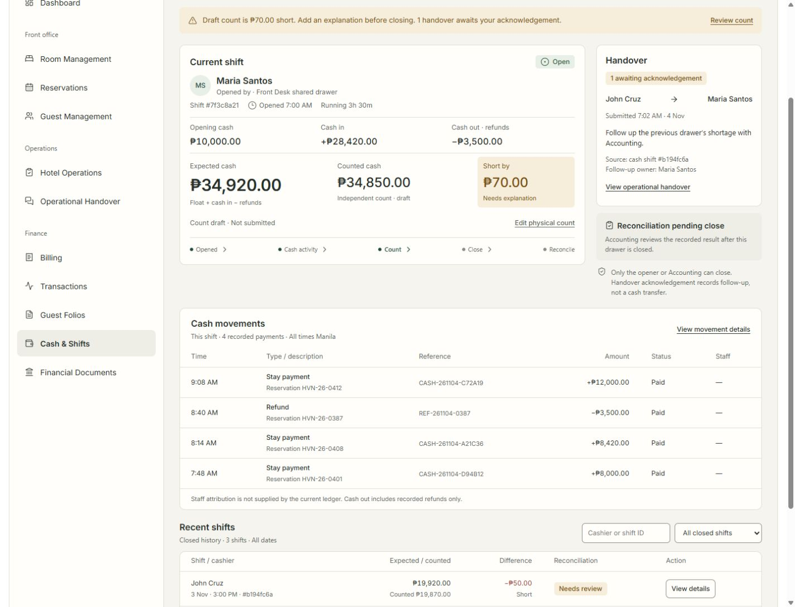

# Cash & Shifts / Cash Drawer — Implementation Plan

- **Date:** 4 November 2026, Asia/Manila
- **Status:** Plan and visual reference only. Application implementation awaits approval.
- **Scope:** Existing cashier workflow plus the proposed desktop, tablet and mobile UI.
**Execution:** One agent; preserve concurrent changes and follow root `AGENTS.md`.

## 1. Outcome and review boundary

Staff should immediately understand who opened the shared drawer, its expected cash, whether an independent physical count exists, any shortage/overage, reconciliation status, pending operational follow-up and the next action they are authorized to perform.

The business workflow stays:

**Open drawer → record cash payments/refunds → physically count → close drawer → Accounting reconciliation.**

Handover is parallel operational follow-up. It does not transfer cash, change the drawer opener, authorize closure or become an additional mandatory closing step. This is a cashier session, not an attendance or employee-scheduling feature.

The user's latest request authorizes this plan and the inclusion of the proposed UI. It does not approve implementation, a label rename, deployment, schema changes or hosted operational writes.

**Naming recommendation:** “Cash Drawer” is clearer for staff. Until explicitly accepted, retain the existing “Cash & Shifts” label. If accepted, change display text only; retain `cash_shifts`, existing URLs, permission keys and database names. Renaming is not a dependency of the UI work.

## 2. Proposed UI included with this plan

- [Interactive design proposal](assets/cash-shifts/proposal.html): screen-size, shift-state and viewer-role controls; sample-only count/close/reconciliation interactions.
- [Editable visual source](assets/cash-shifts/proposal.fragment.html).
- [Phase 1 analysis and rationale](assets/cash-shifts/phase-1-design-review.md).

The HTML files are documentation assets. Do not import them, their sample transactions, preview controls or simulated writes into application code. The standalone preview uses the bundled visualization wrapper and external font/runtime resources; it is not a production application or a network-independent build.

### Proposed desktop



### Proposed mobile


The screenshots show the first operational viewport. The interactive proposal also includes movement rows, secondary shift history, closed/reconciled/no-drawer states and permission differences. All proposed people, IDs, amounts and dates are illustrative.

### Visual specification

| Region | Intended presentation | Functional connection |
| --- | --- | --- |
| Workspace header | Title, concise description, one contextual primary action | Existing open/count/reconcile actions |
| Attention summary | Explicit count difference, pending review or handover needing attention | Actual current drawer and authorized follow-up data |
| Current shift | Opener, location, concise ID, Open/Closed, Manila opening time and elapsed/closed duration | Existing shift fields; no assumption of an assigned work schedule |
| Cash basis | Opening cash, Cash in, Cash out — refunds | Paid transactions linked to the selected drawer |
| Count comparison | Expected, Counted, Short/Over/Balanced in one connected group | Independent draft while open; recorded financial fields after close |
| Reconciliation | Pending close, Awaiting Accounting review, Reconciled | Presentation of existing statuses, distinct from cash agreement |
| Lifecycle | Opened → Cash activity → Count → Close → Reconcile | Guidance over current data; no new persisted states |
| Handover | Sender/receiver where supplied, source, time, acknowledgement and follow-up | Existing department-scoped operational handovers |
| Cash movements | Time, purpose/reservation, reference, signed amount, status, staff availability | Existing linked payment records; no general cash-out button |
| Recent/full history | Search, local status filters, friendly dates, compact financial comparison, details and paging | All existing shift records and fields remain accessible |

Use warm ivory/alabaster, forest actions, charcoal text, muted brass details, sage agreement and amber review states. Reserve red for recorded discrepancies. Reuse the bundled Playfair Display for the page heading and Inter for operational text and numbers. Scope all new styling to the cash workspace and provide equivalent dark-theme contrast. Preserve the actual shared shell, navigation, theme toggle and account controls rather than rebuilding the illustrative shell.

## 3. Verified baseline and implementation constraints

Read these current sources before editing:

- `SYSTEM.md` — focused HMS controls and shared drawer authority.
- `DESIGN.md`, `app/ui-primitives.css`, `app/staff-theme.css` — current shared design system.
- `components/manager/manager-dashboard-client.tsx` — cash section routing, ledger loading, open/close-focus/reconcile callbacks and header drawer status.
- `components/manager/cash-count-panel.tsx` — independent count, note, retry key, validation and close submission.
- `lib/accounting.ts` — ledger shape, paid linked transactions, net collected and recorded financial fields.
- `app/api/accounting/cash-shifts/route.ts` and `[id]/route.ts` — current schemas and protected RPC calls.
- `components/manager/operational-handover-panel.tsx`, `app/api/staff/handovers/route.ts`, `lib/operations.ts` — live source-linked handover workflow.

**Baseline change since the original review:** another session already changed `app/hms-workflows.css` so the cash ledger spans the full width while the count panel stays beside the header. The original before screenshot predates that adjustment. Do not reintroduce the compressed split or overwrite the concurrent contrast fixes.

**Two handover systems exist:** the live `team_operations` navigation imports `operational-handover-panel.tsx` and uses plural `/api/staff/handovers`. The singular `/api/staff/handover` hotel-notes workflow is a separate contract and has no cash-shift source field. Use the plural source-linked workflow for this feature. Do not revive the older roster component or merge these models.

**Cancellation regression to cover:** the current reconciliation handler converts a cancelled prompt to an empty string and only returns early for a nonzero variance. A cancelled balanced-shift prompt can therefore continue to the request. The UI integration must treat cancellation separately from submitting an optional blank note, and test that Cancel sends no write. This is a bounded interaction correction; no financial calculation or backend contract changes.

**No migration, package installation or backend contract change is planned.** If a required field cannot be supplied by existing authorized reads, show its unavailable state and document the limitation rather than invent data or expand permissions.

## 4. Financial data and state rules

| Value | Source and rule |
| --- | --- |
| Active drawer | Find the actual `status === "open"` record independently of search, history page or selected historical shift. One shared drawer property-wide. |
| Cash in | Sum paid, linked, non-refund payments in centavos. Unpaid/pending/unattributed records do not enter this drawer's count. |
| Cash out | Sum paid, linked refund-purpose payments as an outgoing magnitude. No expenses, bank drops or arbitrary withdrawals are inferred. |
| Net collected | Existing ledger `collected` is incoming cash less refunds. Never subtract refunds from that value a second time. |
| Open expected cash | Opening float plus existing net collected. Use the incoming/refund breakdown as supporting evidence and verify it agrees; if input completeness cannot be established, flag the mismatch instead of replacing authoritative values. |
| Closed expected/count/variance | Use recorded `expected_cash`, `actual_cash`, `variance`. Do not recompute historical truth from current display rows or a previous draft. |
| Draft count | Explicit, independent nonnegative input; starts blank. It is not an expected value prefilled as a physical count. A blank count displays Not counted / —. |
| Difference | Counted minus expected, calculated in centavos. Distinguish Short, Over and Balanced. Missing inputs never imply ₱0.00 or Balanced. |
| Reconciled | Review completed. A recorded nonzero variance remains visible and unchanged. |
| Aggregate variance | Preserve access to the existing signed historical net total, label its full scope and do not present it as unresolved shortage or current cash. Counts/totals must state whether global or filter-specific. |
| Staff on movements | Current ledger does not supply the receiving staff member. Show Not supplied / —; never substitute the drawer opener. Named attribution is excluded from this implementation. |
| Handover coverage | Existing list is the recent 100 authorized records, not complete history. Label that scope; zero returned records cannot prove that no older follow-up exists. |

The server remains authoritative for the final expected amount under its existing lock. A payment can arrive between preview and closure; success must display the returned expected/count/variance values. Stable idempotency keys and unchanged retry payloads remain intact. Signing out does not close the shared drawer.

## 5. Permission and next-action matrix

| Drawer state | Front Desk opener | Other Front Desk staff | Accounting |
| --- | --- | --- | --- |
| No open drawer | Open cash shift | Open cash shift | Open cash shift |
| Open | Review count & close | Read-only drawer details; identify opener | Enter independent count and close |
| Closed, not reconciled | View close record; Awaiting Accounting | View close record; Awaiting Accounting | Review and reconcile selected closed shift |
| Reconciled | View recorded result | View recorded result | View recorded result |

Other roles keep their current navigation and financial restrictions. Do not grant Manager/Owner/Admin cashier execution through the redesign. An executive ledger capability does not imply access to this operational workspace. The existing route/RPC checks remain the enforcement boundary.

Handover visibility and actions follow the plural endpoint and existing follow-up-owner/Manager rules. Accounting must not see Front Desk handover notes merely because it can close a drawer. The card should link to the existing operational handover module; keep acknowledgement/resolution mutations there in this first implementation.

## 6. Component and file plan

```text
Existing ManagerDashboardClient / authenticated staff shell
  CashShiftsWorkspace
    Workspace header + authorized contextual action
    Attention summary
    Current shift / no-open-drawer surface
      Identity and Manila timing
      Cash basis breakdown
      CashCountPanel: one owner of count, note and retry state
        Expected / counted / difference
        Count review using existing Modal or visible form
      Lifecycle and reconciliation state
    Cash movements
    Authorized linked handover summary → existing module
    Shift history + details + existing pagination
    Existing open and Accounting reconciliation dialogs
```

These are logical sections, not a requirement to create a file per section. Keep small visual sections local to the workspace. Avoid a new generic dashboard, finance framework or duplicated count store.

| File | Planned change |
| --- | --- |
| `components/manager/cash-shifts-workspace.tsx` — new | Cash-specific layout, selected historical record, movement/history views and authorized handover read/summary. |
| `components/manager/cash-shifts-workspace.css` — new | Scoped light/dark layout, semantic states, responsive recomposition and financial/table typography. |
| `components/manager/cash-count-panel.tsx` | Adapt count comparison/review presentation without duplicating state, losing retry behavior or weakening reset/validation. Keep component mounted across presentation-only changes. |
| `components/manager/manager-dashboard-client.tsx` | Route only `cash_shifts` through the new workspace; reuse action callbacks, loading and status refresh; preserve all other Accounting sections and concurrent payment-detail work. |
| `lib/cash-shift-display.ts` — new if needed | Small pure selectors/formatters for derived breakdown, nullable values, role/state presentation and history filtering. Reuse centavo utilities. No database access here. |
| `app/hms-workflows.css` | Remove only obsolete cash-specific split/placement rules after the new workspace is wired. Do not alter stock/handover or shared contrast behavior. |
| Focused component/helper tests and existing regressions | Verify observable cash behavior, not snapshots that merely mirror markup. |
| `DESIGN.md`, `SYSTEM.md`, session/handoff | Update only verified implementation outcomes after approval and completed validation. No new approved decision is recorded for this draft plan. |

## 7. Ordered implementation tasks

### P0 — Baseline and approval

- [ ] Obtain approval of the proposed direction/plan before editing application files. Retain the current display name unless rename is explicitly accepted.
- [ ] Check git status and reread the current target files; isolate this task's diff and preserve unrelated changes.
- [ ] Run current typecheck and relevant cash regression tests. Record failures with paths before making changes; do not claim historical test counts as a current result.
- [ ] Confirm current cash/ledger/handover schemas and actual imports. Do not query or change hosted financial records as part of layout work.

**Exit:** clear baseline, bounded files and confirmed existing contracts.

### P1 — Financial presentation selectors

- [ ] Select the current open drawer independently from filtered/paged history; select latest closed drawer separately when none is open.
- [ ] Implement nullable money handling, paid-linked incoming/refund breakdown, recorded closed comparisons and Manila date/duration formatting.
- [ ] Keep net collected and historical signed variance semantics unchanged. Handle missing/unknown staff and invalid timestamps explicitly.
- [ ] Test cents, zero, missing count, refund direction, excluded transactions, recorded closed values and retained reconciliation differences.

**Exit:** every displayed financial value has one source and the sample arithmetic agrees without changing server calculations.

### P2 — Current-shift UI and count integration

- [ ] Add the scoped workspace, identity/timing, cash basis, comparison, attention and lifecycle sections.
- [ ] Retain one count/note/retry owner keyed by drawer ID + actor ID + role. A same-drawer refresh preserves the draft; changing drawer/operator/role clears it.
- [ ] Keep count input explicitly entered and preserve nonnegative amount, note-length/400-character limits and nonzero-variance explanation behavior.
- [ ] Wire the page action and local action to the same review/count flow. If using a modal, use the existing Modal component; Cancel must make no request and must not lose the underlying draft.
- [ ] Preserve opening defaults/location validation and existing POST/PATCH payloads. Disable duplicate submits. Preserve draft on failures; display server-returned close values on success.
- [ ] On open/close success refresh the ledger and shared header drawer status. On stale/already-closed responses refresh without submitting a second financial operation automatically.

**Exit:** existing open/count/close behavior works through the proposed layout with no synthetic production data.

### P3 — Movements and complete shift history

- [ ] Render existing payments linked to the selected drawer; clearly distinguish paid cash included in the total from any other displayed state. Use source timestamps/reference/purpose and signed amounts.
- [ ] Show unprovided movement staff honestly. Keep refund processing in its existing Accounting workflow.
- [ ] Preserve full history with search, existing pagination and a local All / Awaiting reconciliation / Reconciled filter. Reset the page when filters change; filters must not hide current drawer operations.
- [ ] Put all existing fields in the history row/detail: full ID, cashier, location, opening float, net collected, expected, counted, variance, status, opening/closure/reconciliation times and notes. Retain callable actions for every eligible historical closed record.
- [ ] Surface older pending reconciliations even when a newer shift is already reconciled or another drawer is open. Do not route a pending-review count to an unrelated latest record.
- [ ] Keep recorded historical aggregate access in a secondary scope-labeled summary/detail. Show honest empty and no-match states.

**Exit:** no existing history, financial field or authorized action is lost in the more compact view.

### P4 — Operational handover summary

- [ ] Read `/api/staff/handovers` only for this authorized workspace, with cancellation on unmount; do not change endpoint schemas or widen departments.
- [ ] Select `source_type === "cash_shift"`, group by the actual `source_id`, distinguish current versus older visible shifts and resolve names only from supplied authorized staff.
- [ ] Show actual awaiting-acknowledgement / acknowledged / resolved state. A personal attention count includes only unresolved, unacknowledged records assigned to this actor; label other visible departmental follow-up separately.
- [ ] Label “recent 100 authorized records”; unknown/error/loading is not zero. Missing archived/older records must not produce an “all handovers clear” claim.
- [ ] Navigate to the existing `team_operations` module for follow-up actions. Prefer a small optional existing-record focus prop over a new workflow; preserve source and version checks.
- [ ] If handovers fail, keep cash operations usable, show a local retry and do not report a successful acknowledgement.

**Exit:** contextual continuity is visible without adding cash-transfer semantics or duplicating handover writes.

### P5 — Responsive, theme and accessibility pass

- [ ] Desktop: current shift with adjacent handover/reconciliation; movements and history below, financial columns aligned.
- [ ] Tablet: shared navigation follows its existing behavior; current shift spans the width; narrower supporting panels stack as needed.
- [ ] Mobile: owner/state → expected/count → difference → main action; supporting opening/in/out follows; movements → handover → history. Keep essential pending follow-up signposted above.
- [ ] At very narrow widths stack cash comparisons and history controls; recompose table rows rather than shrinking typography. No page-level horizontal overflow.
- [ ] Keep DOM/keyboard reading order aligned with the visual order; explicit labels, text plus color, visible focus, focus return, Escape, reduced motion and 44px touch actions.
- [ ] Review light and dark appearances, long names/notes, large peso amounts, 200% zoom, short windows and nullable financial fields. Loading/error surfaces must not resemble a balanced drawer.

**Exit:** all proposed layouts remain usable with real content and each authorized state.

### P6 — Regression, browser QA and documentation

- [ ] Run touched-file lint, typecheck, targeted tests, full suite and production build. Investigate new failures; report unrelated baseline failures separately without silently fixing them.
- [ ] Render actual React components with representative fixtures for screenshot QA. Then perform authenticated read-only walkthroughs for Front Desk and Accounting where available; test financial mutations only in a verified isolated environment with disposable records.
- [ ] Compare the actual application with the proposed identity/hierarchy, not only the standalone documentation mockup. Check 320, 390, 768, 1024 and 1440px plus light/dark and keyboard flow.
- [ ] Confirm Transactions, Folios, statement Reconciliation, Documents, refund handling, payment collection and the shared header remain unchanged outside intended integration.
- [ ] Update verified documentation and session/handoff selectively; label anything unverified. Do not mark a planned feature implemented.

**Exit:** acceptance matrix satisfied, evidence recorded, implementation ready for review. Deployment and migration execution are separate from this plan.

## 8. Acceptance and verification matrix

| Case | Required result |
| --- | --- |
| No open drawer | Clear empty state and Open action; history and older pending reconciliation remain available. |
| Open, no count | Correct running expected; Counted and Difference unavailable. No inferred balanced result. |
| Balanced draft | Explicit ₱0.00 difference; drawer remains open until submitted. |
| Short/over draft | Signed computed difference; explanation required for close. Zero count is valid when deliberately entered. |
| Retry / refresh | Same draft and retry key retained for unchanged payload; drawer/operator/role change resets; filters do not reset count. |
| Concurrent payment/close | Server result wins; stale errors handled without duplicate automatic writes. |
| Other cashier's drawer | Read-only close controls for Front Desk; Accounting retains authorized close. |
| Reconcile | Accounting-only, closed-only; cancelled note dialog sends no request; required variance note remains enforced. |
| Reconciled shortage | Reconciled and Short are both represented; original financial values remain. |
| Multiple historical review items | Exact eligible record is selectable/reconcilable; current open drawer stays visible. |
| Handover | Department and actor scope retained; acknowledgement differs from resolution and cash custody. Recent-list limit stated. |
| Partial failure | Handover error does not erase the ledger; ledger failure never displays cached/zero figures as current certainty. |
| History completeness | Full search, status filters, paging, details and prior fields accessible; displayed counts describe their scope. |
| Responsive / accessible | No overlap/overflow at planned widths, legible light/dark states, keyboard/focus behavior and mobile recomposition. |

Suggested relevant commands, adjusted to the files actually changed:

```powershell
npm run typecheck
npx eslint components/manager/cash-shifts-workspace.tsx components/manager/cash-count-panel.tsx components/manager/manager-dashboard-client.tsx lib/cash-shift-display.ts
npx vitest run components/manager/cash-shifts-workspace.test.tsx lib/cash-shift-display.test.ts components/manager/hms-workflows.test.tsx components/manager/hms-qa-regressions.test.tsx lib/accounting.test.ts lib/hms-workflow-routes.test.ts lib/financial-route.test.ts
npm test
npm run build
git diff --check
```

New test/helper filenames above are planned, not existing files. Extend existing source-location assertions if extraction moves legitimate code; keep their behavioral intent. Do not preserve brittle source placement by duplicating dead code. Browser QA must identify actual-component fixtures versus authenticated application coverage. Current recorded full-suite failures are only a historical reference until rerun.

## 9. Exclusions, rollback and completion

No general expenses, arbitrary cash withdrawals, cash drops, financial-custody transfers, new attendance/schedule behavior, denomination counting, multi-drawer migration, automatic reconciliation or payment edits. The statement-reconciliation workspace and historical unattributed-cash investigation remain separate.

Rollback is presentation-only: restore the old cash-section routing/count layout and this task's scoped styles using a reviewed task-specific diff. Do not reset unrelated work in the dirty tree. There is no planned schema or financial-record rollback because neither is changed.

Implementation is done only when the UI is integrated against actual existing data, financial/permission contracts and draft behavior survive, all history remains accessible, relevant checks pass or documented pre-existing blockers are explained, browser evidence is honest, and the reviewed proposal's hierarchy is reflected in the application. This plan itself does not satisfy those completion conditions.
