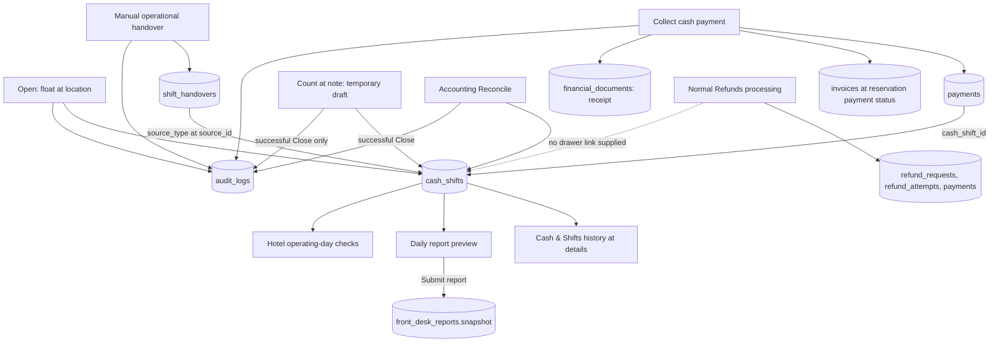

# Cash & Shifts: QA at saan napupunta ang data

Date: 4 November 2026, Asia/Manila. Scope: current local implementation,
actual HTTP handlers and migration-owned database functions; authenticated
Front Desk read-only browser walkthrough. Walang hosted business record na
binago at walang deployment.

## Resulta

**May permanenteng database destination ang Open, cash payment, Close,
Reconcile at operational handover.** Napatunayan ang save at read-back gamit
ang ibang database connection, hindi UI success message lang.

**May isang importanteng gap:** ang normal Refunds workflow ay nagsa-save ng
`manual_refund` na walang `cash_shift_id`. Hindi ito lumalabas na Cash out ng
drawer. Kung mula sa physical drawer talaga ibinayad ang refund, wala pang
supported input/link para maitama ang drawer cash basis. Hindi nawawala ang
refund record; kulang ang classification/link nito sa cash drawer. KI-021.

**Hindi autosave ang count draft.** Nasa React state lang ang count/note habang
bukas ang module. Permanenteng nase-save ang mga ito sa successful Close.

## Simpleng mapa

## Bawat action: input, save at makikitang destination

| Action / data | Kailan nase-save | Database fields / records | Saan ito makikita o ginagamit |
| --- | --- | --- | --- |
| **Open cash shift:** opening float, optional location | Successful Open | `cash_shifts`: `id`, `staff_user_id`, `opening_amount`, `location`, `status='open'`, `opened_at`; `audit_logs` action `open_cash_shift` | Current shift, shift history/detail, shared header Open/Closed, Front Desk dashboard cash card; active cash responsibility in Staff Duty |
| **Collect cash payment:** amount, reservation, reference, cashier | Successful payment collection; one transaction with receipt | `payments`: `cash_shift_id`, `reservation_id`, `invoice_id`, `amount`, `method='cash'`, `purpose='stay_payment'`, `status='paid'`, `reference`, `received_by`, `idempotency_key`; `invoices` totals and reservation payment status updated; `financial_documents` receipt; `audit_logs` action `collect_payment` | Cash movements/current expected, Transactions, Guest Folios/Billing, Financial Documents and guest receipt endpoints |
| **Expected cash / Cash in / Cash out** | Computed during reads while open; expected is recorded at Close | No separate running-total record: opening float + paid linked incoming − paid linked refunds. At Close, server stores `expected_cash` | Current comparison, movement basis; closed comparison uses recorded expected even if a later read differs |
| **Physical count and explanation draft** | **Not saved yet**; Review / Keep draft / Cancel makes no financial write | Component state only: count, note and pending retry information | Current comparison and Review dialog while the same workspace remains mounted |
| **Close shared drawer:** independent count + explanation | Successful Close | Same `cash_shifts` row: `actual_cash`, `expected_cash`, `variance`, `close_notes`, `close_idempotency_key`, `status='closed'`, `closed_at`; `audit_logs` action `close_cash_shift` | Latest closed shift, full history/details, Awaiting reconciliation; daily report totals for its close date; operating-day assessment |
| **Accounting reconciliation:** review note and reviewer | Successful Record reconciliation | Same `cash_shifts` row: `status='reconciled'`, `reconciled_by`, `reconciled_at`, `reconciliation_notes`; original expected/count/variance preserved; `audit_logs` action `reconcile_cash_shift` | Cash & Shifts status/history/detail; unreconciled-shift blocker clears. This does **not** create a `payment_reconciliations` statement record |
| **Handover:** summary, cash source ID, receiver | Manual Create handover in Operational Handover | `shift_handovers`: `department`, `source_type='cash_shift'`, `source_id`, `summary`, `follow_up_user_id`, `submitted_by`, `submitted_at`, `version`; `audit_logs` action `handover_submitted` | Operational Handover log; Cash & Shifts summarizes unresolved cash follow-up among recent 100 authorized records |
| **Acknowledge / resolve handover** | Explicit action by authorized receiver/Manager | Same `shift_handovers` row: `acknowledged_by`, `acknowledged_at`, `resolved_at`, `resolution`, incremented `version`; audit actions `handover_acknowledge` / `handover_resolve` | Operational Handover status/history; resolved items leave the cash unresolved summary. Drawer opener/count are unchanged |
| **Daily report** | Generate is read-only; **Submit** persists a snapshot | `front_desk_reports.snapshot.cashShifts`: closed count, expected, counted and variance for the selected Manila close-date window | Front Desk Reports history; Manager review. Closing a drawer does **not** automatically submit a report |
| **Normal refund processing** | Successful Process refund in Accounting | `refund_requests` processed state/reference; `refund_attempts`; `payments` paid `purpose='refund'`, `method='manual_refund'`, **`cash_shift_id=NULL`**; folio/reservation financial state; `audit_logs` action `process_refund` | Accounting Refunds, Transactions and folio records. **Not linked to the drawer Cash out summary** |
| **Audit trail** | Alongside successful actions | `audit_logs`: actor, action, entity ID, timestamp and recorded action details | Owner Audit section reads these records; current Admin security audit is filtered and is not a complete financial-action log |

Opening cash is a float, hindi bagong guest payment/revenue. Cash & Shifts
reconciliation does not edit guest payments or automatically deduct a shortage
from staff. Handover is operational follow-up, hindi transfer of physical cash
o reassignment ng drawer opener. No automatic handover is created by Close.

## Ano ang temporary at ano ang permanent

- Same drawer, same operator/role, quiet refresh/filter/Keep draft: retained ang
  unsent count at note habang mounted pa ang workspace.
- Leaving Cash & Shifts, page reload, closing the tab or remounting the module:
  **nawawala ang unsent count/note**. Drawer/operator/role change also resets them.
  Added regression explicitly proves remount starts blank and sends no write.
- Successful Close: saved na ang count/note sa database at mababasa sa history
  kahit ibang connection/session na. Close retry uses the stored key to avoid
  duplicate effects. Failed request retains the current mounted draft.
- History search/filter/paging, elapsed time and lifecycle guidance are UI state
  or derived values; wala silang bagong financial record na ginagawa.
- Reviewer identity and payment receiving-staff identity are stored as
  `reconciled_by` / `received_by`. Current cash details do not expose reviewer
  identity; movement rows say staff attribution is not supplied because the
  ledger payload does not select `received_by`. Stored data exists despite
  this presentation limitation.
- Unlinked historical cash is a separate Cash Exceptions investigation; it is
  intentionally excluded from any drawer total. It is not silently assigned.

## Confirmed gap: refund paid from the physical drawer

**CASH-DATA-01 / KI-021 — High operational risk, unresolved.**

Reproduced through the actual `process_refund` SQL function on fictional data:

| Step | Persisted result |
| --- | --- |
| Open float | ₱1,000.00 in `cash_shifts.opening_amount` |
| Collect cash | ₱2,000.00 payment linked to that drawer; receipt saved |
| Collect card | ₱500.00 payment saved without a drawer link; correctly excluded |
| Process refund | ₱250.00 `manual_refund` payment saved, drawer link NULL |
| Count / Close | Count ₱2,750.00; server expected ₱3,000.00; variance −₱250.00 |
| Accounting review | Reconciled; original −₱250.00 and both notes retained |

The arithmetic is correct for the linked records. If the refund was a bank or
other external payout, excluding it from the physical drawer is correct.
**If that ₱250 was actually paid from this drawer**, expected physical cash
should instead be ₱2,750. The current refund form/function cannot express that.
Thus this QA confirms persistence, but cannot certify complete drawer cash-out
accountability through the normal Refunds workflow.

Recommended correction requires an explicit payout method: only a genuine cash
refund should select/lock an open drawer and save its `cash_shift_id` in the same
transaction as the refund/payment/attempt/audit updates. Noncash refunds must
remain outside the drawer. Do not automatically attach every refund or rewrite
historical payouts. This QA made no financial-contract or migration change.

## Verification evidence

| Check performed in this QA pass | Result |
| --- | --- |
| Actual migration replay into new local scratch DB | 117 source migration files replayed; no hosted migration applied |
| Real SQL acceptance checks | **17/17 pass**, plus explicit reproduction of the refund-link gap |
| Focused component/domain/route/report/receipt tests | **10 files / 159 tests pass** |
| Full Vitest suite | **214 files / 2,303 tests pass** |
| TypeScript | Pass |
| ESLint on new/updated QA JS/TS files | 0 errors / 0 warnings |
| Whitespace check | `git diff --check` passes |

SQL checks cover: no payment/receipt without a drawer; opening fields/audit;
one open drawer; payment→drawer/invoice/reservation/receipt linkage; exact retry
without duplicate records; noncash exclusion; forced receipt failure rolling
back payment and folio together; source/receiver handover and state changes;
invalid-source/cross-department rejection without orphan rows; real refund
destinations; close role/explanation controls; persisted close/count/key/note;
close retry conflict; Accounting reconciliation and original variance retention;
statement reconciliation separation; second-connection committed read-back;
all expected audit actions.

The HTTP tests invoke the real route handlers with authentication and RPC
transport boundaries stubbed. They verify exact argument names, session actor,
selected shift ID, role/validation rejections and passing back server-computed
amounts. SQL tests separately execute the real business functions and read the
actual persisted rows. Neither alone is claimed as browser-to-hosted write E2E.

Browser checks this pass: authenticated Front Desk cash history/details; a known
cash movement found in Transactions using the same reference and amount;
Financial Documents populated; current-day Reports preview shows its cash
close-out section and has no automatically submitted reports. Report preview
was not submitted. Live Accounting/write E2E remains unverified. No new visual
redesign or production source change was made; prior production-build evidence
remains in the [implementation QA](cash-shifts-ui-implementation-2026-11-04.md).

## Reproduction and source map

**Publish sync verification (same day):** The user requested commit/push of all
changes. Rebased onto `origin/main` at `d707824` (six incoming commits), retaining
both Cash & Shifts integration and incoming room-rack refresh behavior. Combined
typecheck and production build pass; resolved dashboard lint has 0 errors / 5
existing warnings. Full suite: 2,313 pass / 2 fail (215 files). Both failures
reproduce unchanged in a clean detached checkout of `d707824`: purchase-order
surface contract and full reservation-history refresh after folio mutation.
That baseline run passes 41 / fails 2. The earlier 2,303-pass result above is the
pre-sync QA checkpoint. No unrelated baseline-test fixes were bundled. Temporary
baseline checkout removed; generated build-type paths restored. No DB push.

- Executable SQL harness: [`scripts/cash-shifts-data-qa.mjs`](../../scripts/cash-shifts-data-qa.mjs).
  Fixed loopback target `127.0.0.1:55441`, user `cash_data_qa`; never loads `.env`.
  Each run creates a new named scratch DB, never resets an existing DB. Platform
  storage schemas and service-role read grants are local Supabase substitutes;
  app business tables/functions come from migrations. Server stopped after QA.
- Synthetic read-back evidence: [cash-shifts-data-readback-2026-11-04.json](evidence/cash-shifts-data-readback-2026-11-04.json).
  This contains fictional fixtures only. Detailed local logs remain under
  `.tmp/cash-data-qa/` (ignored).
- [`cash-shifts/route.ts`](../../app/api/accounting/cash-shifts/route.ts) and
  [`cash-shifts/[id]/route.ts`](../../app/api/accounting/cash-shifts/%5Bid%5D/route.ts): opening/count/review API destinations.
- [`lib/accounting.ts`](../../lib/accounting.ts): complete ledger reads and
  derived per-shift collections; [`lib/cash-shift-display.ts`](../../lib/cash-shift-display.ts): UI presentation math.
- [`20261103010000_restore_cash_controls.sql`](../../supabase/migrations/20261103010000_restore_cash_controls.sql): drawer/payment writes and locks.
- [`20261103100000_hms_cash_receipts.sql`](../../supabase/migrations/20261103100000_hms_cash_receipts.sql): atomic receipt/payment and count explanation.
- [`20260829020000_accounting_operations_rpcs.sql`](../../supabase/migrations/20260829020000_accounting_operations_rpcs.sql): reconciliation persistence.
- [`20260829031000_manager_sql_lint_and_rbac.sql`](../../supabase/migrations/20260829031000_manager_sql_lint_and_rbac.sql): current normal refund writer.
- [`20261103090000_operational_handovers.sql`](../../supabase/migrations/20261103090000_operational_handovers.sql): operational handover persistence.
- [`lib/front-desk-reports.ts`](../../lib/front-desk-reports.ts),
  [`front-desk/reports/route.ts`](../../app/api/front-desk/reports/route.ts),
  [`20261103150000_hotel_operating_day.sql`](../../supabase/migrations/20261103150000_hotel_operating_day.sql): downstream reports and operating-day checks.
