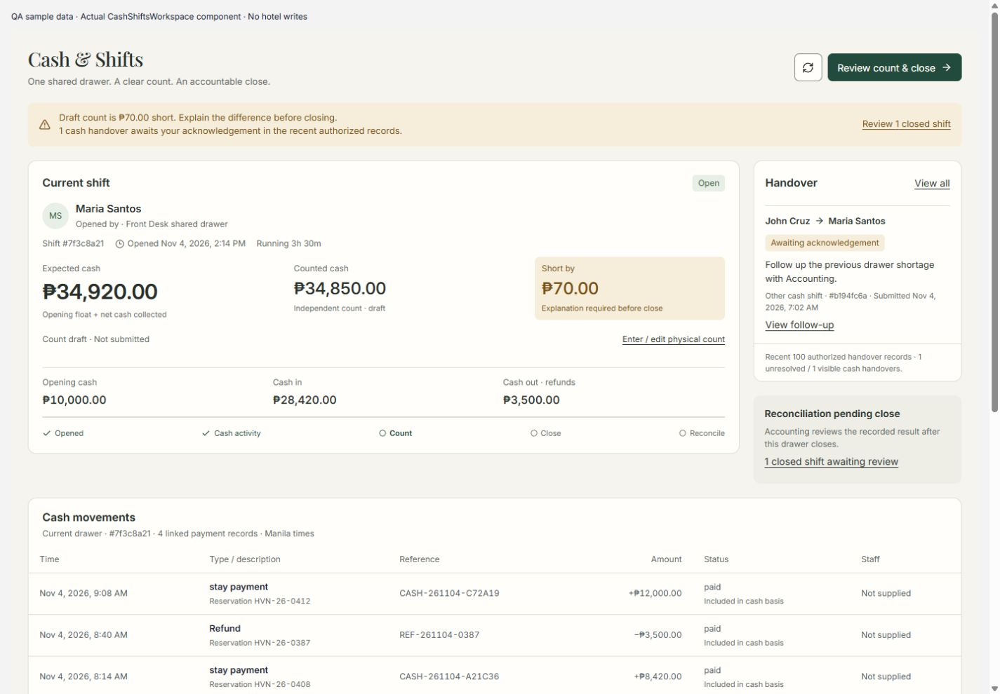
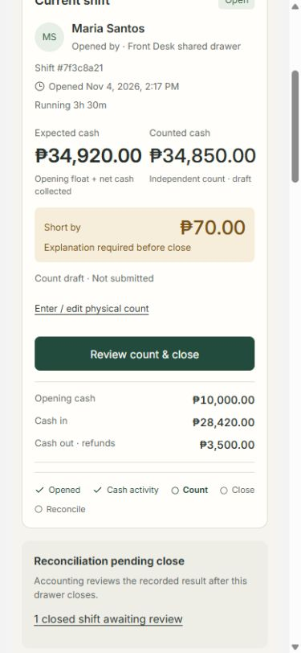
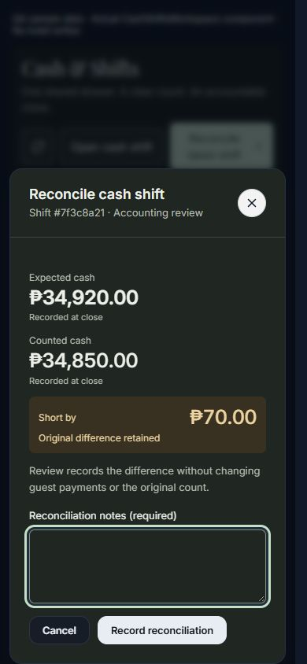

# Cash & Shifts UI — local implementation QA

Date: 4 November 2026, Asia/Manila. User explicitly approved implementation of
the [proposal and plan](../plans/2026-11-04-cash-shifts-ui-implementation-plan.md).

## Implemented behavior

- Dedicated cash workspace in the existing authenticated staff shell. Current
  drawer selection is independent of history search, status filter and paging.
  With no open drawer, the latest closed record remains visible alongside an
  explicit no-open state. The existing Cash & Shifts name is retained.
- Connected expected/count/Short/Over/Balanced presentation; unavailable values
  remain unavailable. Open expected uses opening float plus recorded net cash,
  with a paid-linked incoming/refund breakdown. Closed comparisons use stored
  financial fields. Reconciliation preserves the original difference.
- One count/note/retry owner in `CashCountPanel`, shared Modal review, explicit
  physical entry, variance explanation and duplicate-submit protection. Refresh,
  filters and cancelling review retain the same draft; drawer/operator/role
  changes reset it. Failed submissions retain the draft and unchanged retry key.
  Success displays server-returned amounts. Stale responses refresh without
  automatically submitting again; failed ledger refresh labels the cached read.
- Cash movements, complete shift history, existing pagination, all shift fields
  in details, eligible historical reconciliation actions and scope-labeled signed
  historical variance. Missing transaction staff attribution is stated honestly.
- Recent authorized cash handover summary from plural `/api/staff/handovers`,
  with independent failure/retry, personal pending attention, explicit recent-100
  limit and navigation/focus into the existing follow-up record. This records
  operational work, not a transfer of cash custody.
- Accounting reconciliation now uses an explicit form. Cancel never writes,
  including for balanced shifts. Nonzero variance still requires an explanation.
- Scoped light/dark styling, stacked narrow comparisons, mobile table rows,
  visible focus, existing Modal focus return and Escape. Financial comparison
  precedes supporting basis in both DOM and visual reading order.

No API/RPC contract, migration, role expansion, package installation, payment
write, deployment or commit accompanies this task. Transactions, Folios,
statement Reconciliation, Documents and refund business logic retain their
existing code paths. Obsolete cash-only AccountingView branches were removed.

## Automated verification

| Check | Result |
| --- | --- |
| Baseline typecheck and relevant tests | Pass; 97 baseline tests |
| Final relevant Vitest | 7 files / 117 tests pass |
| Full implementation checkpoint | 213 files / 2,292 tests pass |
| Final `npm run typecheck` | Pass after build-generated paths were restored |
| ESLint on touched TypeScript files | 0 errors; 3 pre-existing dashboard warnings |
| Production build | Pass using `HAVEN_BUILD_DIR=.tmp/cash-shifts-build` |
| `git diff --check` | Pass |

The last functional run followed the final reading-order and wording changes;
the full-suite checkpoint preceded those presentation-only changes. The final
production build includes the dark-dialog title contrast correction. A sandbox
build encountered Windows EPERM creating prerender output; the same build passed
outside the sandbox. An earlier concurrent typecheck raced generated build files;
the final sequential typecheck passed. Temporary build paths were removed from
`next-env.d.ts` and `tsconfig.json` afterwards.

New coverage exercises the real components/helpers, stubbing only HTTP boundaries:
nullable/centavo math, refunds without double subtraction, read-only other-cashier
view, drawer/operator/role reset, refresh/filter/cancel draft retention, failed
close retries, final server amounts, stale ledger labeling, reconciliation Cancel
and exact-record submission, paged history/details, handover failure/navigation
and focus, and reconciled shortages. Existing server/route locking and permission
regressions remain in the targeted suite.

## Browser evidence and limits

Chrome authenticated Front Desk, local `/manager_dashboard`: verified actual
ledger loading, no-open state, latest reconciled overage retained, movement rows,
11-record history across both pages, complete historical detail, existing Open
dialog and Cancel, refresh and absence of Accounting reconciliation controls.
No hosted business record was changed. Local evidence:
`.tmp/cash-ui/evidence/live-front-desk.jpg` (ignored).

The screenshots below render the **actual production React components and shared
CSS with explicitly labeled sample data**, rather than the standalone proposal.
Reviewed 320, 390, 768, 1024 and 1440px layouts without page horizontal overflow;
light Front Desk draft and dark Accounting closed/reconciliation states. A
₱10,000,000 draft also remained within the narrow comparison. Cancel returned
focus to its trigger; the corrected dark dialog heading has light text on its
dark surface. Browser viewport overrides were reset.

Not verified: live Accounting session, live financial mutation E2E, concurrent
payment arrival in a browser, physical touch/Safari, 200% browser zoom and every
long-content/short-window combination. Request and state behavior is covered by
automated component/domain/route tests; this does not claim those browser checks.

## Follow-up / rollback

Subsequent [data-flow QA](cash-shifts-data-flow-qa-2026-11-04.md) verifies actual
local SQL persistence, documents temporary draft lifetime and identifies KI-021:
normal refunds save without a drawer link. The UI supports linked-refund math;
the normal refund writer does not yet supply that link. This limits cash-out
accountability if staff pay a refund from the physical drawer.

Remaining browser coverage is listed in the plan checklist. Rollback is limited
to this task's reviewed UI integration and scoped styles; no schema or financial
record rollback is needed. Preserve unrelated shared-shell/payment changes.
