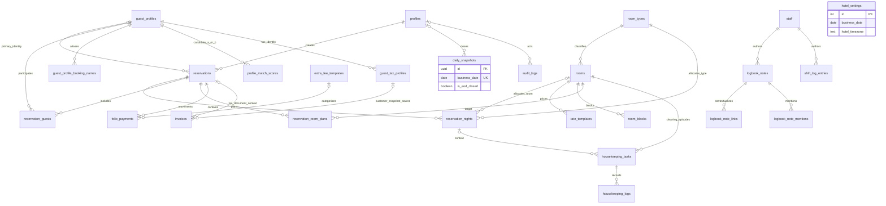
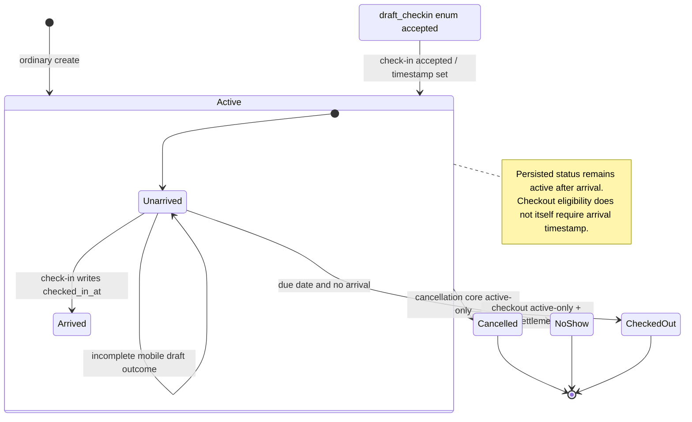
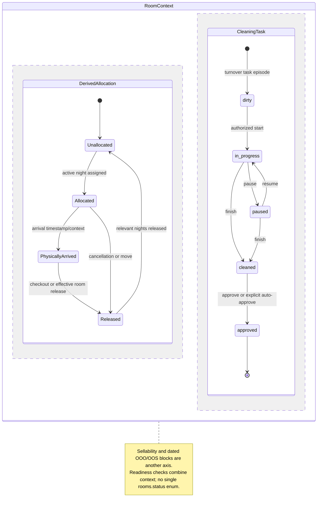
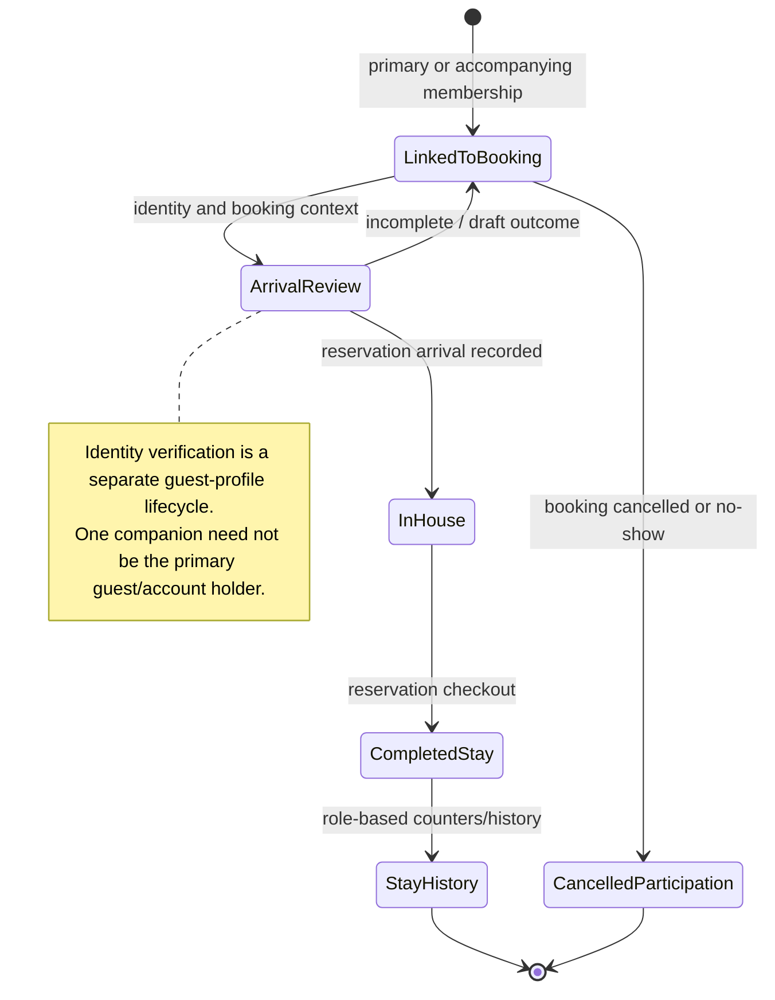
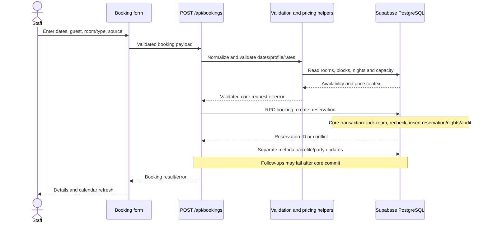
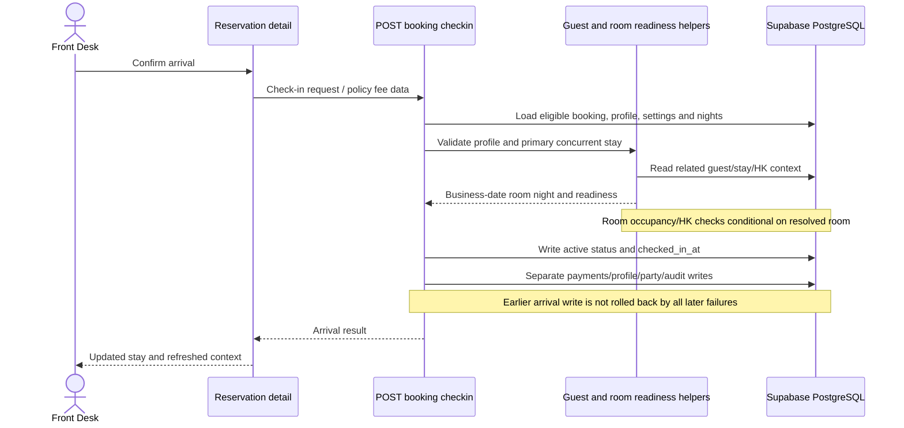

# Open Hotel PMS: hotel-operations analysis and Haven comparison

Investigation date: **3 November 2026**. Reference: `peeraseepat-cell/open-hotel-pms` at **`3f6956a54aa9faef44311f9e943ce7d44b6934e3`**. Haven source: **`d2ea413225101b1764fc81dd63ca4803a8727506`**, with the pre-existing documentation changes preserved.

## 1. Executive Summary

Open Hotel PMS offers useful concepts for Haven: per-night inventory calculation, an explicit operational business date, a guided night audit, identified accompanying guests, room-diary segments, and a shared operational handover log. These are reference concepts, not reasons to replace Haven's architecture.

**One current Haven correctness defect was reproduced:** `countAvailableUnits` subtracts every reservation overlapping the entire requested window. With two rooms, two consecutive one-night reservations in room 1, and room 2 free throughout, a two-night search returns **0 instead of 1**. The same window-wide counting pattern exists in booking SQL. Fixing only the search display would leave inconsistent commit behavior. This is the highest-priority recommendation. [H01][H02][H03]

Haven already has stronger boundaries in several important areas: explicit `checked_in` status; transactional check-in/check-out; required room, identity and payment gates; inspection-controlled room release; idempotency; separate charges and payments; protected financial/audit history. Preserve them. Some reference workflows make multiple independent database writes and can partially complete. Their feature breadth is not evidence of stronger integrity. [H04][H05][H06][H07]

No application source, package manifest, migration, or hotel data was changed for this investigation. REA was installed and verified; this document proposes improvements only. The latest Haven remediation migration remains **pending on hosted Supabase**; comparisons to it describe local intended behavior, not proof of deployed behavior.

## 2. Investigation Scope

Included: reservations, room inventory/diary, arrival/departure, guest identities, housekeeping, business date/night audit, hotel folios/documents, operational notes, and hotel KPIs. The unrelated domains explicitly excluded by the request were not traced or compared, including their linked financial and notification behavior.

Evidence labels used throughout:

- **Source finding:** traced handlers, callers, helpers, migration definitions and later replacements. This establishes code behavior and failure windows, not successful execution against a deployed database.
- **Executed check:** isolated invocation of actual pure production functions, described below. No environment file, database, user session, or payment was needed.
- **Proposal:** an adaptation for Haven, not an existing feature or an approved implementation decision.
- **Unknown:** reference production deployment, private changes, complete migration replay, browser workflow success and concurrent database behavior were not established.

### REA installation and verification

| Check | Verified result |
|---|---|
| Environment | Windows NT 10.0.26200; Codex desktop; project `C:/Projects/HOTEL-MANAGEMENT` |
| Default runtime | Node 26.6.0; npm/npx 11.18.0. This Node version did not satisfy REA 6.8.0's engine range. The initial dry-run made no setup changes. |
| Compatible runtime | Existing bundled Node **24.22.1** at `C:/Users/areva/.cache/codex-runtimes/codex-primary-runtime/dependencies/node/bin/node.exe`; no system Node upgrade |
| Setup | Package acquired through `npx rea-agents@latest`; supported-runtime `setup --client codex --dry-run --json` plan shown before applying `setup --yes --client codex --json` |
| Configuration | Added `rea` to `C:/Users/areva/.codex/config.toml`; preserved existing `node_repl`; `config.toml.rea.backup` SHA-256 matched the original saved digest |
| Skill | `C:/Users/areva/.agents/skills/reverse-engineer-anything/SKILL.md`, version 49; registration and installed skill aligned |
| MCP verification | Real stdio MCP connection to REA **6.8.0**, **229 tools**, successful `binary_session`; subsequently tools became available in this chat and both `binary_session` and scoped `analyze_javascript_application` succeeded directly |
| Restart status | A reconnect/restart was initially needed for tool discovery. **Tools are now loaded and callable; no further restart is needed for this investigation.** |
| Provider scope | Scoped doctor healthy. Overall native-engine environment incomplete; native decompilers are unnecessary for these TypeScript source traces and were not installed. |

REA's own skill directs ordinary source-repository architecture questions to normal source tools. Accordingly, direct source/SQL tracing did most of this investigation. REA's static JavaScript analysis was restricted to `checkin-room-selection.ts`, `checkout-night-release.ts`, and `linked-stay-continuity.ts`: **3 parsed files, 0 parse failures**, partial application coverage. It did not execute the app. The skill's explicit parallel-investigation instruction was used for three scoped read-only reviews under the repository's skill exception. [V01]

Executed checks:

1. Haven availability probe AST-extracted the unmodified `countAvailableUnits` and its actual dependency declarations from `lib/booking.ts`, transpiled them using installed TypeScript, and called the pure function. Result: **actual 0, expected 1** for the staggered-booking case. No application import or network access.
2. Reference helper probe imported actual TypeScript exports with Node's type stripping. **Seven assertions passed**: exact/future/past room-night selection, invalid-date rejection, and three consumed-night release boundaries. This does not verify check-in eligibility or checkout integration. [V02]

The reference checkout is isolated at `.tmp/reference/open-hotel-pms`, remains clean, and was not installed or started. Full application typecheck/build/test suites were not rerun for this documentation/configuration task. Earlier Haven QA results are not represented as tests of this research.

## 3. Open Hotel PMS Architecture Overview

| Layer | Actual implementation | Implication |
|---|---|---|
| Application | Next.js 14.2 App Router, React 18.3, TypeScript 5.7, Zod 3, Tailwind 3 | Different stack/version choices from Haven; not a migration recommendation |
| UI | `/pms` pages call `/api` handlers; large reservation-detail component coordinates multiple hotel actions | Follow the wired caller, not merely similarly named routes |
| Auth | Supabase user from bearer token/cookies, then `profiles.role`; shared staff guards plus endpoint-specific authorization | Authorization varies by operation; presence of middleware is not proof of a dedicated override policy |
| Server data | Service-role Supabase client in server code; Supabase SSR client for browser authentication | Service-role mutations require server authorization; RLS alone does not authorize these calls |
| Business logic | Helpers for nightly capacity, room changes, guest identities, folio arithmetic, housekeeping and night audit | Some workflows delegate atomic core work to SQL; others orchestrate separate writes |
| Database | Postgres tables, enums, conditional unique indexes, triggers, RLS and RPCs | Later migrations supersede earlier definitions and indexes |

Evidence: package manifest; Supabase server helper lines 6–23; server auth lines 37–127; middleware lines 124–200. Actual roles include `admin`, `frontdesk`, `maid`, `supervisor`, `mobile`, `owner`; they do not map directly onto Haven roles. Keep Haven's NextAuth, server-only database access and existing permission model. [R01][R02][R03][H08]

The schema inspected is organized around one hotel's room catalog and singleton `hotel_settings`. No separate `stays`, `check_ins`, `check_outs`, `business_dates`, or `night_audits` tables are needed to explain the traced workflows: reservation timestamps/night rows, settings and daily snapshots perform those jobs. This is a finding about the relevant schema, not a guarantee about every unrelated table. [R04][R24]

## 4. Reservation Logic

### Creation and confirmation

`POST /api/bookings` validates guest/name/phone, source (`walkin`, `ota`, `direct`, `agent`), date range, room or room type, party counts and optional rates/profile. Ordinary nights are generated as **check-in inclusive, checkout exclusive**. Same-day arrival is possible when checkout is later; equal-date overnight stays are rejected by the ordinary API. Dedicated day-use is a separate workflow, and a later schema migration permits equal dates for that purpose. [R05][R06][R09]

The API performs room/type availability and guest eligibility checks, computes pricing, then calls `booking_create_reservation`. That RPC locks a selected physical room, checks sellability/conflicts/blocks/capacity, inserts an **`active`** reservation and its `reservation_nights`, and inserts audit history. Later API metadata, profile and party writes are separate operations. **Atomic core creation does not make the entire HTTP workflow atomic.** [R05][R07]

There is no normal `confirmed` status in the reference lifecycle. Creating an ordinary booking makes it active; arrival is distinguished later by `checked_in_at`. A unique booking code prevents duplicate codes, but the inspected create input/RPC has no retry idempotency key. No same-person/same-date duplicate-booking guarantee was found. Haven already has stronger request idempotency; retain it. [R04][R05][R07][H02]

The reference allows yesterday's arrival before Bangkok noon in one create path. This is property-specific backdating policy, not a default rule for Haven. Guest-facing real-date validation must remain distinct from any future operational business date. [R05]

### Actual states and modification

| Operation | Actual transition / guard | Records affected |
|---|---|---|
| Create | New → `active`, no check-in timestamp | Reservation, night rows, core audit; later metadata/party writes |
| Standard check-in | `active` or accepted `draft_checkin` → `active` with `checked_in_at` | Arrival timestamp, optional money/profile/party/audit work |
| Edit | Core update RPC requires `active`; some post-checkout administrative metadata exceptions exist in the API | Self-excluding conflict checks; replaced night rows soft-cancelled/rebuilt; audit |
| Cancel | `active` → `cancelled`; core RPC rejects a repeated cancellation | Night rows soft-cancelled; audit; separate settlement/linked cleanup |
| No-show | Active, not checked in, arrival ≤ business date → `no_show` | Status, nights, optional fee, audit in separate writes |
| Checkout | `active` → `checked_out` | Money, state/timestamps, future-night release, HK/history/audit |

`draft_checkin` is a real allowed enum value and accepted by check-in paths. However, an inspected mobile **draft response writes `active`**, leaving arrival incomplete and recording a draft outcome in response/audit. Do not equate every draft screen with a persisted `draft_checkin` state. [R10][R12][R15][R17][R27]

`PUT /api/bookings/:id` splits metadata-only editing from `booking_update_reservation`. The core RPC locks the reservation and target room, excludes its own existing nights during conflict/capacity checks, soft-cancels obsolete rows and inserts replacements. Notes/source/details and additional API follow-ups are outside that core transaction. Booking edits, creation and cancellation have action audits with before/after context. [R07][R10][R11]

Cancellation can settle fees/refunds before calling the cancellation RPC, then clean up linked bookings, future room plans and housekeeping afterward. Warnings acknowledge partial cleanup. Do not import this money-before-state, multi-write boundary over Haven's atomic refund-request/entitlement controls. [R11][H03]

### Extension, shortening and assignment

Extension has preview/commit endpoints backed by `extend-stay-orchestrator.ts`. It requires an active reservation and a later checkout; resolves last assigned room, blocks and proposed room changes; can extend in place or coordinate other room changes. Night additions, new checkout/total and audit are separate writes. Haven already supports a simpler checked-in extension with frozen additional nightly rates and conflict escalation. Grade **C** for the existing basic feature; **B** for selectively improving previews; **E** for copying the broad orchestration or its transaction boundary. [R13][H02]

Shortening previews revised room total, paid amount, fees and refund, then separately posts settlement, cancels future nights and updates dates, with attempted rollback. The useful concept is a policy-driven preview; the implementation should not be copied. A dedicated shorten flow was not found in Haven's focused Front Desk route inventory; pre-arrival changes and ordinary checkout already exist. Any proposed early-departure financial adjustment needs a separately approved policy and an atomic commit. [R14]

Assignment updates night allocations and leaves the lifecycle unchanged. Immediate room changes check availability/readiness, soft-cancel old night allocations and insert new ones from an effective date, then reprice/audit. Future plans use `reservation_room_plans` with `planned/executed/cancelled`. Planned allocation is distinct from a guest already moving physically. [R18][R19]

## 5. Room Availability Logic

The reference has **two different questions**:

1. How many bookings of a room type fit on every requested night?
2. Is a particular physical room free for the required range, including blocks/planned holds?

`GET /api/availability` uses sellable, non-day-use inventory. For each requested night it removes OOO/OOS blocked rooms, counts distinct active reservation IDs using uncancelled night rows, and counts planned room holds. The result is the bottleneck night:

```text
nightly_capacity(type, date) = sellable overnight rooms minus blocked physical rooms
nightly_free(type, date) = nightly_capacity - distinct booked reservations - planned holds
advertised_available(type, range) = max(0, min(nightly_free for every requested night))
```

Actual source locations: inventory 33–58; per-night blocked capacity **63–74**; booked sets **78–116**; planned holds **119–134**; minimum/clamp **136–148**. Later rate lookup is not the inventory formula. Housekeeping readiness today is not used as a blanket ban on selling future nights. [R08]

Physical-room helpers search `stay_date >= checkin AND stay_date < checkout`, uncancelled active/draft nights, excluding the edited reservation. Block overlap is **`start_date < requested_checkout AND end_date > requested_checkin`**; night membership is `start_date <= night AND end_date > night`. Helpers combine night conflicts, OOO/OOS and planned holds. [R20][R21]

Enforcement exists in UI feedback, APIs/shared helpers, create/update RPCs, a capacity trigger and a database uniqueness constraint. The latest inspected physical-night index is **`(room_id, stay_date, dayuse_session) WHERE cancelled_at IS NULL`**, replacing the older two-column index. Floating rows may have no room ID, so that index alone cannot guard type-level capacity. [R07][R09][R22]

Important reference limitations:

- The inspected capacity trigger accounts for **OOO**, while newer server helpers account for **OOO and OOS**. The layers are not fully aligned.
- Floating capacity uses count/check logic without an identified per-type/per-night locking protocol in those inspected paths. Race-free capacity is **not proven** by a trigger alone.
- Per-night type capacity does not prove that one physical room is free for the entire stay. Fragmented room assignments may require a planned move. These are separate feasibility checks. [R20][R22]

### Confirmed Haven defect

| Input | Value |
|---|---|
| Inventory | Two sellable, clean rooms of the same type |
| Booking A | Room 1, `[2026-11-10, 2026-11-11)` |
| Booking B | Room 1, `[2026-11-11, 2026-11-12)` |
| Search | `[2026-11-10, 2026-11-12)` |
| Current pure function | `2 rooms - 2 overlapping reservations = 0` |
| Correct feasible result | **1**; room 2 is free for both nights |

This fixture deliberately avoids physical-room fragmentation ambiguity. `lib/booking.ts:252–276` counts the whole-window union of reservations/holds. Similar counting occurs in hold/staff booking SQL and pending deposit-submission remediation. **Recommendation A / High:** use one nightly rule across read estimates and locked database commits, retaining hold expiry, converted-hold exclusion, unpaid-pending expiry, administrative/readiness policy, retry idempotency and physical assignment constraints. No fix was performed. [H01][H02][H03][V02]

## 6. Room Calendar / Room Diary Logic

The actual calendar page uses a 21-day date window and requests `/api/calendar?start=&end=`. The API loads visible rooms, uncancelled night rows joined to active/checked-out/draft reservations, room blocks, planned moves and housekeeping context. It groups rows by **room + reservation**, preserves individual night arrays and includes unassigned reservations. `RoomGrid` splits consecutive nights and clips bars to the visible window. This explains how a reservation can be displayed in different rooms across its stay. [R23]

Source/channel colors are walk-in sky, OTA purple, direct emerald and agent amber; arrival/draft/departure/HK/block indicators carry additional meaning. These colors are not a pure reservation-state machine. The page passes **`mode="readonly"`**: a bar opens details, an empty cell starts a prefilled booking, and unassigned bookings open assignment. Do not infer drag-and-drop rescheduling from generic component capabilities. [R23]

Data refresh occurs on date/dependency changes and mutation callbacks. No timer or realtime subscription was found on that page. Haven already polls its rack every 30 seconds; no refresh subsystem needs copying. [R23][H09]

Haven currently projects the reservation's current `room_id` over its full date range in `barsForRoom`; `/api/rack` reads that current mapping. Existing assignment history could support more accurate segments, but historical effective boundaries must be verified before treating those rows as a faithful diary. Proposed improvement: extend the existing rack response with effective assignment segments; retain existing polling/actions and frozen pricing. [H09][H10]

## 7. Check-In Logic

Actual standard flow, from reservation detail to `POST /api/bookings/:id/checkin`:

1. Require eligible staff and reservation `active`/`draft_checkin`; require a linked guest profile and run completeness validation.
2. Resolve operational business date and prior check-in audit context; load uncancelled night rows. Pick exact business-date night, otherwise earliest future, otherwise latest past.
3. Reject the same primary guest already checked in on an unrelated active stay, with linked/group exceptions.
4. **If a room resolves**, reject a different guest physically occupying it, including an uncompleted due-out-today stay; check newest housekeeping task. Dirty/in-progress/paused blocks; missing task passes; cleaned can be auto-approved.
5. Update reservation to `active` with check-in timestamp/time.
6. Separately process optional payments/early fee, profile promotion, primary-party membership/name aliases and audits; refresh UI. [R12][R16]

The guest completeness helper applies reference-specific nationality/address/identity rules, including a 13-digit Thai ID requirement in the relevant branch. Early arrival uses a fixed 04:00–08:59 policy window. Neither should be transplanted into Haven's configured local policy. [R12][R16]

Source limitations: room checks are conditional on a resolved room; no explicit arrival/departure date-window rejection was found in the standard eligibility-to-persistence section; reservation arrival is persisted before later financial/profile operations. Mobile readiness also accepts absent room/HK context in inspected branches. These are **static findings**, not a claim that a live operator successfully bypassed them. [R12][R15][R16]

Haven's latest local `front_desk_check_in` requires confirmed status, policy-required verified identity, verified website deposit, zero folio balance, valid configured arrival/early-approval timing and an available, clean, active room, with overlap checks under SQL locks. It changes reservation/assignment/room/audit atomically. Keep that boundary; only consider a consolidated **read-only readiness assessment** if it improves the existing wizard. [H04]

## 8. Check-Out Logic

Reference reservation detail/settlement drawer calls `POST /api/bookings/:id/checkout`. The route authorizes admin/supervisor/frontdesk and requires **`active`**; the inspected eligibility section does not require `checked_in_at`. It resolves linked stays, validates settlement, optionally checks returnable hotel items, then performs departure writes. [R17]

The balance helper accounts for discounted room total, net additional charges, optional policy fee, net payments, applied security deposit and current settlement. Refunds reduce payment credit; deposit-category/record-only rows do not automatically count as ordinary room payment. Outstanding positive balance blocks checkout. `force_checkout` skips certain unreturned-item warnings, **not the money gate**. Optional late fee uses a fixed local-time rule. [R17][R28]

Affected records: payment/deposit/refund rows; active linked reservation status/timestamps; future `reservation_nights.cancelled_at`; guest completed-stay/night counters; housekeeping task/log episode; reservation/group audit context. The release helper preserves consumed nights and releases later unused nights. Checkout's writes are **not one transaction**; guest-counter failures can be logged without undoing departure, and some audit handling is unchecked. [R17][R29][R30]

Haven requires **checked_in**, an active assignment and settled balance, then atomically releases assignment, records checkout, makes the room dirty, creates turnover cleaning and writes audit. This is stronger than copying the reference's multi-request sequence. A clearer consolidated settlement/readiness preview can be adapted without moving money authority to the client. [H05]

## 9. Guest Management Logic

Guests and reservations are independent entities. Reference `guest_profiles` stores identity/contact/lifecycle; `reservations.guest_profile_id` identifies the primary; `reservation_guests` records primary/accompanying membership. Uniqueness prevents duplicate membership and multiple primaries. Reference slot limits are primary 1, companions 2–4; the latest `sync_accompanying_party` RPC synchronizes slots atomically. **Haven should derive limits from its own capacity, not adopt four-person assumptions.** [R31][R32][R33]

The party API rejects merged profiles, a primary re-added as companion, and duplicates. Primary occupancy conflict logic is an application check with linked/group exceptions, not an independently proven database exclusion constraint. On completed stays the reference tracks primary/accompanying history and legacy imported counters. [R16][R33][R34]

Identity handling separates verified names from booking-name aliases. Document identifiers are normalized; existing document matches fill missing fields rather than blindly overwriting protected values. A weaker fallback accepts normalized name **or phone** within a first-50 result set. That is not safe proof of identity and is not recommended. [R35]

Duplicate review has actual UI/API wiring: scored candidate queue, manual source/master choice and reason; do-not-merge/protected-profile guards. Latest merge SQL locks profiles, deduplicates party links, reassigns relevant hotel relationships, preserves counters and marks the source merged with an audit snapshot. Alias union runs after the RPC, so whole-request atomicity and undo are not established. [R36][R37]

Haven already has independent guests, account/email uniqueness, preferences/loyalty and a consolidated history surface. Focused source/migration search did not find equivalent per-occupant party or reviewed merge flows. Additive party identity is useful if the hotel needs every occupant registered. Merge needs conservative human review and must never silently reassign auth accounts or rewrite issued financial identity. No actual duplicate population was measured. [H11]

## 10. Housekeeping Logic

Reference task states are **`dirty → in_progress ↔ paused → cleaned → approved`**. `is_no_service` is a flag. Starting checks the authenticated maid identity, allowed prior state and whether that maid already has another running task that day; timer resume preserves accumulated active duration. [R38]

The latest inspected finish RPC locks the task, validates in-progress/paused, computes duration and records checklist/cleaned completion. Explicit auto-approve/no-service may also approve it. The HTTP finish path subsequently performs room stock/amenity/return operations; those are not automatically part of the RPC transaction. A later grant migration restricts the finish RPC to service role. [R39]

Approval requires cleaned and records approver/log. At arrival, the reference may auto-approve a cleaned task; missing HK context may pass. A departure uses `hk-dirty`: an unfinished latest task can reset to dirty, while a completed latest task produces a **new cleaning episode**, preserving history. Latest uniqueness is **room/date/task_seq**, not the initial room/date uniqueness. [R12][R30][R38][R40]

Housekeeping interacts with reservation operations as follows:

| Event | Reference effect |
|---|---|
| Future reservation search | Sellability/dated blocks checked; today's dirty state is not permanent future unavailability |
| Check-in / immediate room change | Latest dirty/in-progress/paused task can block the target |
| Checkout / relevant room release | Create/reset dirty cleaning episode |
| Cleaning completion | Checklist/duration recorded; cleaned or explicit auto-approved |
| Inspection/approval | Approved marker/log available for room readiness |

Haven already has typed tasks, worker identity, locks, an exclusive running task per room, checkout-cleaning creation and inspection fail→reclean child history. Preserve its explicit inspection gate. Optional pause/duration capture is **B / Low**, only if active-time workload data is needed. Hotel returnable-item tracking is conditional, not a reason to add another inventory subsystem. [H05][H06]

## 11. Night Audit & Business Date Logic

### Why a separate operational date exists

A calendar date changes at midnight even when hotel staff are still closing the previous operating day. The reference persists `hotel_settings.business_date`, reads real calendar date in configured hotel timezone, and lets the old business date remain open until night audit. This keeps late postings and unresolved arrivals attached to a deliberate operational period rather than whichever server date a request happens to see. Real timestamps remain real timestamps. [R24][R25]

Actual usage includes EOD status/pre-check/run, pending no-show selection, payment posting/closed-day guards, room-night selection at arrival, checkout release context, and dashboard operational-date filters. It is not merely a date label. [R12][R17][R25][R26][R27][R41]

### Traced closing flow

1. Night-audit UI loads EOD status and walks through no-shows, pre-check, hotel operational review, preview, confirmation and summary.
2. Pre-check queries unresolved no-shows, arrival/departure context, unfinished check-in drafts, active day-use and housekeeping.
3. **Blockers:** unresolved no-shows, open check-in wizard drafts and active day-use. **Warnings:** unfinished arrivals/departures/housekeeping in the inspected response. Do not treat every warning as a blocker.
4. Marking no-show requires active, no check-in and arrival ≤ business date. It updates status and cancels nights, with optional fee/audit in separate writes.
5. Run endpoint rechecks eligibility. Without force it refuses premature closing and unresolved no-shows; it checks drafts/day-use. A body `force` branch bypasses listed gates/cancels drafts without an identified dedicated override authorization inside that handler.
6. Compute nightly hotel revenue/occupancy and collection summaries, upsert `daily_snapshots` with `is_eod_closed=true`, run room-operation snapshots, then **separately advance** `hotel_settings.business_date` one day. [R25][R26][R27][R42]

This is **not an atomic close**: no enclosing transaction, compare-and-swap business-date advance or dedicated close lock was found in the handler. Snapshot/date advancement can diverge on failure. A snapshot row can also exist before close; the later `is_eod_closed` migration explicitly distinguishes that case. Do not use snapshot existence as the close criterion. [R42][R43]

Haven's focused `app/`, `lib/`, migration search found no explicit business-date/night-audit mechanism. `hotelToday` uses actual Manila calendar date; Front Desk daily reports are generated/submitted operational evidence, **not a business-day advance**. Their `hotelDayWindow` correctly uses UTC+8 local midnight; there is no demonstrated UTC-window bug here. [H01][H12]

**Proposal:** introduce an operational posting date only where policy requires it; keep public booking/auth/session clocks real. Use an authorized, idempotent, locked **single transaction** for required resolution checks, immutable snapshot and date advance. Keep warning acknowledgement distinct from prohibited-state overrides. Do not import client-controlled force or automatic fee-as-collected behavior. [R27][R42]

## 12. Hotel Fees / Payment Logic

Reference `folio_payments` records hotel payment/refund/deposit movements, payment method, local paid date and staff attribution. Fee templates add categorized charges. `computeFeeSummary` calculates in integer satang, excludes record-only entries from received money and distinguishes security deposits from ordinary credits. Payment posting checks positive amounts, closed business day and checked-out/reopened folio rules. [R28][R41][R44]

**Security deposit is not reservation downpayment.** The reference's held deposit is separate until applied/refunded; Haven's reservation deposit is booking payment toward the folio. This difference is not evidence that Haven's existing deposit accounting is wrong. Add a separate liability only if the hotel actually requires held security deposits. [R28][R45][H07]

The reference overloads payment storage for some record-only fee assessments (`tx_type=payment`, extra-charge category). Haven already separates `folio_charges`, payments, adjustments, refunds and issued documents, derives totals in centavos, and protects settled payments/history. Keep this clearer model. Server-stamp financial actors; do not copy request-controlled cashier text. [R28][R41][H07]

Tax-document naming differs: reference **`invoices` are tax documents**; Haven **`invoices` are live folios**, with `financial_documents` the closer issued-document counterpart. The reference has draft/issued/cancelled tax documents and coverage splitting. Its old one-issued-per-booking index was later dropped; API coverage guards must not be mistaken for that old database constraint. Bangkok-specific numbering/tax rules and MAX+1 allocation are not an appropriate transplant. [R46][R47][H07]

Reusable active hotel fee templates are **B**: a small server-priced catalog can reduce inconsistent entry, freezing code/name/price into existing folio charges and requiring authorized override reasons. Actual inconsistent hotel data was not measured. Existing configured Haven tax snapshots and immutable financial controls are **C**. [R28][H07]

## 13. Operational Logbook Logic

Reference `logbook_notes` supports editable operational work: open/in-progress/resolved, priority/type, author, reminder and time window. Links associate room/guest/staff context; mentions support acknowledgement. `shift_log_entries` is unique per log date/hour slot. Board coordinates/rich editor details are presentation choices, not necessary business rules. [R48][R49]

Create stamps authenticated author and validates the note, then inserts links/mentions in later calls. Close is retry-tolerant and records resolved/closed-by/time; reopen clears close markers and returns to open. Archive preserves the record; restore clears archive but **does not reopen**. Latest policies permit shared editing by active staff rather than the older creator-only behavior. A reminder field alone does not prove any notification delivery guarantee. [R50][R51]

Audit and logbook serve different purposes. Reservation creation/edit/cancel, check-in/out, HK approval and guest merge emit action audits in the traced handlers/RPCs. Editable notes cannot replace immutable evidence. Haven already has protected audit, reservation notes and formal submitted Front Desk reports; a shared lightweight follow-up queue was not found in the focused search. Adapt a simple linked handover list with responsibility, due time and audited status, without copying a freeform canvas. [R07][R11][R12][R17][R37][H07][H12]

## 14. Dashboard KPI Logic

The actual `/pms` dashboard fetches **`/api/dashboard/kpi`**, once on mount in the inspected page. A similarly named legacy endpoint exists with different filters; it is not the canonical caller described below. The response includes business date, calendar date and EOD need. [R52][R53]

| KPI | Actual data/query/filter | Date and interpretation |
|---|---|---|
| Arrivals | `reservations`, active, non-day-use, check-in equals business date; completion flag from `checked_in_at` | Operating-day scheduled arrivals, not calendar timestamp count |
| Departures | Reservations active/checked-out, non-day-use, checkout equals business date; suppress same-room linked continuation | A continuation need not be a physical departure |
| In-house label | Active, non-day-use, check-in ≤ business date, checkout ≥ business date; **no `checked_in_at` predicate** | May include unarrived reservations; do not copy as physical in-house count |
| Pending no-shows | Active, non-day-use, arrival ≤ business date, `checked_in_at IS NULL` | Unresolved decision queue; not automatically persisted no-show |
| Dirty rooms label | Count task IDs for business date with dirty/in-progress/paused | Unit is task rows, not distinct room IDs. Latest schema permits multiple episodes; this alone does not prove actual overcount. |
| Room-night revenue | Uncancelled night rows on business date joined to non-cancelled, non-day-use bookings | Accrual by stay night, not same-day cash collection |
| Occupied nights / occupancy | Count relevant night rows / configured regular sellable capacity | Night-inventory basis, not physically checked-in room count |
| ADR | Room-night revenue / occupied night rows, zero-safe | Accrual basis |
| RevPAR | Room-night revenue / sellable capacity, zero-safe | Capacity basis; denominator is configured, so catalog consistency matters |
| Trend | Prior daily snapshots plus current live business-date point | Closed snapshots and live point have different finality |

Evidence: KPI handler queries 81–139, continuation filtering 210–236, calculations 248–267, trend/response 323–360. Availability-by-type is provided by the separate availability endpoint; the inspected KPI route should not be credited with an unproven vacant-ready-room formula. [R08][R53]

Haven already distinguishes **booked occupancy** from **live room-rack occupancy** by an approved decision; in-house explicitly uses `checked_in`, and room readiness uses room state. Preserve these definitions. A future business-date view should add date/basis labels and a reconciled nightly accrual report using existing frozen rates, without forcing unlike occupancy values to agree or calling role-hidden financial zeros actual zero revenue. [H13][H14]

## 15. Simplified Database/ERD Analysis

This is an actual reference-table subset. Fields reflect the relevant migrations through the pinned commit; it is not a new Haven schema proposal. FK arrows are relational references; temporal selection of a snapshot/settings date is **not** an invented FK.



The diagram omits nonessential columns and some staff/profile audit FKs. `logbook_note_links` uses typed identifiers and is not represented as guaranteed FKs to every possible linked entity. There is no general `Hotel` or `Stay` entity invented for this diagram. [R04][R19][R24][R31][R32][R44][R46][R48][R49][R54]

| Actual table | Purpose / module | PK | Important FKs | Material fields and rule |
|---|---|---|---|---|
| `profiles` | Authenticated application identity | `user_id` UUID | `auth.users.id` | Role, active flag; used by auth and audit |
| `staff` | Operational staff directory | `id` UUID | See directory migration | Distinct from auth profile; logbook authors reference this table |
| `room_types` | Inventory classification | `id` bigint | — | Unique code, display names/order |
| `rooms` | Physical inventory | `id` UUID | `room_type_id` | Unique room number; sellable, board visibility, closure reason; no occupied/vacant status enum |
| `room_blocks` | Dated physical-room exclusion | `id` UUID | `room_id` | Block type/start/end; half-open consuming dates; range index |
| `rate_templates` | Room/date pricing | `id` UUID | Room, updater profile | Unique `(stay_date,room_id)` |
| `reservations` | Booking and stay lifecycle | `id` UUID | Creator/updater profiles; primary guest; optional parent reservation | Unique booking code, source/status, dates/total, arrival/departure timestamps |
| `reservation_nights` | Dated allocation and frozen nightly amount | `id` UUID | Reservation, nullable room, room type | Stay date, nightly price, cancellation timestamp, day-use session; active physical slot uniqueness |
| `reservation_room_plans` | Future room allocation | `id` UUID | Reservation, target room/type, optional previous room | Date/pricing/status checks; target/date/status index |
| `guest_profiles` | Independent guest identity | `id` UUID | Self `merged_into` | Contact/ID, draft/verified/merged/blacklisted; unique non-merged document pair |
| `reservation_guests` | Stay party | `id` UUID | Reservation, guest profile | Primary/accompanying; member/primary/slot uniqueness |
| `profile_match_scores` | Reviewed duplicate candidates | `id` UUID | Two guest profiles | Score, match fields, pending/merged/dismissed/do-not-merge; no-self and unique pair |
| `guest_profile_booking_names` | Booking spelling history | `id` UUID | Guest, source reservation | Unique guest/normalized-name; seen count/times |
| `housekeeping_tasks` | Cleaning episodes | `id` UUID | Room, optional night, assigned/requested/approved profiles | Stay date, task sequence, state, timestamps/checklist; latest room/date/sequence uniqueness |
| `housekeeping_logs` | Task transition history | `id` UUID | Task, actor profile | State/checklist/note/time |
| `folio_payments` | Hotel financial movements and some fee assessments | `id` UUID | Reservation, recorder profile, fee-template code | Type/method/amount/category/record-only/paid date; RLS service-role policy |
| `extra_fee_templates` | Hotel fee catalog | `code` text | — | Active/category/default price; category check and sort index |
| `guest_tax_profiles` | Tax customer identity | `id` UUID | Guest profile | Tax/address identity used for document snapshots |
| `invoices` | Tax documents, not live folios | `id` UUID | Reservation context, guest tax profile | Draft/issued/cancelled, unique non-null number, covered-booking snapshots; later split coverage |
| `hotel_settings` | Property configuration / operating date | `id` integer | — | Singleton check `id=1`, business date/timezone/capacity |
| `daily_snapshots` | Daily accrual/collection close results | `id` UUID | Closing profile | Unique business date; explicit `is_eod_closed`; revenue/occupancy/ADR/RevPAR |
| `audit_logs` | Action evidence | `id` UUID | Actor profile | Action/entity/before/after/time; not editable handover content |
| `logbook_notes` | Shared operational follow-up | `id` UUID | Staff author/closer/archiver | Status/priority/reminder/window; close and archive are separate |
| `logbook_note_links` | Typed note context | `id` UUID | Note | Linked room/guest/staff identifiers; at least one identifier check |
| `logbook_note_mentions` | Mention acknowledgement | `id` UUID | Note, optional staff | Individual/group target, acknowledgement |
| `shift_log_entries` | Shared hourly handover | `id` UUID | Creator/updater staff | Unique `(log_date,hour_slot)`, hour 0–23 |

Table evidence: core [R04]; blocks/staff [R54]; plans [R19]; guests/party/aliases [R31][R32][R35][R36]; HK [R39][R40]; hotel finance [R44][R45][R46]; settings/snapshots [R24][R43]; logbook [R48][R49].

### Material database enforcement and supersession

| Object | What it enforces | Important boundary |
|---|---|---|
| Conditional night index, latest day-use migration | One uncancelled allocation per room/date/session | NULL physical room remains possible; not type-capacity locking [R09] |
| `enforce_reservation_night_capacity` trigger | Sellability/day-use/type capacity on relevant night writes | OOO/server OOS drift; count/check concurrency not proven [R22] |
| `booking_create_reservation`, `booking_update_reservation` | Locked core booking/night/audit mutation | API follow-ups outside RPC [R07] |
| `booking_cancel_reservation` | Active booking/night cancellation and core audit | Repeat cancelled state raises; not retry no-op [R11] |
| Party partial unique/check indexes; `link_primary_guest`; `sync_accompanying_party` | Primary/member/slot consistency | Latest slot sync is October migration, not older comments [R32][R33] |
| Guest document partial unique index | Unique non-merged ID type/number | Does not prove phone/name identity [R32][R35] |
| `merge_guest_profiles`, latest replacement | Profile locks, relinking/history/protection, merge audit | Alias union is outside transaction [R37] |
| Latest HK finish body + later grant | Task lock/state/duration/checklist; service-role execution | HTTP stock/amenity follow-ups outside it [R39] |
| HK room/date/task_seq unique | Distinguishes repeated same-day cleaning | Replaces original room/date unique [R40] |
| Hotel settings singleton; snapshot date unique | One settings row and one snapshot per date | No atomic close implied; `is_eod_closed` matters [R24][R43] |
| Folio RLS; fee-template service policy | Restricted direct database access | Service-role callers still need operation authorization [R44] |
| Invoice number uniqueness; split migration | Number backstop, broader coverage model | Old one-issued-per-booking index removed; API overlap checks not equivalent to a DB invariant [R46][R47] |
| Logbook active-window indexes/timestamp trigger/shared-staff RLS | Retrieval/update tracking/shared authorization | Later staff policy supersedes creator-only policy [R48][R49][R51] |

These migrations were traced as source; they were not replayed into a new reference database. No claim is made that a particular public deployment has exactly this ledger or RLS state.

## 16. Business Rule Catalog

Each row states the observed rule, source, enforcement, related tables/API and UI effect. Limitations are retained where enforcement is partial. IDs belong to this report and are not production rule identifiers.

| ID | Rule | Source | Enforced by | Related tables | API / service | UI impact |
|---|---|---|---|---|---|---|
| BR-HOTEL-001 | Ordinary overnight nights are `[arrival,departure)` and require departure later | [R05][R06] | API + helper + RPC | reservations, reservation_nights | bookings, listNights | Checkout day does not consume another overnight night |
| BR-HOTEL-002 | Reference create makes `active`; arrival is a separate timestamp | [R07][R12] | RPC + arrival handler | reservations | booking_create_reservation, checkin | Booked and arrived flags must be distinguishable |
| BR-HOTEL-003 | Type availability is minimum nightly free capacity | [R08] | API/helper | rooms, nights, blocks, plans | availability | Show bottleneck-night availability |
| BR-HOTEL-004 | OOO/OOS blocks consume `[start,end)` in newer server helpers | [R20][R21] | Backend queries/helper | room_blocks | assertRoomAvailableForDateRange | Block unavailable room choices |
| BR-HOTEL-005 | Physical uncancelled room/date/session slot is unique | [R09] | Database partial unique | reservation_nights | Booking/assignment/move writes | Reject a physical double allocation |
| BR-HOTEL-006 | Floating type capacity needs its own check | [R07][R22] | RPC + trigger count/check | rooms, nights, reservations | capacity guard | Cannot infer availability from NULL-room uniqueness |
| BR-HOTEL-007 | Edit excludes the same booking's old allocations | [R07][R10] | API/RPC | reservations, nights | booking_update_reservation | A booking does not conflict with itself |
| BR-HOTEL-008 | Replaced/cancelled allocations retain soft-cancel history | [R07][R11] | SQL + handlers | reservation_nights | update/cancel | Released inventory without erasing prior allocations |
| BR-HOTEL-009 | Cancellation core accepts active only; repeat is error | [R11] | Locked RPC | reservations, nights, audits | booking_cancel_reservation | Retry must reload; not assumed success |
| BR-HOTEL-010 | Assignment is allocation, not lifecycle transition | [R18] | API | nights, reservations | assign | Room label changes without new stay state |
| BR-HOTEL-011 | Immediate move checks occupancy, readiness, dates and pricing | [R18][R20] | Shared service | nights, rooms, HK, audits | executeRoomMove | Explain target conflicts and repricing |
| BR-HOTEL-012 | Planned move has planned/executed/cancelled lifecycle | [R19] | Checks + services | reservation_room_plans | planned-room-moves | Future allocation displayed separately |
| BR-HOTEL-013 | Extension requires active booking and later departure | [R13] | Orchestrator | reservations, nights | extend preview/commit | Preview in-place/move choices |
| BR-HOTEL-014 | Shortening previews settlement and releases future nights | [R14] | Handler; multi-write limit | reservations, nights, folio | shorten | Show revised total/refund before confirmation |
| BR-HOTEL-015 | Standard arrival requires linked complete primary guest | [R12][R16] | Handler/helper | reservations, guest_profiles | checkin | Return missing identity fields |
| BR-HOTEL-016 | Primary guest cannot be concurrently checked into unrelated stays | [R16] | Application check | reservations, reservation_guests | guest-primary-checkin | Resolve duplicate occupancy; linked/group exceptions |
| BR-HOTEL-017 | Selected room night prefers business date, then future, then past | [R16][V02] | Pure helper | reservation_nights | pickCheckinRoomNight | Target selection is not itself date eligibility |
| BR-HOTEL-018 | Resolved target with dirty/in-progress/paused HK blocks arrival | [R12] | Handler | rooms, HK tasks | checkin | Cleaned may auto-approve; absent context may pass |
| BR-HOTEL-019 | Checkout settlement rejects positive remaining room balance | [R17][R28] | Backend balance check | reservations, folio_payments | checkout, checkout-balance | Require settlement; force-item exception cannot bypass |
| BR-HOTEL-020 | Consumed nights survive departure release | [R29][V02] | Helper + handler | reservation_nights | checkout-night-release | Free unused future inventory only |
| BR-HOTEL-021 | Departure starts a new dirty episode after completed cleaning | [R30][R40] | Helper + unique sequence | housekeeping_tasks/logs | hk-dirty | Preserve completed cleaning history |
| BR-HOTEL-022 | HK start/resume only from dirty/paused; maid identity checked | [R38] | API auth/prechecks | HK tasks | start | Valid worker/start controls |
| BR-HOTEL-023 | HK finish locks task and accepts in-progress/paused | [R39] | SQL RPC | HK tasks/logs | finish RPC | Final checklist/time; explicit auto-approve cases |
| BR-HOTEL-024 | Party has one primary, unique members and valid slots | [R32][R33] | DB constraints + RPC/API | reservation_guests | guests, sync_accompanying_party | No duplicate occupant/slot |
| BR-HOTEL-025 | Non-merged normalized document pair is unique | [R32][R35] | DB + normalization | guest_profiles | profile persistence | Reuse/review existing identity |
| BR-HOTEL-026 | Duplicate candidate is not automatic merge permission | [R36][R37] | Review UI + protected RPC | profiles, match scores | duplicates, merge | Source/master/reason and protection |
| BR-HOTEL-027 | Completed stay history distinguishes party role | [R34] | History queries/counter updates | guests, party, reservations | history, checkout | Label primary/accompanying completed stays |
| BR-HOTEL-028 | Held security deposit/record-only fee is not ordinary payment credit | [R28][R45] | Money helper/ledger derivation | folio_payments, reservations | computeFeeSummary | Separate held/applied/paid amounts |
| BR-HOTEL-029 | Posting checks positive money, folio state and open business date | [R41] | API | folio_payments, snapshots/settings | payments | Block invalid/closed-date posting |
| BR-HOTEL-030 | Cancelled tax document cannot issue; split coverage is controlled | [R46][R47] | API + number unique | invoices | tax-invoice issue/create | Controlled issue/split options |
| BR-HOTEL-031 | Business date can lag calendar until deliberate close | [R24][R25] | Stored setting + readers | hotel_settings | eod/status | Show both dates and close need |
| BR-HOTEL-032 | Pending no-show requires active, unarrived, due arrival | [R27] | Handler/helper | reservations, nights | no-shows/mark | Manual resolution queue |
| BR-HOTEL-033 | Ordinary close blocks unresolved no-shows/drafts/day-use | [R26][R42] | API; force caveat | reservations, settings | pre-check, eod/run | Blockers separate from warnings |
| BR-HOTEL-034 | Snapshot existence does not mean closed | [R43] | Explicit schema flag + readers | daily_snapshots | eod/payment guards | Use `is_eod_closed` |
| BR-HOTEL-035 | Close records snapshot then advances date, separately | [R42] | HTTP orchestration only | snapshots, settings | eod/run | Source limitation; do not present as atomic |
| BR-HOTEL-036 | Closing, archiving and restoring notes are distinct | [R50] | APIs | logbook_notes | close/reopen/archive/restore | Restore does not reopen |
| BR-HOTEL-037 | Shared operational editing is not immutable audit | [R51][H07] | Latest RLS/auth + separate audit model | logbook, audit_logs | logbook-api | Shared handover with retained action evidence |
| BR-HOTEL-038 | KPI metrics need explicit date/unit/basis | [R53][H14] | Query definitions; interpretation rule | reservations/nights/HK/snapshots | dashboard/kpi | Avoid in-house/task/room/cash/accrual confusion |

## 17. State Machines

### Actual reference reservation lifecycle

The nested active states are **derived from a timestamp**, not extra enum values. `draft_checkin` exists and is accepted, but no invented normal transition into it is asserted. Mobile incomplete arrival can remain active/unarrived with a draft outcome. Active-only cancellation/checkout guards are represented as observed, not endorsed. [R07][R11][R12][R15][R17][R27]



### Reference room context and housekeeping lifecycle

There is **no stored room occupancy enum** in the relevant reference schema. These are independent axes: dated allocation/physical arrival and HK state. The first region is derived context; the second uses actual task states. A new turnover creates a new task rather than reversing an approved historical task. [R04][R12][R17][R30][R38][R40]



### Guest stay lifecycle

These stages describe a guest's participation in a reservation, not a persisted guest-stay enum or separate stay table. Profile lifecycle (`draft/verified/merged/blacklisted`) is independent and must not be overwritten by arrival/departure stage. [R31][R32][R34]



For Haven, retain the explicit `pending → confirmed → checked_in → checked_out` contract, cancellation/no-show alternatives and separate room/HK axes. The diagrams above are not a proposal to replace it. [H08]

## 18. Sequence Diagrams

These show the **observed reference** operations. Separate database messages represent separate calls unless marked as the core RPC transaction. Rejected paths leave later steps unexecuted; successful UI/API/database integration was not runtime tested.

### 18.1 Creating a reservation



Evidence: [R05][R07][R33].

### 18.2 Checking room availability

```mermaid
sequenceDiagram
    actor User as Staff
    participant Frontend as Availability widget
    participant API as GET /api/availability
    participant Logic as Night enumeration and capacity logic
    participant DB as Supabase PostgreSQL
    User->>Frontend: Select check-in and checkout
    Frontend->>API: Date query
    API->>Logic: Validate half-open overnight range
    Logic-->>API: Requested nights
    API->>DB: Read sellable overnight rooms and OOO/OOS blocks
    API->>DB: Read active uncancelled reservation_nights and planned holds
    DB-->>API: Nightly source rows
    API->>Logic: Capacity minus unique bookings and planned holds per night
    Logic-->>API: Clamp minimum nightly free count by type
    API-->>Frontend: Availability and display rate estimate
    Frontend-->>User: Type choices
    Note over API,DB: Read estimate; booking commit independently rechecks
```

Evidence: [R06][R08][R20].

### 18.3 Checking in a guest



Evidence: [R12][R16].

### 18.4 Checking out a guest

```mermaid
sequenceDiagram
    actor User as Front Desk
    participant Frontend as Settlement drawer
    participant API as POST booking checkout
    participant Logic as Balance and release helpers
    participant DB as Supabase PostgreSQL
    User->>Frontend: Review settlement and confirm
    Frontend->>API: Payment/deposit/fee choices
    API->>DB: Load active booking, linked stays and ledger
    API->>Logic: Recompute outstanding balance and item warnings
    Logic-->>API: Reject if unpaid; otherwise release boundary
    API->>DB: Separate payment/deposit/refund writes
    API->>DB: Set linked active reservations checked_out
    API->>DB: Soft-cancel unused future nights
    API->>Logic: Prepare dirty cleaning episode and guest history
    Logic->>DB: HK task/log and completed-stay counters
    API->>DB: Audit and group status follow-ups
    API-->>Frontend: Checkout result
    Frontend-->>User: Departure and room context
    Note over API,DB: Multi-write HTTP orchestration, not one checkout transaction
```

Evidence: [R17][R28][R29][R30].

### 18.5 Changing a guest's room

```mermaid
sequenceDiagram
    actor User as Front Desk
    participant Frontend as Move-room action
    participant API as POST booking move-room
    participant Logic as executeRoomMove
    participant DB as Supabase PostgreSQL
    User->>Frontend: Select target, effective date and pricing reason
    Frontend->>API: Room move request
    API->>Logic: Resolve active booking and move policy
    Logic->>DB: Read nights, target blocks/plans, occupancy and latest HK
    DB-->>Logic: Target readiness / conflicts
    Logic->>DB: Soft-cancel replaced night allocations
    Logic->>DB: Insert target room night allocations
    Logic->>DB: Recompute total; dirty old room when applicable; audit
    Logic-->>API: Move result
    API-->>Frontend: Updated allocation
    Frontend-->>User: Refresh segmented room diary
    Note over Logic,DB: Separate writes; target checks are not an enclosing transaction
```

Evidence: [R18][R20][R23].

### 18.6 Running the night audit

```mermaid
sequenceDiagram
    actor User as Authorized staff
    participant Frontend as Night-audit wizard
    participant API as EOD status, pre-check and run APIs
    participant Logic as Night-audit helpers
    participant DB as Supabase PostgreSQL
    User->>Frontend: Start operating-day review
    Frontend->>API: Read status and pre-check
    API->>DB: Settings, due unarrived stays, drafts, departures and HK
    API->>Logic: Classify blockers versus warnings
    Logic-->>Frontend: Business/calendar dates and readiness
    User->>Frontend: Resolve no-shows/drafts and confirm close
    Frontend->>API: POST /api/eod/run with notes
    API->>DB: Re-read settings and eligibility
    API->>Logic: Calculate hotel nightly accrual / operational summary
    Logic->>DB: Read night and hotel ledger rows
    API->>DB: Upsert daily_snapshots, is_eod_closed=true
    API->>DB: Room-operation snapshots
    API->>DB: Separate advance hotel_settings.business_date
    API-->>Frontend: Summary / errors
    Frontend-->>User: Updated operational date
    Note over API,DB: Reference close is not atomic; force branch is not recommended
```

Evidence: [R24][R25][R26][R27][R42][R43].

## 19. Comparison With Our Current System

Grades: **A** strongly recommended; **B** recommended with simplification; **C** already implemented/equivalent/better; **D** not currently needed; **E** do not adopt. Grades describe specific concepts, not a blanket score for a repository.

| Area | My Current System | Open Hotel PMS | Difference | Recommendation / classification |
|---|---|---|---|---|
| Reservations | Explicit states, deposit confirmation, retry keys, frozen rates, controlled changes | Active plus arrival flag, nightly allocations, broad edit/extend/shorten | Rich allocation features; weaker whole-request atomicity | **C** retain lifecycle/idempotency/basic extension; **B** narrowly scoped previews; **E** direct multi-write orchestration [H02][H03][R07][R13][R14] |
| Availability | Whole-window overlapping count across reads and commits | Minimum per-night type availability | Confirmed false sold-out case | **A** central nightly calculation, preserve locked commit safeguards [H01][H02][H03][R08] |
| Room status | Stored room and HK axes, active/sellable and readiness gates | Derived occupancy, sellable flag, dated blocks/HK | Different models, not missing room state | **C** preserve ours; **B** align named readiness projections, no blanket schema replacement [H04][H06][R04] |
| Room diary/calendar | Existing rack, current-room full-stay bars, 30-second polling | Per-night segmentation, planned allocations, callback refresh | History/mid-stay mapping stronger in reference | **B** segment existing diary; **C** current refresh already adequate [H09][H10][R23] |
| Check-in | Confirmed + identity/payment/time/required-room gates in locked SQL | Active/draft; profile/occupancy/HK helpers, some missing context passes | Haven has stronger mutation boundary | **C** keep ours; **B** readiness assessment; **E** missing-room pass/implicit state/auto-approval [H04][R12][R16] |
| Check-out | Checked-in and zero balance; transactional release/turnover/audit | Active-only gate; inline settlement and later multi-write release/history | Useful preview, weaker integrity | **C** keep atomic checkout; **B** clearer consolidated preview only [H05][R17] |
| Guests | Independent guest/account, consolidated profile/history, counts | Primary/companion identities, aliases, review/merge | Occupant identity and merge workflow not found in Haven | **A/B** additive party; **B** conservative reviewed merge; **E** name/phone automatic reuse [H11][R32][R35][R37] |
| Housekeeping | Typed tasks, worker identity, reclean history, policy inspection | Episode sequence, pause/timer, optional auto-approve | Timer optional; inspection already stronger here | **C** retain ours; **B/Low** optional timing; **E** silent arrival auto-approval [H06][R38][R39][R40] |
| Night audit | Formal daily reports but no explicit close/advance found | Guided no-show/draft checks, snapshot/advance | Missing operational-close mechanism | **A** concept with atomic server transaction; **E** force/multi-write close [H12][R26][R42] |
| Business date | Manila calendar day; correct local report window | Persisted operating date may lag wall clock | Explicit controlled posting period absent in search | **A** scoped operational clock; real public/auth clocks preserved [H01][H12][R24][R25] |
| Fees/payments | Separate charge/payment/refund/document flows, immutability, policy approvals | Templates, overloaded movements, held security deposits, Thai tax docs | Fee catalog useful; deposit/doc meanings differ | **C** ledger/snapshots; **B** optional catalog; **D** held deposit unless needed; **E** tax/storage transplant [H07][R28][R44][R46] |
| Operational logs | Immutable audits, reservation notes, submitted daily reports | Shared linked editable notes, close/reopen/archive | Cross-shift actionable queue not found | **A** concept/**B** simple queue; **C** retain audits; **E** replacing audit with notes [H12][R48][R50] |
| Dashboard KPIs | Named booked/live occupancy, actual checked-in, role-scoped finance | Business-date nightly accrual plus live ops; some ambiguous labels | Operational-date/accrual presentation useful, several reference filters unsuitable | **C** current definitions; **B** reconciled operating-day view; **E** copying in-house/task count semantics [H13][H14][R53] |
| Conflict prevention | Half-open overlap, assignment exclusion, holds, idempotency and locks | Night slot index, capacity checks, planned holds; OOO/OOS drift | Both need correct read/commit agreement; reference race safety not established | **C** preserve SQL constraints/locks; **A** correct nightly rule; **E** count/check without proven serialization [H02][H10][R09][R22] |

Other scope decisions: dedicated day-use, multi-booking displacement cascades and complex tax coverage are **D** unless actual hotel requirements justify them. Property-specific identity/fee clocks and jurisdiction numbering are **E** as imports. This explains why a valid reference feature can still be unnecessary or unsuitable here. [R09][R13][R16][R47]

## 20. Missing / Weak Logic in Our System

| Finding | Evidence strength | Practical effect | Priority |
|---|---|---|---|
| Window-wide availability undercounts staggered bookings/holds | **Confirmed pure-function execution**; matching SQL pattern observed | False sold-out quotes/commits; lost bookings | High |
| Explicit operational business date not found | Bounded local source/migration search | Cannot intentionally hold an operating day open using a dedicated domain clock | High if adopting nightly close |
| Gated transactional night audit not found | Same bounded search; formal report traced separately | Daily report does not itself resolve arrivals/close ledger/advance operational date | High if adopting nightly close |
| Per-occupant identity join not found | Focused schema/API inspection | Guest count does not provide individual companion history | High where occupant registration required |
| Rack bars project current room over original full stay | Source trace | Historical/mid-stay room diary may misrepresent allocation | Medium |
| Shared actionable handover queue not found | Focused logbook search; existing reports/notes accounted for | Cross-shift follow-up remains scattered | Medium |
| Reviewed guest merge not found | Focused source/migration search | Potentially fragmented identity history; actual duplicate prevalence unknown | Medium |
| Readiness facts distributed across existing screens/gates | Improvement opportunity, **not proven absence of a wizard/checklist** | A unified assessment may reduce late validation failures | Medium, validate UI overlap first |
| Reusable server-priced hotel fee catalog not found in reviewed fee flow | Potential standardization, no measured bad pricing | Repeated manual fee entry may vary | Medium |
| Operating-day accrual vs collections view absent with business-date mechanism | Current booked/live distinction already exists | Future close reports need reconciled bases; no proven current finance-total error | Medium |

None of these feature gaps implies that the hosted database is corrupt, that reference production is correct, or that all ten proposals should be built at once. Existing pre-arrival/departure reminders, frozen rates, booking extensions, CRM and reporting should be reused. [H02][H11][H12][H13][H14][H15]

## 21. Logic We Should NOT Copy

- **Overloaded reservation state:** active plus timestamps/audit fallback is less explicit than Haven's checked-in state. [R12][R17]
- **Partial workflow commits:** create follow-ups, arrival/departure settlement, shortening, room moves and day close span independent writes. Keep locked transaction boundaries. [R05][R12][R14][R17][R18][R42]
- **Missing-context readiness:** no resolved room/no HK may pass in reference paths; cleaned can auto-approve at arrival. Preserve required-room and inspection rules. [R12][R16][H04][H06]
- **Loose identity matching:** first-50 name-or-phone fallback must not automatically establish identity or authorize merges. [R35]
- **Client-driven closing override:** a force field is not a substitute for role, reason, policy, lock and immutable evidence. [R42]
- **Financial semantics/storage transplant:** do not turn fee assessments into ordinary paid rows, security deposits into downpayments, or live folios into tax documents. [R28][R44][R46]
- **Country/property constants:** Thai ID rules, Bangkok clocks, fixed early/late fee hours, tax formats and four-person party slots do not define Haven policy. [R12][R16][R32][R47]
- **Assumed concurrency safety:** nightly count checks, trigger presence and MAX+1 document numbers are not proof of serialization. Retain assignment exclusion/locks and test races in an isolated database when implementing. [R22][R47][H10]
- **Misleading KPI definitions:** scheduled-but-unarrived is not physically in-house; task rows are not necessarily rooms; collection is not room-night accrual. [R53][H14]
- **Unneeded platform complexity:** no framework/auth replacement, canvas coordinates, broad linked-booking displacement engine, dedicated day-use or statutory document subsystem without a scoped requirement. [R01][R09][R13][R48]

## 22. Recommended Improvements

All cards below are **proposals**. File lists identify existing entry points or proposed modules; they are not claims that new APIs/tables already exist. Database changes would require additive migrations, live-ledger verification and separate implementation authorization.

### I-01 — Correct nightly availability everywhere — A

**Current behavior:** whole-window reservation/hold counts reduce inventory. **Reference behavior:** minimum available on each requested night. **Problem:** reproduced false sold-out result despite a continuously free room. **Recommended behavior:** a canonical nightly capacity calculation shared in meaning across TypeScript estimates and locked SQL commits; distinguish continuous physical assignment from type capacity. Preserve policy, pending expiry, hold conversion/expiry and idempotency. **Reason:** restores correct sellable counts without weakening conflict prevention. [H01][H02][H03][R08]

**Files/modules likely affected:** `lib/booking.ts`, availability tests, booking-hold/staff/deposit submission RPCs in a new additive migration; audit other reservation commit callers. **Database impact:** replace relevant function bodies through a new migration, preserving existing serialization and exclusion constraints. **API impact:** consistent quote/hold/submit/staff results and conflict responses. **UI impact:** correct counts; explain continuous-room conflicts separately if relevant. **Risk:** central inventory regression; require staggered reservations/holds, adjacency, expiry, conversion dedupe, administrative blocks and isolated real-DB concurrency checks. **Priority: High. Complexity: Medium.**

### I-02 — Introduce a scoped operational business date — A

**Current behavior:** real Manila calendar day; no explicit operating-date mechanism found. **Reference behavior:** singleton business date can lag calendar date and drives operational posting. **Problem:** an unfinished operating day cannot be held open through a dedicated policy clock. **Recommended behavior:** persist one property operating date/timezone, expose both dates and stamp applicable operational postings; retain real timestamps and public/auth clocks. **Reason:** avoids midnight changing the period underneath staff. [H01][H12][R24][R25][R41]

**Files/modules likely affected:** existing hotel-settings/policy services, `lib/booking.ts` callers only where operational semantics apply, Front Desk/accounting reports and server data contracts; proposed operational-date helper. **Database impact:** additive current-date setting and applicable posting-date fields, explicit initialization/cutover policy; no historical timestamp rewrite. **API impact:** return business/calendar dates and validate posting dates server-side. **UI impact:** operating-date banner and stale-day indicator. **Risk:** date-policy confusion/backdating; keep public bookings and identity/session security on real time. **Priority: High, conditional on adopting nightly close. Complexity: High.**

### I-03 — Add an atomic guided night audit — A concept, B implementation

**Current behavior:** submitted Front Desk reports are evidence, not transactional close/advance. **Reference behavior:** no-show/draft pre-check, nightly snapshot, date advance, but separate writes/force branch. **Problem:** no central operational close was found. **Recommended behavior:** read-only pre-check then authorized idempotent RPC; lock operating-date row, recheck required blockers, freeze hotel snapshot and advance once in one transaction. Make warnings/acknowledgements explicit; configure unresolved-departure policy rather than blindly copying the reference. **Reason:** consistent daily boundaries and repeatable reconciliation. [H12][R26][R27][R42][R43]

**Files/modules likely affected:** Front Desk reports, manager review, no-show/arrival services; proposed night-audit API/UI/domain module. **Database impact:** close record/snapshot, date uniqueness/idempotency, locked close RPC; controlled closed-period corrections. **API impact:** preview and commit with authenticated actor/version; no arbitrary body force. **UI impact:** checklist with links to resolve blockers and immutable summary. **Risk:** frozen incorrect totals, concurrent posting/close races, premature close; isolate/replay DB tests and reconcile before rollout. **Priority: High after I-02. Complexity: High.**

### I-04 — Identify accompanying guests per reservation — A concept, B limits

**Current behavior:** independent primary guest and guest count, with existing consolidated history. **Reference behavior:** primary/accompanying membership and per-role history. **Problem:** a count cannot identify individual occupants. **Recommended behavior:** additive party relationship using Haven guest IDs, one primary and unique membership, limits from reserved capacity; optional companion collection according to property policy, never fixed four-slot assumptions. **Reason:** accurate occupant/history records without replacing primary booking ownership. [H11][R32][R33][R34]

**Files/modules likely affected:** `lib/staff-data.ts`, staff guest/reservation APIs, check-in/detail/guest profile panels. **Database impact:** membership table/indexes and transactional linking, historical primary backfill only when reliable. **API impact:** authorized party list/add/remove/update with reservation version and capacity checks. **UI impact:** compact primary/companion list and missing-field guidance. **Risk:** sensitive identity visibility, account-vs-occupant confusion and historical inference. **Priority: High where individual occupant registration is required. Complexity: Medium.**

### I-05 — Render effective room-assignment history — B

**Current behavior:** rack maps current room over full reservation dates. **Reference behavior:** actual dated room-night segmentation. **Problem:** room changes can obscure where a stay was allocated over time. **Recommended behavior:** extend the current rack with dated/effective assignment segments, verify whether current history can supply truthful boundaries, add missing effective boundaries only if needed. **Reason:** useful diary fidelity without duplicating the reference's entire allocation/pricing model. [H09][H10][R23]

**Files/modules likely affected:** `lib/room-rack.ts`, `app/api/rack/route.ts`, rack rendering and room-change RPC audit projection. **Database impact:** reuse assignment history first; optional additive effective-period snapshot/index, no guessed historic backfill. **API impact:** segment list with reservation identity and recorded/effective dates. **UI impact:** split bars, previous/current room details, explicit unknown historical boundaries. **Risk:** misleading reconstructed history or date/time rounding; retain checkout-exclusive semantics. **Priority: Medium. Complexity: Medium.**

### I-06 — Add a simple shared shift-handover queue — A concept, B UI

**Current behavior:** protected audit, guest/reservation notes and formal reports. **Reference behavior:** shared linked notes with status, responsibility, time window, close/reopen/archive. **Problem:** no lightweight shared actionable queue was found. **Recommended behavior:** simple linked follow-up records for room/reservation/guest, owner/role, due time and status; separate archive flag; audit every transition. **Reason:** explicit responsibility across shifts while retaining immutable evidence. [H12][R48][R49][R50][R51]

**Files/modules likely affected:** Front Desk/staff overview and reports, existing notification/permissions modules; proposed notes API. **Database impact:** small note/link/history records with versioning, role-scoped access and appropriate indexes. **API impact:** actor-stamped CRUD/resolve/reopen/archive; atomic linked writes. **UI impact:** list/filter/counts, no coordinate/canvas system. **Risk:** personal data leakage, stale editing, notification noise; reminder delivery must be explicitly implemented before promised. **Priority: Medium. Complexity: Medium.**

### I-07 — Review duplicate guests and merge conservatively — B

**Current behavior:** email/account uniqueness and consolidated history; no reviewed merge found. **Reference behavior:** normalized identifiers, scored candidates, protected source/master merge. **Problem:** potential profile fragmentation; prevalence not measured. **Recommended behavior:** start with read-only candidate review; if justified, preview field/history changes and run one authorized, audited transaction. Preserve aliases in that transaction, protect auth accounts and financial document identity, require reason/version. **Reason:** combines history without conflating people. [H11][R35][R36][R37]

**Files/modules likely affected:** guest API/UI, permissions and guest-resolution callers. **Database impact:** reviewed candidate/protection metadata and carefully enumerated-FK merge RPC; no implicit account merge. **API impact:** candidate/preview/commit with strong authorization and stale-state checks. **UI impact:** side-by-side source/master diff, protected-conflict explanation. **Risk:** wrong-person merges are high impact; never automate using name/shared phone and do not promise undo. **Priority: Medium after measuring duplicate demand. Complexity: High.**

### I-08 — Consolidate read-only arrival/departure readiness — B

**Current behavior:** strong SQL gates and existing arrival/folio screens; operator feedback may be distributed. **Reference behavior:** missing-field responses, draft outcomes and settlement drawer. **Problem:** potential late discovery of another blocker, not demonstrated absence of current readiness UI. **Recommended behavior:** assess existing wizard overlap first; consolidate remaining blockers into one server-read assessment using current identity/payment/room/time policy and valid next actions. Final transaction always rechecks. **Reason:** improves operator clarity without new reservation states or weaker gates. [H04][H05][R12][R15][R17]

**Files/modules likely affected:** current check-in/checkout wizard/detail, corresponding API helpers and policy reads. **Database impact:** normally none; optional read function only if required for consistent snapshot. **API impact:** role-scoped assessment with blocker codes, exact financial values, timestamp and permitted links. **UI impact:** checklist and actionable errors; stale assessment label. **Risk:** duplicating rules or presenting stale approval; keep mutation authority in existing RPCs. **Priority: Medium. Complexity: Low.**

### I-09 — Add an optional server-priced hotel fee catalog — B

**Current behavior:** validated generic charges, configured policy and approval reasons. **Reference behavior:** active fee templates with code/category/default price. **Problem:** possible repeated manual-description/amount variation; no incorrect current charges were demonstrated. **Recommended behavior:** small catalog, server quote and frozen fee description/amount on existing charge; authorized override/waiver reasons and current approval boundaries. **Reason:** consistent staff entry and reporting. [H07][R28][R44]

**Files/modules likely affected:** accounting/Front Desk charge dialog, fee/policy configuration and existing `post_folio_charge` flow. **Database impact:** additive definitions and charge-source snapshot metadata; no new payment storage model. **API impact:** permitted catalog/quote and existing idempotent charge commit. **UI impact:** searchable common fees with transparent overrides. **Risk:** historical repricing or approval bypass; snapshot values and preserve permissions. **Priority: Medium. Complexity: Medium.**

### I-10 — Reconcile operating-day accrual and collection metrics — B; preserve C

**Current behavior:** booked/live occupancy are already deliberately separate; ledger metrics and frozen nightly rates exist. **Reference behavior:** dated nightly accrual plus payment totals and daily snapshots. **Problem:** introducing business date would need consistent basis/date labeling and reconciliation, not a second conflicting occupancy definition. **Recommended behavior:** reuse current occupancy/rate/accounting helpers; expose explicitly named booked nights, live occupied rooms, accrued room revenue, collected hotel payments and balances with operating-date/time basis. Define cancellation/early-departure recognition before freezing close snapshots. **Reason:** reconcilable hotel reporting. [H02][H07][H13][H14][R24][R53]

**Files/modules likely affected:** `lib/data.ts`, `lib/analytics/occupancy.ts`, accounting/report generators, Front Desk/Owner KPI views. **Database impact:** none for labels/read projections; reuse I-03 close snapshot only if approved; no mandatory duplicate night table. **API impact:** explicit basis/date/finality/capacity metadata and permission-aware omissions. **UI impact:** clear captions and accrual-versus-receipts reconciliation. **Risk:** reporting unlike amounts as one total or exposing hidden finance. **Priority: Medium, coordinated with I-02/I-03. Complexity: Medium.**

Optional later work, not in the top ten: planned room moves, policy-driven shortened stays, reusable hotel-item returns, and accurate housekeeping pause time. Grade **B** only if actual operational demand is confirmed; otherwise **D**. Basic extensions, CRM, reminders and inspections already exist and should not be rebuilt. [R13][R14][R19][R38][H02][H06][H11][H15]

## 23. Prioritized Implementation Roadmap

This is a proposed order, not authorization to implement or deploy. No speculative time estimates are asserted.

| Stage | Scope | Exit evidence before proceeding |
|---|---|---|
| 1 — Inventory correctness | I-01 only | Staggered bookings/holds return correct nightly bottleneck; adjacency/expiry/conversion cases; read and SQL agreement; isolated concurrent commit tests retain exclusion/locking/idempotency |
| 2 — Operational policy | Decide business-date cutover, no-show, outstanding-departure, correction and revenue-recognition policies for I-02/I-03/I-10 | Written property decisions; map exactly which operations use real time versus business date; no historical reinterpretation |
| 3 — Business date and close | I-02 then I-03 with I-10 reconciliation | Atomic repeatable close; concurrent posting/close behavior; failure rollback; closed-day correction authorization; reconciliation and operator walkthrough |
| 4 — Everyday guest/shift clarity | I-04, I-06; I-08 only after existing UI overlap review | Capacity/identity permissions, party uniqueness, actor-stamped handover, stale-edit handling; preview cannot authorize mutation |
| 5 — Diary and charge consistency | I-05, I-09 | Accurate effective segments; no fabricated historic allocation; server fee snapshots, unchanged financial approvals |
| 6 — Conditional identity consolidation | Measure need before I-07 commit feature | Duplicate review quality; protected-account cases; all relevant hotel FKs enumerated; merge transaction/audit and financial-history preservation |

When implementation is separately authorized: follow Haven's existing architecture, create additive migrations only after checking the hosted ledger, run typecheck/touched-file lint/targeted meaningful tests, then full test/build at the appropriate checkpoint. Exercise database behavior in an isolated test database; production reads/writes, migration apply and deployment are not implied by this report. Coordinate any pending remediation rollout before relying on new RPC contracts.

## 24. Evidence / File References

Reference links below are pinned to the inspected commit. Haven links point to the current local checkout; local migration source is not proof that it is deployed. R entries list the material lines/objects used, including secondary callers where relevant. V entries preserve executed-check identity and limits. Negative findings are bounded to the inspected source/migration areas.

### Reference source map

- **[R01]** — Stack and dependencies. `package.json:1–41`.
- **[R02]** — Server service-role client. `src/lib/supabase/server.ts:6–23`; [src/lib/supabase/client.ts:16–48][R02-1].
- **[R03]** — User/role resolution and staff guard. `src/lib/server-auth.ts:37–127`; [src/middleware.ts:124–200][R03-1]; [src/lib/types.ts:1–29][R03-2].
- **[R04]** — Core enums/tables/indexes and audit relations. `supabase/migrations/20260219999999_000001_init_core.sql:13–152`.
- **[R05]** — Create schema, validation, availability, RPC and later metadata/party writes. `src/app/api/bookings/route.ts:117–505`.
- **[R06]** — Half-open night enumeration. `src/lib/dates.ts:41–56`.
- **[R07]** — Latest discovered create/update core RPC bodies. `supabase/migrations/20260226000199_complete_uuid_standardize.sql:14–526`.
- **[R08]** — Actual per-night inventory, booked/hold sets and bottleneck formula. `src/app/api/availability/route.ts:33–148`.
- **[R09]** — Day-use dates/session and replacement physical-night unique index. `supabase/migrations/20260307000199_phase14_dayuse_rooms.sql:5–30`.
- **[R10]** — Edit eligibility, metadata/core-RPC paths. `src/app/api/bookings/[id]/route.ts:517–980`.
- **[R11]** — Cancellation core RPC. `supabase/migrations/20260223999999_000002_booking_workflows.sql:422–494`; [src/app/api/bookings/[id]/cancel/route.ts:223–590][R11-1].
- **[R12]** — Room/HK/identity arrival gates, persistence and later writes. `src/app/api/bookings/[id]/checkin/route.ts:118–761`; [src/components/reservation-detail-page.tsx:4473–4510][R12-1].
- **[R13]** — Extension context; preview 1171–1289, commit 1291–1786. `src/lib/extend-stay-orchestrator.ts:304–340`; [src/lib/extend-stay-orchestrator.ts:1077–1786][R13-1].
- **[R14]** — Shortening preview, settlement/night/date writes and rollback attempt. `src/app/api/bookings/[id]/shorten/route.ts:66–295`.
- **[R15]** — Mobile draft/full-arrival outcome. `src/app/api/checkin/confirm/route.ts:166–522`; [supabase/migrations/20260328001099_phase48_mobile_checkin.sql:67–67][R15-1].
- **[R16]** — Completeness and primary/room selection helpers. `src/lib/guest-profile-completeness.ts:30–69`; [src/lib/checkin-room-selection.ts:1–34][R16-1]; [src/lib/guest-primary-checkin.ts:35–159][R16-2]; [src/lib/mobile-checkin-room-readiness.ts:74–165][R16-3].
- **[R17]** — Checkout eligibility, money gate, status and later release/history. `src/app/api/bookings/[id]/checkout/route.ts:382–724`; [src/components/settlement-drawer.tsx:125–167][R17-1]; [src/lib/checkout-balance.ts:8–80][R17-2].
- **[R18]** — Immediate move readiness/allocation/pricing/audit. `src/lib/room-move.ts:282–647`; [src/app/api/bookings/[id]/assign/route.ts:24–76][R18-1]; [src/app/api/bookings/[id]/move-room/route.ts:21–70][R18-2].
- **[R19]** — Planned allocation schema/status/indexes. `supabase/migrations/20260308000399_phase17_planned_room_move.sql:3–43`; [supabase/migrations/20260308000499_phase17b_planned_move_dependencies.sql:3–27][R19-1].
- **[R20]** — Room-night/block/planned-hold conflict helper. `src/lib/planned-room-moves.ts:491–590`.
- **[R21]** — Night membership for room blocks. `src/lib/room-block-availability.ts:1–30`; [src/lib/room-type-capacity.ts:5–131][R21-1].
- **[R22]** — Capacity trigger, including OOO-only branch. `supabase/migrations/20260309999999_phase19_reservation_capacity_guard.sql:15–134`.
- **[R23]** — Diary window/load; readonly mode at 715–746. `src/app/pms/calendar/page.tsx:295–356`; [src/app/pms/calendar/page.tsx:700–746][R23-1]; [src/app/api/calendar/route.ts:354–579][R23-2]; [src/components/room-grid.tsx:15–67][R23-3]; [src/components/room-grid.tsx:203–263][R23-4]; [src/app/api/calendar/route.ts:10–104][R23-5].
- **[R24]** — Singleton operating date and daily snapshot schema. `supabase/migrations/20260224000299_eod_system.sql:8–60`.
- **[R25]** — Business/calendar spillover. `src/lib/night-audit.ts:70–107`; [src/app/api/eod/status/route.ts:18–46][R25-1]; [src/app/pms/night-audit/page.tsx:39–79][R25-2]; [src/app/pms/night-audit/page.tsx:178–218][R25-3].
- **[R26]** — Operational queries, blockers versus warnings. `src/app/api/night-audit/pre-check/route.ts:24–228`.
- **[R27]** — No-show guards and separate mutations. `src/app/api/night-audit/no-shows/[id]/mark/route.ts:43–143`; [src/lib/night-audit.ts:460–512][R27-1].
- **[R28]** — Integer-minor-unit balance and fee-assessment semantics. `src/lib/folio-fees.ts:149–282`.
- **[R29]** — Preserve consumed nights on departure. `src/lib/checkout-night-release.ts:1–9`.
- **[R30]** — Dirty/new episode behavior. `src/lib/hk-dirty.ts:45–167`.
- **[R31]** — Independent guest profile schema. `supabase/migrations/20260224001099_traces_and_guests.sql:22–64`.
- **[R32]** — Profile/duplicate/party constraints. `supabase/migrations/20260305000799_phase11b_profile_lifecycle.sql:38–97`.
- **[R33]** — Latest atomic party-slot synchronization. `supabase/migrations/20261007035300_passport_party_atomic_slots.sql:5–81`; [supabase/migrations/20260308000299_phase16_accompanying_guest_invariant.sql:3–70][R33-1]; [src/app/api/bookings/[id]/guests/route.ts:22–180][R33-2].
- **[R34]** — Completed stay counting. `src/app/api/guests/[id]/history/route.ts:60–100`; [supabase/migrations/20260312000299_phase29_guest_stay_night_counters.sql:1–21][R34-1].
- **[R35]** — Document matching and weak bounded fallback. `src/lib/guest-resolution.ts:39–210`; [src/lib/guest-profile-persistence.ts:45–171][R35-1]; [src/lib/guest-booking-names.ts:17–65][R35-2]; [supabase/migrations/20260403000399_phase59_guest_booking_name_aliases.sql:1–19][R35-3].
- **[R36]** — Candidate scores and queue. `src/app/api/guests/duplicates/route.ts:50–159`; [src/app/pms/guests/duplicates/page.tsx:194–194][R36-1]; [src/app/pms/guests/duplicates/page.tsx:345–394][R36-2].
- **[R37]** — Latest inspected protected merge/history/audit. `supabase/migrations/20260402000399_phase57_guest_merge_preserve_legacy_counters.sql:7–193`; [src/app/api/guests/merge/route.ts:30–74][R37-1].
- **[R38]** — HK start/worker/timer gates. `src/app/api/housekeeping/tasks/[id]/start/route.ts:29–90`; [src/app/api/housekeeping/tasks/[id]/pause/route.ts:61–95][R38-1]; [src/app/api/housekeeping/tasks/[id]/approve/route.ts:34–107][R38-2].
- **[R39]** — Relevant housekeeping portion of latest finish body; final HK log 330–358 only. `supabase/migrations/20260301000399_phase9_maintenance_checklist_results.sql:151–208`; [supabase/migrations/20260301000399_phase9_maintenance_checklist_results.sql:330–358][R39-1]; [src/app/api/housekeeping/tasks/[id]/finish/route.ts:899–979][R39-2]; [supabase/migrations/20260621000199_secure_hk_finish_anon.sql:12–19][R39-3].
- **[R40]** — Replacement room/date/episode uniqueness. `supabase/migrations/20260316999999_hk_task_seq.sql:9–17`.
- **[R41]** — Hotel payment validation/open-folio/business-date gate and direct insert. `src/app/api/bookings/[id]/payments/route.ts:297–618`.
- **[R42]** — Run eligibility/force and nightly metric calculations. `src/app/api/eod/run/route.ts:44–225`; [src/app/api/eod/run/route.ts:359–426][R42-1].
- **[R43]** — Explicit finalized-close flag. `supabase/migrations/20260415000298_phase65_daily_snapshot_eod_closed_flag.sql:3–17`.
- **[R44]** — Hotel movement schema. `supabase/migrations/20260224000599_folio_payments.sql:9–40`; [supabase/migrations/20260310000199_phase20_extra_fees_policy_loans.sql:3–24][R44-1]; [supabase/migrations/20260310000199_phase20_extra_fees_policy_loans.sql:47–51][R44-2]; [supabase/migrations/20260606000399_folio_payments_enable_rls.sql:3–7][R44-3].
- **[R45]** — Signed deposit-ledger snapshot derivation. `supabase/migrations/20260508165658_deposit_snapshot_payment_movements.sql:3–57`.
- **[R46]** — Tax document/customer schema. `supabase/migrations/20260328000199_phase46_tax_invoice.sql:27–107`; [supabase/migrations/20260511000199_tax_invoice_coverage_split.sql:1–43][R46-1]; [src/app/api/tax-invoice/route.ts:550–650][R46-2].
- **[R47]** — Issue/split/manual-date checks. `src/app/api/tax-invoice/[id]/issue/route.ts:81–145`; [supabase/migrations/20260428000199_phase77_full_tax_invoice_yymm_sequence.sql:3–42][R47-1].
- **[R48]** — Operational note/link/mention schema and timestamp/indexes. `supabase/migrations/20260305001399_phase12c_logbook_freeform_revised.sql:10–93`.
- **[R49]** — Close/window/hourly shift records. `supabase/migrations/20260504000199_phase_logbook_l1.sql:7–47`; [supabase/migrations/20260306000199_phase12d_logbook_archive_rich_editor.sql:1–40][R49-1].
- **[R50]** — Close semantics. `src/app/api/logbook/notes/[id]/close/route.ts:28–60`; [src/app/api/logbook/notes/[id]/reopen/route.ts:28–39][R50-1]; [src/app/api/logbook/notes/[id]/archive/route.ts:28–44][R50-2]; [src/app/api/logbook/notes/[id]/restore/route.ts:32–44][R50-3]; [src/app/api/logbook/notes/route.ts:258–378][R50-4].
- **[R51]** — Latest shared-staff policies. `supabase/migrations/20260504000299_logbook_shared_staff_rls.sql:3–72`; [src/lib/logbook-api.ts:124–148][R51-1].
- **[R52]** — Actual KPI endpoint caller. `src/app/pms/page.tsx:70–88`; [src/app/pms/page.tsx:154–229][R52-1].
- **[R53]** — Canonical dashboard date/filter queries. `src/app/api/dashboard/kpi/route.ts:46–139`; [src/app/api/dashboard/kpi/route.ts:210–267][R53-1]; [src/app/api/dashboard/kpi/route.ts:323–360][R53-2].
- **[R54]** — Dated room-block schema. `supabase/migrations/20260224000899_room_assignment.sql:70–84`; [supabase/migrations/20260305000999_phase12a_staff_directory_foundation.sql:48–86][R54-1]; [supabase/migrations/20260225000699_uuid_standardize.sql:76–101][R54-2].

### Haven source map

- **[H01]** — Half-open boundaries and Manila calendar date. `lib/booking.ts:27–40`; [lib/booking.ts:252–317][H01-1].
- **[H02]** — Frozen rates; hold/staff capacity, idempotency and extension. `supabase/migrations/20260929010000_room_rate_plans.sql:173–341`.
- **[H03]** — Pending local cancellation/refund entitlement remediation. `supabase/migrations/20261102010000_backend_audit_remediation.sql:23–112`; [supabase/migrations/20261102010000_backend_audit_remediation.sql:487–491][H03-1].
- **[H04]** — Latest local check-in body; pending hosted migration. `supabase/migrations/20261102010000_backend_audit_remediation.sql:297–342`; [app/api/front-desk/check-in/route.ts:1–3][H04-1].
- **[H05]** — Transactional checkout/turnover. `supabase/migrations/20260830010000_housekeeping_operational_workflow.sql:167–176`.
- **[H06]** — Exclusive running room task, start and inspection/reclean. `supabase/migrations/20260830010000_housekeeping_operational_workflow.sql:39–137`; [supabase/migrations/20260831010000_maintenance_operational_workflow.sql:187–191][H06-1].
- **[H07]** — Centavo totals, configured tax and least privilege. `lib/accounting.ts:8–70`; [supabase/migrations/20260828050000_connected_hotel_workflows.sql:23–25][H07-1]; [supabase/migrations/20260829020000_accounting_operations_rpcs.sql:7–24][H07-2]; [supabase/migrations/20260829020000_accounting_operations_rpcs.sql:86–119][H07-3]; [supabase/migrations/20260928010000_tax_aware_documents.sql:25–45][H07-4]; [supabase/migrations/20260905020000_settled_payment_status_immutable.sql:1–18][H07-5]; [supabase/migrations/20260829010000_accounting_financial_operations.sql:46–47][H07-6].
- **[H08]** — Authoritative reservation/Front Desk/HK contracts. `SYSTEM.md:744–829`.
- **[H09]** — Existing rack read window/current mapping. `app/api/rack/route.ts:10–86`; [hooks/use-front-office-rack.ts:23–62][H09-1].
- **[H10]** — Current-room full-stay bar and overlap projection. `lib/room-rack.ts:58–99`; [supabase/migrations/20260828070000_front_desk_operations.sql:2–14][H10-1].
- **[H11]** — Consolidated current guest profile/history. `lib/staff-data.ts:269–297`; [supabase/migrations/20260826125341_initial_hotel_schema.sql:10–13][H11-1]; [supabase/migrations/20260826132411_guest_booking_flow.sql:33–33][H11-2]; [app/api/staff/guests/[id]/route.ts:7–17][H11-3].
- **[H12]** — Report activity/window/build; correct UTC+8 midnight. `lib/front-desk-reports.ts:61–141`; [app/api/front-desk/reports/route.ts:37–64][H12-1]; [supabase/migrations/20260828070000_front_desk_operations.sql:89–92][H12-2].
- **[H13]** — Live rack/arrival/departure/in-house/HK metrics. `lib/data.ts:188–201`; [lib/data.ts:44–69][H13-1].
- **[H14]** — D-033: deliberately different booked/live occupancy. `nano_bots/05 Memory/Decisions.md:8–35`; [lib/analytics/occupancy.ts:1–80][H14-1].


[R01]: https://github.com/peeraseepat-cell/open-hotel-pms/blob/3f6956a54aa9faef44311f9e943ce7d44b6934e3/package.json#L1-L41
[R02-1]: https://github.com/peeraseepat-cell/open-hotel-pms/blob/3f6956a54aa9faef44311f9e943ce7d44b6934e3/src/lib/supabase/client.ts#L16-L48
[R02]: https://github.com/peeraseepat-cell/open-hotel-pms/blob/3f6956a54aa9faef44311f9e943ce7d44b6934e3/src/lib/supabase/server.ts#L6-L23
[R03-1]: https://github.com/peeraseepat-cell/open-hotel-pms/blob/3f6956a54aa9faef44311f9e943ce7d44b6934e3/src/middleware.ts#L124-L200
[R03-2]: https://github.com/peeraseepat-cell/open-hotel-pms/blob/3f6956a54aa9faef44311f9e943ce7d44b6934e3/src/lib/types.ts#L1-L29
[R03]: https://github.com/peeraseepat-cell/open-hotel-pms/blob/3f6956a54aa9faef44311f9e943ce7d44b6934e3/src/lib/server-auth.ts#L37-L127
[R04]: https://github.com/peeraseepat-cell/open-hotel-pms/blob/3f6956a54aa9faef44311f9e943ce7d44b6934e3/supabase/migrations/20260219999999_000001_init_core.sql#L13-L152
[R05]: https://github.com/peeraseepat-cell/open-hotel-pms/blob/3f6956a54aa9faef44311f9e943ce7d44b6934e3/src/app/api/bookings/route.ts#L117-L505
[R06]: https://github.com/peeraseepat-cell/open-hotel-pms/blob/3f6956a54aa9faef44311f9e943ce7d44b6934e3/src/lib/dates.ts#L41-L56
[R07]: https://github.com/peeraseepat-cell/open-hotel-pms/blob/3f6956a54aa9faef44311f9e943ce7d44b6934e3/supabase/migrations/20260226000199_complete_uuid_standardize.sql#L14-L526
[R08]: https://github.com/peeraseepat-cell/open-hotel-pms/blob/3f6956a54aa9faef44311f9e943ce7d44b6934e3/src/app/api/availability/route.ts#L33-L148
[R09]: https://github.com/peeraseepat-cell/open-hotel-pms/blob/3f6956a54aa9faef44311f9e943ce7d44b6934e3/supabase/migrations/20260307000199_phase14_dayuse_rooms.sql#L5-L30
[R10]: https://github.com/peeraseepat-cell/open-hotel-pms/blob/3f6956a54aa9faef44311f9e943ce7d44b6934e3/src/app/api/bookings/%5Bid%5D/route.ts#L517-L980
[R11-1]: https://github.com/peeraseepat-cell/open-hotel-pms/blob/3f6956a54aa9faef44311f9e943ce7d44b6934e3/src/app/api/bookings/%5Bid%5D/cancel/route.ts#L223-L590
[R11]: https://github.com/peeraseepat-cell/open-hotel-pms/blob/3f6956a54aa9faef44311f9e943ce7d44b6934e3/supabase/migrations/20260223999999_000002_booking_workflows.sql#L422-L494
[R12-1]: https://github.com/peeraseepat-cell/open-hotel-pms/blob/3f6956a54aa9faef44311f9e943ce7d44b6934e3/src/components/reservation-detail-page.tsx#L4473-L4510
[R12]: https://github.com/peeraseepat-cell/open-hotel-pms/blob/3f6956a54aa9faef44311f9e943ce7d44b6934e3/src/app/api/bookings/%5Bid%5D/checkin/route.ts#L118-L761
[R13-1]: https://github.com/peeraseepat-cell/open-hotel-pms/blob/3f6956a54aa9faef44311f9e943ce7d44b6934e3/src/lib/extend-stay-orchestrator.ts#L1077-L1786
[R13]: https://github.com/peeraseepat-cell/open-hotel-pms/blob/3f6956a54aa9faef44311f9e943ce7d44b6934e3/src/lib/extend-stay-orchestrator.ts#L304-L340
[R14]: https://github.com/peeraseepat-cell/open-hotel-pms/blob/3f6956a54aa9faef44311f9e943ce7d44b6934e3/src/app/api/bookings/%5Bid%5D/shorten/route.ts#L66-L295
[R15-1]: https://github.com/peeraseepat-cell/open-hotel-pms/blob/3f6956a54aa9faef44311f9e943ce7d44b6934e3/supabase/migrations/20260328001099_phase48_mobile_checkin.sql#L67
[R15]: https://github.com/peeraseepat-cell/open-hotel-pms/blob/3f6956a54aa9faef44311f9e943ce7d44b6934e3/src/app/api/checkin/confirm/route.ts#L166-L522
[R16-1]: https://github.com/peeraseepat-cell/open-hotel-pms/blob/3f6956a54aa9faef44311f9e943ce7d44b6934e3/src/lib/checkin-room-selection.ts#L1-L34
[R16-2]: https://github.com/peeraseepat-cell/open-hotel-pms/blob/3f6956a54aa9faef44311f9e943ce7d44b6934e3/src/lib/guest-primary-checkin.ts#L35-L159
[R16-3]: https://github.com/peeraseepat-cell/open-hotel-pms/blob/3f6956a54aa9faef44311f9e943ce7d44b6934e3/src/lib/mobile-checkin-room-readiness.ts#L74-L165
[R16]: https://github.com/peeraseepat-cell/open-hotel-pms/blob/3f6956a54aa9faef44311f9e943ce7d44b6934e3/src/lib/guest-profile-completeness.ts#L30-L69
[R17-1]: https://github.com/peeraseepat-cell/open-hotel-pms/blob/3f6956a54aa9faef44311f9e943ce7d44b6934e3/src/components/settlement-drawer.tsx#L125-L167
[R17-2]: https://github.com/peeraseepat-cell/open-hotel-pms/blob/3f6956a54aa9faef44311f9e943ce7d44b6934e3/src/lib/checkout-balance.ts#L8-L80
[R17]: https://github.com/peeraseepat-cell/open-hotel-pms/blob/3f6956a54aa9faef44311f9e943ce7d44b6934e3/src/app/api/bookings/%5Bid%5D/checkout/route.ts#L382-L724
[R18-1]: https://github.com/peeraseepat-cell/open-hotel-pms/blob/3f6956a54aa9faef44311f9e943ce7d44b6934e3/src/app/api/bookings/%5Bid%5D/assign/route.ts#L24-L76
[R18-2]: https://github.com/peeraseepat-cell/open-hotel-pms/blob/3f6956a54aa9faef44311f9e943ce7d44b6934e3/src/app/api/bookings/%5Bid%5D/move-room/route.ts#L21-L70
[R18]: https://github.com/peeraseepat-cell/open-hotel-pms/blob/3f6956a54aa9faef44311f9e943ce7d44b6934e3/src/lib/room-move.ts#L282-L647
[R19-1]: https://github.com/peeraseepat-cell/open-hotel-pms/blob/3f6956a54aa9faef44311f9e943ce7d44b6934e3/supabase/migrations/20260308000499_phase17b_planned_move_dependencies.sql#L3-L27
[R19]: https://github.com/peeraseepat-cell/open-hotel-pms/blob/3f6956a54aa9faef44311f9e943ce7d44b6934e3/supabase/migrations/20260308000399_phase17_planned_room_move.sql#L3-L43
[R20]: https://github.com/peeraseepat-cell/open-hotel-pms/blob/3f6956a54aa9faef44311f9e943ce7d44b6934e3/src/lib/planned-room-moves.ts#L491-L590
[R21-1]: https://github.com/peeraseepat-cell/open-hotel-pms/blob/3f6956a54aa9faef44311f9e943ce7d44b6934e3/src/lib/room-type-capacity.ts#L5-L131
[R21]: https://github.com/peeraseepat-cell/open-hotel-pms/blob/3f6956a54aa9faef44311f9e943ce7d44b6934e3/src/lib/room-block-availability.ts#L1-L30
[R22]: https://github.com/peeraseepat-cell/open-hotel-pms/blob/3f6956a54aa9faef44311f9e943ce7d44b6934e3/supabase/migrations/20260309999999_phase19_reservation_capacity_guard.sql#L15-L134
[R23-1]: https://github.com/peeraseepat-cell/open-hotel-pms/blob/3f6956a54aa9faef44311f9e943ce7d44b6934e3/src/app/pms/calendar/page.tsx#L700-L746
[R23-2]: https://github.com/peeraseepat-cell/open-hotel-pms/blob/3f6956a54aa9faef44311f9e943ce7d44b6934e3/src/app/api/calendar/route.ts#L354-L579
[R23-3]: https://github.com/peeraseepat-cell/open-hotel-pms/blob/3f6956a54aa9faef44311f9e943ce7d44b6934e3/src/components/room-grid.tsx#L15-L67
[R23-4]: https://github.com/peeraseepat-cell/open-hotel-pms/blob/3f6956a54aa9faef44311f9e943ce7d44b6934e3/src/components/room-grid.tsx#L203-L263
[R23-5]: https://github.com/peeraseepat-cell/open-hotel-pms/blob/3f6956a54aa9faef44311f9e943ce7d44b6934e3/src/app/api/calendar/route.ts#L10-L104
[R23]: https://github.com/peeraseepat-cell/open-hotel-pms/blob/3f6956a54aa9faef44311f9e943ce7d44b6934e3/src/app/pms/calendar/page.tsx#L295-L356
[R24]: https://github.com/peeraseepat-cell/open-hotel-pms/blob/3f6956a54aa9faef44311f9e943ce7d44b6934e3/supabase/migrations/20260224000299_eod_system.sql#L8-L60
[R25-1]: https://github.com/peeraseepat-cell/open-hotel-pms/blob/3f6956a54aa9faef44311f9e943ce7d44b6934e3/src/app/api/eod/status/route.ts#L18-L46
[R25-2]: https://github.com/peeraseepat-cell/open-hotel-pms/blob/3f6956a54aa9faef44311f9e943ce7d44b6934e3/src/app/pms/night-audit/page.tsx#L39-L79
[R25-3]: https://github.com/peeraseepat-cell/open-hotel-pms/blob/3f6956a54aa9faef44311f9e943ce7d44b6934e3/src/app/pms/night-audit/page.tsx#L178-L218
[R25]: https://github.com/peeraseepat-cell/open-hotel-pms/blob/3f6956a54aa9faef44311f9e943ce7d44b6934e3/src/lib/night-audit.ts#L70-L107
[R26]: https://github.com/peeraseepat-cell/open-hotel-pms/blob/3f6956a54aa9faef44311f9e943ce7d44b6934e3/src/app/api/night-audit/pre-check/route.ts#L24-L228
[R27-1]: https://github.com/peeraseepat-cell/open-hotel-pms/blob/3f6956a54aa9faef44311f9e943ce7d44b6934e3/src/lib/night-audit.ts#L460-L512
[R27]: https://github.com/peeraseepat-cell/open-hotel-pms/blob/3f6956a54aa9faef44311f9e943ce7d44b6934e3/src/app/api/night-audit/no-shows/%5Bid%5D/mark/route.ts#L43-L143
[R28]: https://github.com/peeraseepat-cell/open-hotel-pms/blob/3f6956a54aa9faef44311f9e943ce7d44b6934e3/src/lib/folio-fees.ts#L149-L282
[R29]: https://github.com/peeraseepat-cell/open-hotel-pms/blob/3f6956a54aa9faef44311f9e943ce7d44b6934e3/src/lib/checkout-night-release.ts#L1-L9
[R30]: https://github.com/peeraseepat-cell/open-hotel-pms/blob/3f6956a54aa9faef44311f9e943ce7d44b6934e3/src/lib/hk-dirty.ts#L45-L167
[R31]: https://github.com/peeraseepat-cell/open-hotel-pms/blob/3f6956a54aa9faef44311f9e943ce7d44b6934e3/supabase/migrations/20260224001099_traces_and_guests.sql#L22-L64
[R32]: https://github.com/peeraseepat-cell/open-hotel-pms/blob/3f6956a54aa9faef44311f9e943ce7d44b6934e3/supabase/migrations/20260305000799_phase11b_profile_lifecycle.sql#L38-L97
[R33-1]: https://github.com/peeraseepat-cell/open-hotel-pms/blob/3f6956a54aa9faef44311f9e943ce7d44b6934e3/supabase/migrations/20260308000299_phase16_accompanying_guest_invariant.sql#L3-L70
[R33-2]: https://github.com/peeraseepat-cell/open-hotel-pms/blob/3f6956a54aa9faef44311f9e943ce7d44b6934e3/src/app/api/bookings/%5Bid%5D/guests/route.ts#L22-L180
[R33]: https://github.com/peeraseepat-cell/open-hotel-pms/blob/3f6956a54aa9faef44311f9e943ce7d44b6934e3/supabase/migrations/20261007035300_passport_party_atomic_slots.sql#L5-L81
[R34-1]: https://github.com/peeraseepat-cell/open-hotel-pms/blob/3f6956a54aa9faef44311f9e943ce7d44b6934e3/supabase/migrations/20260312000299_phase29_guest_stay_night_counters.sql#L1-L21
[R34]: https://github.com/peeraseepat-cell/open-hotel-pms/blob/3f6956a54aa9faef44311f9e943ce7d44b6934e3/src/app/api/guests/%5Bid%5D/history/route.ts#L60-L100
[R35-1]: https://github.com/peeraseepat-cell/open-hotel-pms/blob/3f6956a54aa9faef44311f9e943ce7d44b6934e3/src/lib/guest-profile-persistence.ts#L45-L171
[R35-2]: https://github.com/peeraseepat-cell/open-hotel-pms/blob/3f6956a54aa9faef44311f9e943ce7d44b6934e3/src/lib/guest-booking-names.ts#L17-L65
[R35-3]: https://github.com/peeraseepat-cell/open-hotel-pms/blob/3f6956a54aa9faef44311f9e943ce7d44b6934e3/supabase/migrations/20260403000399_phase59_guest_booking_name_aliases.sql#L1-L19
[R35]: https://github.com/peeraseepat-cell/open-hotel-pms/blob/3f6956a54aa9faef44311f9e943ce7d44b6934e3/src/lib/guest-resolution.ts#L39-L210
[R36-1]: https://github.com/peeraseepat-cell/open-hotel-pms/blob/3f6956a54aa9faef44311f9e943ce7d44b6934e3/src/app/pms/guests/duplicates/page.tsx#L194
[R36-2]: https://github.com/peeraseepat-cell/open-hotel-pms/blob/3f6956a54aa9faef44311f9e943ce7d44b6934e3/src/app/pms/guests/duplicates/page.tsx#L345-L394
[R36]: https://github.com/peeraseepat-cell/open-hotel-pms/blob/3f6956a54aa9faef44311f9e943ce7d44b6934e3/src/app/api/guests/duplicates/route.ts#L50-L159
[R37-1]: https://github.com/peeraseepat-cell/open-hotel-pms/blob/3f6956a54aa9faef44311f9e943ce7d44b6934e3/src/app/api/guests/merge/route.ts#L30-L74
[R37]: https://github.com/peeraseepat-cell/open-hotel-pms/blob/3f6956a54aa9faef44311f9e943ce7d44b6934e3/supabase/migrations/20260402000399_phase57_guest_merge_preserve_legacy_counters.sql#L7-L193
[R38-1]: https://github.com/peeraseepat-cell/open-hotel-pms/blob/3f6956a54aa9faef44311f9e943ce7d44b6934e3/src/app/api/housekeeping/tasks/%5Bid%5D/pause/route.ts#L61-L95
[R38-2]: https://github.com/peeraseepat-cell/open-hotel-pms/blob/3f6956a54aa9faef44311f9e943ce7d44b6934e3/src/app/api/housekeeping/tasks/%5Bid%5D/approve/route.ts#L34-L107
[R38]: https://github.com/peeraseepat-cell/open-hotel-pms/blob/3f6956a54aa9faef44311f9e943ce7d44b6934e3/src/app/api/housekeeping/tasks/%5Bid%5D/start/route.ts#L29-L90
[R39-1]: https://github.com/peeraseepat-cell/open-hotel-pms/blob/3f6956a54aa9faef44311f9e943ce7d44b6934e3/supabase/migrations/20260301000399_phase9_maintenance_checklist_results.sql#L330-L358
[R39-2]: https://github.com/peeraseepat-cell/open-hotel-pms/blob/3f6956a54aa9faef44311f9e943ce7d44b6934e3/src/app/api/housekeeping/tasks/%5Bid%5D/finish/route.ts#L899-L979
[R39-3]: https://github.com/peeraseepat-cell/open-hotel-pms/blob/3f6956a54aa9faef44311f9e943ce7d44b6934e3/supabase/migrations/20260621000199_secure_hk_finish_anon.sql#L12-L19
[R39]: https://github.com/peeraseepat-cell/open-hotel-pms/blob/3f6956a54aa9faef44311f9e943ce7d44b6934e3/supabase/migrations/20260301000399_phase9_maintenance_checklist_results.sql#L151-L208
[R40]: https://github.com/peeraseepat-cell/open-hotel-pms/blob/3f6956a54aa9faef44311f9e943ce7d44b6934e3/supabase/migrations/20260316999999_hk_task_seq.sql#L9-L17
[R41]: https://github.com/peeraseepat-cell/open-hotel-pms/blob/3f6956a54aa9faef44311f9e943ce7d44b6934e3/src/app/api/bookings/%5Bid%5D/payments/route.ts#L297-L618
[R42-1]: https://github.com/peeraseepat-cell/open-hotel-pms/blob/3f6956a54aa9faef44311f9e943ce7d44b6934e3/src/app/api/eod/run/route.ts#L359-L426
[R42]: https://github.com/peeraseepat-cell/open-hotel-pms/blob/3f6956a54aa9faef44311f9e943ce7d44b6934e3/src/app/api/eod/run/route.ts#L44-L225
[R43]: https://github.com/peeraseepat-cell/open-hotel-pms/blob/3f6956a54aa9faef44311f9e943ce7d44b6934e3/supabase/migrations/20260415000298_phase65_daily_snapshot_eod_closed_flag.sql#L3-L17
[R44-1]: https://github.com/peeraseepat-cell/open-hotel-pms/blob/3f6956a54aa9faef44311f9e943ce7d44b6934e3/supabase/migrations/20260310000199_phase20_extra_fees_policy_loans.sql#L3-L24
[R44-2]: https://github.com/peeraseepat-cell/open-hotel-pms/blob/3f6956a54aa9faef44311f9e943ce7d44b6934e3/supabase/migrations/20260310000199_phase20_extra_fees_policy_loans.sql#L47-L51
[R44-3]: https://github.com/peeraseepat-cell/open-hotel-pms/blob/3f6956a54aa9faef44311f9e943ce7d44b6934e3/supabase/migrations/20260606000399_folio_payments_enable_rls.sql#L3-L7
[R44]: https://github.com/peeraseepat-cell/open-hotel-pms/blob/3f6956a54aa9faef44311f9e943ce7d44b6934e3/supabase/migrations/20260224000599_folio_payments.sql#L9-L40
[R45]: https://github.com/peeraseepat-cell/open-hotel-pms/blob/3f6956a54aa9faef44311f9e943ce7d44b6934e3/supabase/migrations/20260508165658_deposit_snapshot_payment_movements.sql#L3-L57
[R46-1]: https://github.com/peeraseepat-cell/open-hotel-pms/blob/3f6956a54aa9faef44311f9e943ce7d44b6934e3/supabase/migrations/20260511000199_tax_invoice_coverage_split.sql#L1-L43
[R46-2]: https://github.com/peeraseepat-cell/open-hotel-pms/blob/3f6956a54aa9faef44311f9e943ce7d44b6934e3/src/app/api/tax-invoice/route.ts#L550-L650
[R46]: https://github.com/peeraseepat-cell/open-hotel-pms/blob/3f6956a54aa9faef44311f9e943ce7d44b6934e3/supabase/migrations/20260328000199_phase46_tax_invoice.sql#L27-L107
[R47-1]: https://github.com/peeraseepat-cell/open-hotel-pms/blob/3f6956a54aa9faef44311f9e943ce7d44b6934e3/supabase/migrations/20260428000199_phase77_full_tax_invoice_yymm_sequence.sql#L3-L42
[R47]: https://github.com/peeraseepat-cell/open-hotel-pms/blob/3f6956a54aa9faef44311f9e943ce7d44b6934e3/src/app/api/tax-invoice/%5Bid%5D/issue/route.ts#L81-L145
[R48]: https://github.com/peeraseepat-cell/open-hotel-pms/blob/3f6956a54aa9faef44311f9e943ce7d44b6934e3/supabase/migrations/20260305001399_phase12c_logbook_freeform_revised.sql#L10-L93
[R49-1]: https://github.com/peeraseepat-cell/open-hotel-pms/blob/3f6956a54aa9faef44311f9e943ce7d44b6934e3/supabase/migrations/20260306000199_phase12d_logbook_archive_rich_editor.sql#L1-L40
[R49]: https://github.com/peeraseepat-cell/open-hotel-pms/blob/3f6956a54aa9faef44311f9e943ce7d44b6934e3/supabase/migrations/20260504000199_phase_logbook_l1.sql#L7-L47
[R50-1]: https://github.com/peeraseepat-cell/open-hotel-pms/blob/3f6956a54aa9faef44311f9e943ce7d44b6934e3/src/app/api/logbook/notes/%5Bid%5D/reopen/route.ts#L28-L39
[R50-2]: https://github.com/peeraseepat-cell/open-hotel-pms/blob/3f6956a54aa9faef44311f9e943ce7d44b6934e3/src/app/api/logbook/notes/%5Bid%5D/archive/route.ts#L28-L44
[R50-3]: https://github.com/peeraseepat-cell/open-hotel-pms/blob/3f6956a54aa9faef44311f9e943ce7d44b6934e3/src/app/api/logbook/notes/%5Bid%5D/restore/route.ts#L32-L44
[R50-4]: https://github.com/peeraseepat-cell/open-hotel-pms/blob/3f6956a54aa9faef44311f9e943ce7d44b6934e3/src/app/api/logbook/notes/route.ts#L258-L378
[R50]: https://github.com/peeraseepat-cell/open-hotel-pms/blob/3f6956a54aa9faef44311f9e943ce7d44b6934e3/src/app/api/logbook/notes/%5Bid%5D/close/route.ts#L28-L60
[R51-1]: https://github.com/peeraseepat-cell/open-hotel-pms/blob/3f6956a54aa9faef44311f9e943ce7d44b6934e3/src/lib/logbook-api.ts#L124-L148
[R51]: https://github.com/peeraseepat-cell/open-hotel-pms/blob/3f6956a54aa9faef44311f9e943ce7d44b6934e3/supabase/migrations/20260504000299_logbook_shared_staff_rls.sql#L3-L72
[R52-1]: https://github.com/peeraseepat-cell/open-hotel-pms/blob/3f6956a54aa9faef44311f9e943ce7d44b6934e3/src/app/pms/page.tsx#L154-L229
[R52]: https://github.com/peeraseepat-cell/open-hotel-pms/blob/3f6956a54aa9faef44311f9e943ce7d44b6934e3/src/app/pms/page.tsx#L70-L88
[R53-1]: https://github.com/peeraseepat-cell/open-hotel-pms/blob/3f6956a54aa9faef44311f9e943ce7d44b6934e3/src/app/api/dashboard/kpi/route.ts#L210-L267
[R53-2]: https://github.com/peeraseepat-cell/open-hotel-pms/blob/3f6956a54aa9faef44311f9e943ce7d44b6934e3/src/app/api/dashboard/kpi/route.ts#L323-L360
[R53]: https://github.com/peeraseepat-cell/open-hotel-pms/blob/3f6956a54aa9faef44311f9e943ce7d44b6934e3/src/app/api/dashboard/kpi/route.ts#L46-L139
[R54-1]: https://github.com/peeraseepat-cell/open-hotel-pms/blob/3f6956a54aa9faef44311f9e943ce7d44b6934e3/supabase/migrations/20260305000999_phase12a_staff_directory_foundation.sql#L48-L86
[R54-2]: https://github.com/peeraseepat-cell/open-hotel-pms/blob/3f6956a54aa9faef44311f9e943ce7d44b6934e3/supabase/migrations/20260225000699_uuid_standardize.sql#L76-L101
[R54]: https://github.com/peeraseepat-cell/open-hotel-pms/blob/3f6956a54aa9faef44311f9e943ce7d44b6934e3/supabase/migrations/20260224000899_room_assignment.sql#L70-L84
[H01-1]: <C:/Projects/HOTEL-MANAGEMENT/lib/booking.ts:252>
[H01]: <C:/Projects/HOTEL-MANAGEMENT/lib/booking.ts:27>
[H02]: <C:/Projects/HOTEL-MANAGEMENT/supabase/migrations/20260929010000_room_rate_plans.sql:173>
[H03-1]: <C:/Projects/HOTEL-MANAGEMENT/supabase/migrations/20261102010000_backend_audit_remediation.sql:487>
[H03]: <C:/Projects/HOTEL-MANAGEMENT/supabase/migrations/20261102010000_backend_audit_remediation.sql:23>
[H04-1]: <C:/Projects/HOTEL-MANAGEMENT/app/api/front-desk/check-in/route.ts:1>
[H04]: <C:/Projects/HOTEL-MANAGEMENT/supabase/migrations/20261102010000_backend_audit_remediation.sql:297>
[H05]: <C:/Projects/HOTEL-MANAGEMENT/supabase/migrations/20260830010000_housekeeping_operational_workflow.sql:167>
[H06-1]: <C:/Projects/HOTEL-MANAGEMENT/supabase/migrations/20260831010000_maintenance_operational_workflow.sql:187>
[H06]: <C:/Projects/HOTEL-MANAGEMENT/supabase/migrations/20260830010000_housekeeping_operational_workflow.sql:39>
[H07-1]: <C:/Projects/HOTEL-MANAGEMENT/supabase/migrations/20260828050000_connected_hotel_workflows.sql:23>
[H07-2]: <C:/Projects/HOTEL-MANAGEMENT/supabase/migrations/20260829020000_accounting_operations_rpcs.sql:7>
[H07-3]: <C:/Projects/HOTEL-MANAGEMENT/supabase/migrations/20260829020000_accounting_operations_rpcs.sql:86>
[H07-4]: <C:/Projects/HOTEL-MANAGEMENT/supabase/migrations/20260928010000_tax_aware_documents.sql:25>
[H07-5]: <C:/Projects/HOTEL-MANAGEMENT/supabase/migrations/20260905020000_settled_payment_status_immutable.sql:1>
[H07-6]: <C:/Projects/HOTEL-MANAGEMENT/supabase/migrations/20260829010000_accounting_financial_operations.sql:46>
[H07]: <C:/Projects/HOTEL-MANAGEMENT/lib/accounting.ts:8>
[H08]: <C:/Projects/HOTEL-MANAGEMENT/SYSTEM.md:744>
[H09-1]: <C:/Projects/HOTEL-MANAGEMENT/hooks/use-front-office-rack.ts:23>
[H09]: <C:/Projects/HOTEL-MANAGEMENT/app/api/rack/route.ts:10>
[H10-1]: <C:/Projects/HOTEL-MANAGEMENT/supabase/migrations/20260828070000_front_desk_operations.sql:2>
[H10]: <C:/Projects/HOTEL-MANAGEMENT/lib/room-rack.ts:58>
[H11-1]: <C:/Projects/HOTEL-MANAGEMENT/supabase/migrations/20260826125341_initial_hotel_schema.sql:10>
[H11-2]: <C:/Projects/HOTEL-MANAGEMENT/supabase/migrations/20260826132411_guest_booking_flow.sql:33>
[H11-3]: <C:/Projects/HOTEL-MANAGEMENT/app/api/staff/guests/[id]/route.ts:7>
[H11]: <C:/Projects/HOTEL-MANAGEMENT/lib/staff-data.ts:269>
[H12-1]: <C:/Projects/HOTEL-MANAGEMENT/app/api/front-desk/reports/route.ts:37>
[H12-2]: <C:/Projects/HOTEL-MANAGEMENT/supabase/migrations/20260828070000_front_desk_operations.sql:89>
[H12]: <C:/Projects/HOTEL-MANAGEMENT/lib/front-desk-reports.ts:61>
[H13-1]: <C:/Projects/HOTEL-MANAGEMENT/lib/data.ts:44>
[H13]: <C:/Projects/HOTEL-MANAGEMENT/lib/data.ts:188>
[H14-1]: <C:/Projects/HOTEL-MANAGEMENT/lib/analytics/occupancy.ts:1>
[H14]: <C:/Projects/HOTEL-MANAGEMENT/nano_bots/05 Memory/Decisions.md:8>
[V01]: C:/Projects/HOTEL-MANAGEMENT/.tmp/rea-investigation/rea-hotel-module-analysis.json
[V02]: C:/Projects/HOTEL-MANAGEMENT/.tmp/rea-investigation/availability-pure-probe.cjs

### Verification artifacts and reproducibility

- **[H15]** — Existing pre-arrival/pre-departure reminder pass and delivery claim logic, `lib/guest-reminders.ts:1–127`; [daily API entry point](C:/Projects/HOTEL-MANAGEMENT/app/api/guest-reminders/route.ts:1).

[H15]: <C:/Projects/HOTEL-MANAGEMENT/lib/guest-reminders.ts:1>

**[V01] REA evidence:** analysis-view ID `ev_ef114eababda8d38c21183140a52a4a8edc8741e9879965f7e583e53bdcd5312`; parent JavaScript graph `ev_edbc331935b058d7324d9df1dcecc9ab05332016f6548566ea52cea41012dfb4`; artifact SHA-256 `175367b6335ea26a2e57d1076907b2cdd0febb435f2004b936288c1b6cc22236`. Static selection of the three named helpers: 737 AST nodes / 4,620 text bytes; 1,201 unselected files remain outside analysis. Complete-within-view is not complete application coverage. MCP export contains two evidence records; no app execution is implied.

**[V02] Executed pure probes:** availability reproducer prints actual `0` / expected `1` on unmodified extracted Haven function; reference helper script reports seven passing assertions. These are the only claimed application-behavior executions for this research. They do not establish SQL concurrency, UI, external integration or full workflow success.

| Local research artifact | Purpose |
|---|---|
| [mcp-verify.mjs](C:/Projects/HOTEL-MANAGEMENT/.tmp/rea-investigation/mcp-verify.mjs) | Real stdio MCP connection/tool/session verification |
| [mcp-hotel-analysis.mjs](C:/Projects/HOTEL-MANAGEMENT/.tmp/rea-investigation/mcp-hotel-analysis.mjs) | Scoped REA analysis and evidence export |
| [rea-hotel-evidence-bundle.json](C:/Projects/HOTEL-MANAGEMENT/.tmp/rea-investigation/rea-hotel-evidence-bundle.json) | Exported evidence, approximately 21.7 MB |
| [availability-pure-probe.cjs](C:/Projects/HOTEL-MANAGEMENT/.tmp/rea-investigation/availability-pure-probe.cjs) | AST-extracted current pure availability reproduction |
| [checkin-checkout-hk-probe.mjs](C:/Projects/HOTEL-MANAGEMENT/.tmp/rea-investigation/checkin-checkout-hk-probe.mjs) | Actual reference helper execution |
| [checkin-checkout-hk-probe-result.json](C:/Projects/HOTEL-MANAGEMENT/.tmp/rea-investigation/checkin-checkout-hk-probe-result.json) | Recorded seven-assertion result |

Research artifacts and the reference checkout are under ignored `.tmp`; the pinned links and evidence descriptions in this report remain the durable source map if temporary files are cleaned later. They contain no stored login credentials or application secrets. To rerun the probes from the project root in PowerShell using the already available supported runtime:

```powershell
& 'C:/Users/areva/.cache/codex-runtimes/codex-primary-runtime/dependencies/node/bin/node.exe' '.tmp/rea-investigation/availability-pure-probe.cjs'
& 'C:/Users/areva/.cache/codex-runtimes/codex-primary-runtime/dependencies/node/bin/node.exe' '--experimental-strip-types' '.tmp/rea-investigation/checkin-checkout-hk-probe.mjs'
```

REA setup reference: [official REA repository](https://github.com/morluto/rea), [installation guide](https://github.com/morluto/rea/blob/main/docs/installation.md). Codex MCP guidance consulted: [OpenAI documentation MCP guide](https://developers.openai.com/learn/docs-mcp). Actual readiness above is established by local setup/doctor/MCP calls rather than inferred from those documentation pages.

## Top 10 Hotel-Management Improvements Worth Implementing

Ranking reflects this property's likely value, with conditional features called out. Details, source evidence and risk are in I-01 through I-10 above; none has been implemented by this investigation.

| Rank / improvement | Current problem | Open Hotel PMS reference behavior | Recommended implementation | Expected benefit | Complexity | Priority |
|---|---|---|---|---|---|---|
| **1. Correct nightly availability (I-01)** | Confirmed false sold-out for staggered stays | Bottleneck nightly free count | Shared read/locked-commit rule with hold semantics and continuous-room checks | Recover valid bookings; consistent inventory | Medium | High |
| **2. Operational business date (I-02)** | Only real calendar-day operation found | Persisted open operating date | Scoped posting clock, real timestamps/public/auth clocks retained | Stable overnight operational period | High | High, if nightly close adopted |
| **3. Atomic night audit (I-03)** | Daily reports do not close/advance an operational day | Guided checks, snapshots, advance | Authorized idempotent locked transaction; no arbitrary force | Reliable daily close and reconciliation | High | High, after I-02 |
| **4. Per-occupant guest identity (I-04)** | Counts do not identify companions | Primary/accompanying join and history | Capacity-aware party membership using current guest IDs | Accurate occupant and repeat-stay records | Medium | High, where required |
| **5. Shared shift handover (I-06)** | Follow-up scattered across notes/reports | Linked editable notes with closure/archive | Simple assigned queue with audit and due times | Fewer lost cross-shift actions | Medium | Medium |
| **6. Accurate room-diary segments (I-05)** | Latest room projected across original stay | Actual dated room allocations | Existing rack plus truthful effective-assignment segments | Better room-change/history visibility | Medium | Medium |
| **7. Consolidated readiness assessment (I-08)** | Potentially distributed blockers | Missing-field/settlement previews | Reuse current wizard; one read assessment, final RPC recheck | Earlier actionable feedback | Low | Medium, after overlap check |
| **8. Operating-day metric reconciliation (I-10)** | New operational clock needs consistent reporting bases | Nightly accrual and closed snapshots | Reuse current rates/occupancy/ledger with explicit basis/date/finality | Reconcilable accrual, receipts and occupancy | Medium | Medium |
| **9. Server-priced fee catalog (I-09)** | Potential manual fee variation | Active reusable fee templates | Optional catalog, frozen charge snapshots, authorized overrides | Consistent hotel charging | Medium | Medium |
| **10. Reviewed guest deduplication (I-07)** | Potential fragmented profiles, demand not measured | Scored review and protected merge | Candidate review first; authorized atomic merge only if justified | Consolidated history with identity protection | High | Medium |
